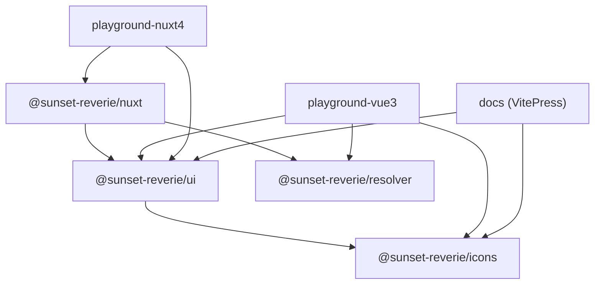
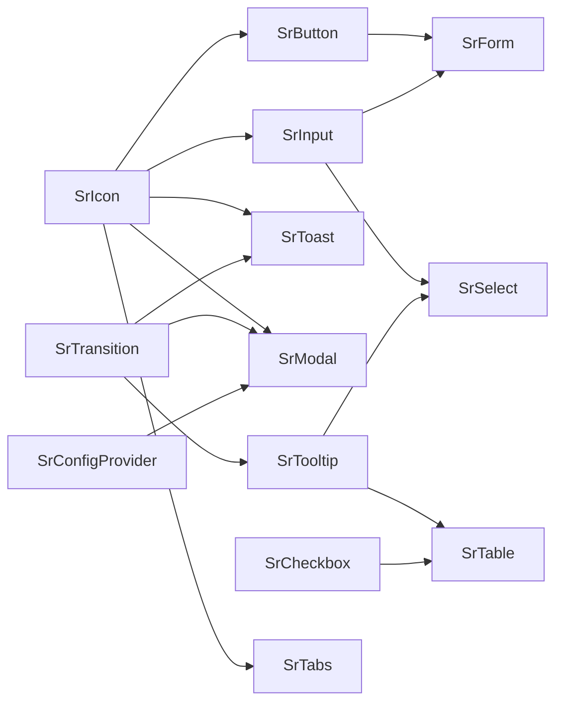
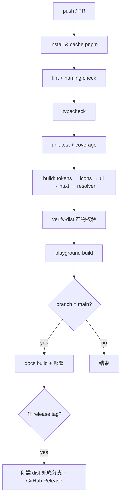

# SunsetReverie-UI（夕梦 UI）开发规划文档

> 品牌：SunsetReverie-UI ／ 中文名：夕梦 UI ／ 缩写：**SR**
> 版本：v0.1（规划稿）　编写日期：2026-11-05　适用周期：第 1 ~ 14 周
> 技术栈：Vue 3 + Nuxt 4 + TypeScript + Less + Vite（库模式）+ pnpm monorepo
> 文档状态：**规划已定稿，待评审**。文中标注「待决策」的条目需在第 1 周评审会上拍板。

---

## 目录

| 章节 | 标题 |
| --- | --- |
| 一 | [项目目标与边界](#一项目目标与边界) |
| 二 | [品牌命名规范（全局强制）](#二品牌命名规范全局强制) |
| 三 | [整体架构与目录结构](#三整体架构与目录结构) |
| 四 | [设计系统与 Token 规范](#四设计系统与-token-规范) |
| 五 | [主题系统详细设计](#五主题系统详细设计) |
| 六 | [响应式自适应系统详细设计](#六响应式自适应系统详细设计) |
| 七 | [动画系统详细设计](#七动画系统详细设计) |
| 八 | [图标方案详细设计](#八图标方案详细设计) |
| 九 | [组件设计规范](#九组件设计规范) |
| 十 | [组件清单与开发优先级](#十组件清单与开发优先级) |
| 十一 | [构建、发布与版本管理](#十一构建发布与版本管理) |
| 十二 | [接入示例（Vite + Vue 3 / Nuxt 4）](#十二接入示例vite--vue-3--nuxt-4) |
| 十三 | [Playground 与文档站建设方案](#十三playground-与文档站建设方案) |
| 十四 | [测试策略与 CI/CD 规划](#十四测试策略与-cicd-规划) |
| 十五 | [里程碑与开发排期](#十五里程碑与开发排期) |
| 十六 | [风险与待决策事项清单](#十六风险与待决策事项清单) |
| 附录 | [附录](#附录) |

---

## 一、项目目标与边界

### 1.1 背景与定位

SunsetReverie-UI 是一套**自用 / 团队内部**的 Vue UI 组件库，服务于团队内的中后台系统、官网与内容站点。它不面向开源社区，**不发布到 NPM 公共仓库**，只托管在私有 Git 仓库，通过 Git 依赖方式被下游项目安装。

定位三个关键词：

| 关键词 | 含义 | 具体约束 |
| --- | --- | --- |
| **内部** | 只服务自己人与少数项目 | 不承诺公开 API 稳定性周期，但内部项目必须可控升级 |
| **黄昏美学** | 视觉语言围绕日落、晚霞、余晖、薄暮 | 品牌色系为暖橙 → 霞紫 → 暮蓝，支持毛玻璃质感 |
| **双端一致** | Vite（纯 SPA/SSG）与 Nuxt 4（SSR/SSG）行为一致 | 所有涉及浏览器环境的逻辑必须 SSR 安全，无水合不匹配告警 |

### 1.2 项目目标（做什么）

1. **一套组件、两处渲染**：同一份组件代码在 Vue 3（Vite）与 Nuxt 4（SSR/SSG）下渲染结果一致，控制台零 hydration mismatch 警告。
2. **完整设计系统**：Token 分层（原始色板 → 语义 → 组件级）、响应式断点与栅格、动效体系全部自研，且以 Less 为唯一样式语言（不引入 Tailwind / UnoCSS）。
3. **四维可切换**：亮/暗模式、主题色、毛玻璃/扁平风格、响应式布局，全部由根属性 + CSS 变量驱动，运行时可切换、可持久化。
4. **按需引入与全量引入双轨**：既支持 `unplugin-vue-components` 自动按需引入，也支持全量 `app.use(SunsetReverieUI)` 且产物可 tree-shake。
5. **可维护的发布链路**：Git tag 即版本，下游可用 `#v1.2.0` 精准锁定，也可回滚，全流程有 CHANGELOG。
6. **文档与示例即测试**：VitePress 文档站的每个示例都来自可运行的示例源码，示例与两个 playground 共享同一份代码。

### 1.3 非目标（不做什么）

明确排除，避免范围蔓延：

| 非目标 | 原因 / 替代方案 |
| --- | --- |
| 不发布到 NPM 公共 registry | 内部使用；git 依赖已足够。如未来需要，再补 `npm publish` 流程 |
| 不做 Tailwind / UnoCSS / CSS-in-JS 方案 | 已定 Less；原子类由自研响应式工具类在 Less 中生成 |
| 不自建图标库、不画 SVG 图标 | 全量依赖 Iconify 生态，见第八章 |
| 不做低代码 / 可视化搭建 / 页面级模板 | 组件库只提供原子与分子级组件 |
| 不做移动端原生 / 小程序适配 | 仅 Web；响应式覆盖移动浏览器但不做端侧框架 |
| 不做 i18n 文案内置 | 组件内文案通过 props 注入，语言包由业务侧提供 |
| 不追求 IE / 旧版 Edge 兼容 | 目标浏览器见 1.4；允许使用 CSS 变量、`:has()` 之外的新特性（`:has()` 仅作渐进增强） |
| 不做设计稿到代码的自动同步（Figma Token 同步） | 一期手工维护 Token；标为 P3 远期 |

### 1.4 目标环境与兼容性基线

| 项 | 基线 |
| --- | --- |
| Vue | `^3.4`（使用 `defineModel`、`defineOptions`） |
| Nuxt | `^4.0` |
| Node | `>= 20.11`；pnpm `>= 9` |
| 浏览器 | Chrome/Edge ≥ 111、Safari ≥ 16.4、Firefox ≥ 128（支持 `oklch`、`color-mix` 可选降级） |
| 类型 | TypeScript `^5.5`，`moduleResolution: bundler` |
| 样式 | Less `^4.2` |
| 包格式 | 仅 ESM（`"type": "module"`），不产出 CJS |

> 不产出 CJS 的决策理由：目标工具链（Vite 5+ / Nuxt 4）均已 ESM 化；双格式会显著增加 exports 映射与类型声明维护成本。若下游出现 Jest CJS 场景，通过 `vitest` 替代，不为 CJS 妥协。

### 1.5 使用方与使用方式

```bash
# 方式一：tag 锁定（推荐生产）
pnpm add github:your-org/sunsetreverie-ui#v1.2.0
# 或
pnpm add git+https://github.com/your-org/sunsetreverie-ui.git#v1.2.0

# 方式二：跟随分支（仅本地调试，禁止用于生产）
pnpm add github:your-org/sunsetreverie-ui#main
```

---

## 二、品牌命名规范（全局强制）

本章是**唯一命名事实来源**。任何代码、类名、变量、配置键、文档命名与本表冲突，一律以本表为准，CI 中设置校验。

### 2.1 命名总览表

| 类别 | 规范 | 正例 | 反例 |
| --- | --- | --- | --- |
| 组件名 | PascalCase，`Sr` 前缀 | `SrButton`、`SrModal`、`SrIcon` | `Button`、`SRButton`、`Srbutton` |
| 标签名 | kebab-case，`sr-` 前缀 | `<sr-button>`、`<sr-modal>` | `<SrButton>`、`<srButton>` |
| 组件文件名 | kebab-case | `button/src/button.vue` | `Button.vue`、`SrButton.vue` |
| 组件目录 | kebab-case，去 `sr-` 前缀 | `packages/ui/src/components/button/` | `components/SrButton/` |
| CSS 变量 | `--sr-*`，分段 kebab-case | `--sr-color-primary`、`--sr-font-size-md`、`--sr-radius-base`、`--sr-glass-blur` | `--primary`、`--srPrimary`、`--SR-color` |
| Less 变量 | `@sr-*` | `@sr-color-primary`、`@sr-breakpoint-md` | `@primary`、`@srColorPrimary` |
| Less mixin | `.sr-` 前缀 + kebab-case + `()` | `.sr-breakpoint-md()`、`.sr-glass-surface()` | `.breakpoint-md()`、`.srButton()` |
| 样式类 | BEM + `sr-` 前缀 | `.sr-button`、`.sr-button__icon`、`.sr-button--primary` | `.srButton`、`.button--primary` |
| 状态类 | `is-` 前缀，挂在块上 | `.sr-button.is-loading`、`.sr-input.is-disabled` | `.sr-button--loading`（与 variant 混淆） |
| 组合式函数 | `useSr*` | `useSrTheme`、`useSrBreakpoint` | `useTheme`、`useSRTheme` |
| 工具函数 | `sr` 小驼峰前缀 | `srMergeClass`、`srToCssVar` | `mergeClass`、`$srMerge` |
| 常量 | `SR_` 前缀 + UPPER_SNAKE | `SR_BREAKPOINTS`、`SR_THEME_KEY` | `BREAKPOINTS` |
| 类型 / 接口 | PascalCase，`Sr` 前缀（组件公共类型） | `SrButtonProps`、`SrSize`、`SrThemeMode` | `ButtonProps`、`IButton` |
| 类型文件 | `types.ts` / `*.d.ts` | `packages/ui/src/types/theme.ts` | `ITheme.ts` |
| 根属性 | `data-sr-*` | `data-sr-theme="light\|dark"`、`data-sr-style="glass\|flat"` | `data-theme`、`sr-theme` |
| 子包名 | `@sunset-reverie/*` | `@sunset-reverie/ui`、`@sunset-reverie/nuxt`、`@sunset-reverie/resolver`、`@sunset-reverie/icons` | `@sunset/ui`、`sunsetreverie-ui` |
| Nuxt 配置键 | camelCase，`sunsetReverie` | `sunsetReverie: { prefix: 'Sr' }` | `sunset-reverie`、`srUI` |
| Resolver 导出 | `SunsetReverieResolver` | `import { SunsetReverieResolver } from '@sunset-reverie/resolver'` | `SrResolver`、`resolver` |
| Nuxt Module 导出 | `default`（`defineNuxtModule`） | `export default defineNuxtModule({ meta: { name: '@sunset-reverie/nuxt' } })` | — |
| 测试文件 | `__tests__/<name>.spec.ts` | `__tests__/button.spec.ts` | `Button.test.ts` |
| 示例文件 | `<component>-<scene>.vue` | `button-basic.vue`、`modal-async.vue` | `Demo1.vue` |
| CHANGELOG 条目 | `type(scope): subject` | `feat(button): 新增 loading 态` | `update button` |

### 2.2 组件命名与注册规则

- 组件 `name` 通过 `defineOptions({ name: 'SrButton' })` 显式声明，禁止依赖文件名推导。
- 全局注册时同时注册 `SrButton` 与 `sr-button` 两种键（Vue 会自动做 kebab 映射，无需手工注册 kebab）。
- 子组件采用**父级命名空间**：`SrFormItem`、`SrTableColumn`、`SrTabsPane`；不使用 `SrFormItemChild` 这类无意义后缀。
- 语义化后缀白名单：`Group` / `Item` / `Pane` / `Column` / `Option` / `Trigger` / `Content`。超出白名单需评审。

### 2.3 CSS 变量命名规则

```
--sr-<域>-<语义>-<变体>[-<状态>]

--sr-color-primary            // 域=color，语义=primary
--sr-color-text-secondary     // 三级：域-语义-变体
--sr-font-size-md
--sr-radius-base
--sr-glass-blur
--sr-motion-duration-base
--sr-shadow-lg
--sr-z-modal
--sr-color-primary-hover      // 组件级扩展：语义-状态
```

规则细节：

1. 全部小写，`-` 连接，**禁止** camelCase、**禁止**数字开头。
2. 数字只允许出现在色板阶数与间距阶数末尾：`--sr-red-500`、`--sr-space-4`。
3. 组件级 token 必须携带组件域：`--sr-button-height-md`，不允许裸 `--sr-height-md` 造成全局污染。
4. 禁止出现 `--sr-` 之外的前缀；禁止使用 `!important` 覆盖 token（用作用域选择器提升优先级）。

### 2.4 BEM 落地细则

```less
// packages/ui/src/components/button/style/index.less
.sr-button {                      // Block
  display: inline-flex;
  height: var(--sr-button-height-md);
  border-radius: var(--sr-radius-base);
  background: var(--sr-button-bg);
  transition: background-color var(--sr-motion-duration-fast) var(--sr-motion-easing-standard);

  &__icon {                       // Element
    margin-inline-end: var(--sr-space-2);
    font-size: 1em;
  }

  &--primary {                    // Modifier（variant）
    --sr-button-bg: var(--sr-color-primary);
    --sr-button-fg: var(--sr-color-on-primary);
  }

  &--lg {                         // Modifier（size）
    height: var(--sr-button-height-lg);
  }

  &.is-loading,                   // State（状态，非变体）
  &.is-disabled {
    cursor: not-allowed;
    opacity: 0.6;
  }
}
```

约束：**Modifier 表达「是什么」，State 表达「此刻怎样」**。`--primary` 是变体，`is-loading` 是状态；两者不可混用同一前缀。

### 2.5 命名规范的自动化校验

命名不能只靠自觉，需三道闸门：

| 闸门 | 工具 | 校验内容 |
| --- | --- | --- |
| 编辑器 / lint | `stylelint` + `stylelint-selector-bem-pattern` + 自定义规则 | 类名必须以 `sr-` 开头、BEM 结构合法 |
| 提交前 | `husky` + `lint-staged` + `scripts/check-naming.mjs` | 组件文件名 kebab、组件 `name` 与目录一致、CSS 变量前缀 |
| CI | `pnpm lint:naming` | 全量扫描，失败即阻断合并 |

```js
// scripts/check-naming.mjs（核心逻辑示意）
import { readdirSync } from 'node:fs'
import { join } from 'node:path'

/** 校验组件目录名与 defineOptions name 是否一致
 * @param {string} dir 组件目录绝对路径
 * @returns {string[]} 违规信息列表
 */
export function checkComponentNaming(dir) {
  const errors = []
  for (const name of readdirSync(dir, { withFileTypes: true })) {
    if (!name.isDirectory()) continue
    // 目录必须 kebab-case
    if (!/^[a-z][a-z0-9]*(-[a-z0-9]+)*$/.test(name.name)) {
      errors.push(`[目录] ${name.name} 不符合 kebab-case`)
    }
    // 目录名转 PascalCase 后必须与 Sr 前缀组件名一致
    const expected = 'Sr' + name.name.split('-').map(s => s[0].toUpperCase() + s.slice(1)).join('')
    // 后续读取 .vue 内 defineOptions({ name }) 比对
    errors.push(...checkVueName(join(dir, name.name), expected))
  }
  return errors
}
```

### 2.6 命名对照速查（供评审与新人使用）

```ts
// 一句话记忆：所有对外暴露的东西都带 sr/Sr，所有内部实现细节都是 kebab-case
import { SrButton, SrModal } from '@sunset-reverie/ui'          // 组件
import { useSrTheme, useSrBreakpoint } from '@sunset-reverie/ui' // 组合式
import type { SrButtonProps, SrThemeMode } from '@sunset-reverie/ui' // 类型
```

```vue
<template>
  <!-- 标签 kebab-case；插槽 kebab-case；事件 kebab-case -->
  <sr-button variant="primary" size="md" :loading="loading" @click="onSubmit">
    <template #icon><sr-icon name="mdi:send" /></template>
    提交
  </sr-button>
</template>
```

---

## 三、整体架构与目录结构

### 3.1 仓库布局

```
sunsetreverie-ui/
├── packages/
│   ├── ui/                     # @sunset-reverie/ui —— 核心组件库
│   ├── nuxt/                   # @sunset-reverie/nuxt —— Nuxt Module
│   ├── resolver/               # @sunset-reverie/resolver —— 按需引入解析器
│   └── icons/                  # @sunset-reverie/icons —— Iconify 封装与离线集合
├── playground-vue3/            # Vite + Vue 3 演示/调试站
├── playground-nuxt4/           # Nuxt 4 演示/调试站（验证 SSR 水合）
├── docs/                       # VitePress 文档站
├── internal/
│   ├── build/                  # 共享构建配置（vite 基础配置、less 注入）
│   └── tokens/                 # Token 单一源（JSON/TS）+ 代码生成脚本
├── scripts/                    # 命名校验、发版、产物检查
├── pnpm-workspace.yaml
├── turbo.json                  # 见 3.4 待决策
├── tsconfig.base.json
└── package.json                # 根：仅 devDependencies 与脚本编排
```

`pnpm-workspace.yaml`：

```yaml
packages:
  - 'packages/*'
  - 'playground-vue3'
  - 'playground-nuxt4'
  - 'docs'
  - 'internal/*'
```

> playground 与 docs 作为 workspace 成员，通过 `workspace:*` 引用本地包。开发期通过 `exports` 条件导出把 `@sunset-reverie/ui` 指向 **源码入口**，实现热更新直连源码（详见 3.5）。

### 3.2 各子包职责

| 子包 | 包名 | 职责 | 允许依赖 |
| --- | --- | --- | --- |
| `ui` | `@sunset-reverie/ui` | 组件、组合式函数、Token、样式、类型；**唯一**产出可运行 UI 的包 | `@sunset-reverie/icons`（peer/optional） |
| `icons` | `@sunset-reverie/icons` | Iconify 客户端封装、离线集合 JSON、`SrIcon` 依赖的图标提供者 | `@iconify/vue` |
| `nuxt` | `@sunset-reverie/nuxt` | Nuxt Module：自动注册组件、注入插件与样式、注册 Vite resolver 插件、处理 SSR 主题脚本 | `@sunset-reverie/ui`、`@sunset-reverie/resolver`、`@nuxt/kit` |
| `resolver` | `@sunset-reverie/resolver` | `unplugin-vue-components` Resolver，把 `<sr-button>` 映射到子路径导入与样式副作用 | 无运行时依赖（仅类型） |

依赖方向（**严格单向，禁止环**）：



> 关键约束：`ui` **不得**依赖 `nuxt` / `resolver`；`resolver` **不得**在运行时代码里 import `ui`（否则按需引入失效）。

### 3.3 `ui` 包内部结构（约定式）

```
packages/ui/
├── src/
│   ├── components/
│   │   ├── button/
│   │   │   ├── src/
│   │   │   │   ├── button.vue
│   │   │   │   └── button-group.vue
│   │   │   ├── style/
│   │   │   │   └── index.less
│   │   │   ├── __tests__/
│   │   │   │   └── button.spec.ts
│   │   │   └── index.ts            # 导出组件 + 类型
│   │   ├── icon/
│   │   ├── row/
│   │   ├── col/
│   │   └── ...
│   ├── composables/
│   │   ├── use-sr-theme.ts
│   │   ├── use-sr-breakpoint.ts
│   │   └── index.ts
│   ├── styles/
│   │   ├── index.less              # 全量入口（base + 全部组件）
│   │   ├── base/                   # reset、token、动画、工具类
│   │   └── mixins/                 # 全部 .sr-* mixin
│   ├── tokens/                     # 由 internal/tokens 生成 + 手写语义层
│   ├── utils/
│   ├── types/
│   └── index.ts                    # 全量导出
├── dist/                           # 构建产物（不入库，CI 构建）
├── vite.config.ts
└── package.json
```

**约定式的好处**：`resolver`、`nuxt module`、样式构建脚本都能靠「目录扫描 + 约定路径」自动生成，不需要手工维护组件清单表。新增组件只需建目录，注册表自动更新。

### 3.4 构建顺序与任务编排

**确定的构建顺序**：

```
internal/tokens（生成 token）
        ↓
      icons
        ↓
       ui
        ↓
   ┌────┴────┐
resolver    nuxt        （nuxt 依赖 ui 的产物 + resolver 的类型，故最后）
```

注意：`nuxt` 包的类型声明会 import `@sunset-reverie/ui` 的类型，因此 `ui` 必须先 `dts` 产出；`playground`、`docs` 依赖全部包，最后启动。

**两种编排方案对比（⏳ 待决策）**：

| 维度 | 方案 A：Turborepo | 方案 B：纯 pnpm `--filter` + 脚本 |
| --- | --- | --- |
| 依赖图感知 | 内置，自动拓扑排序 | 手写 `pnpm -r --filter ...` 顺序 |
| 增量缓存 | 强（本地 + 远程缓存，命中率取决于输入声明） | 无（`pnpm --filter` 无缓存概念） |
| 配置成本 | 中（`turbo.json` 需精确声明 inputs/outputs，否则缓存脏读） | 低（scripts 里写死顺序） |
| monorepo 规模 | 4~10 包非常合适 | 4~10 包也够用 |
| 调试体验 | 缓存命中时输出被折叠，排查需 `--force` | 日志直出，直观 |
| 团队学习成本 | 需理解 task pipeline / `dependsOn` / `^build` | 零学习成本 |
| 最痛的点 | 缓存正确性难保证（Less/TS 隐式依赖容易漏配） | 每次全量构建，随着组件增多变慢 |

**倾向建议：方案 B（纯 pnpm + 明确的 `build` 顺序脚本）作为一期方案，但预留 Turborepo 接入位。**

理由：
1. 当前只有 4 个产出包，全量构建预计 < 30s，增量缓存收益 < 维护成本。
2. 组件数量上来后（P1 完成约 12 个组件），构建时间才会成为问题，届时再引入 Turborepo，只需加 `turbo.json` + 改根 scripts，改动面小。
3. 一期优先保证「产物正确可发布」，而不是「构建快」。

**落地脚本（方案 B）**：

```jsonc
// 根 package.json
{
  "scripts": {
    "dev": "pnpm --filter \"./playground-*\" --parallel dev",
    "dev:vue3": "pnpm --filter playground-vue3 dev",
    "dev:nuxt4": "pnpm --filter playground-nuxt4 dev",
    "dev:docs": "pnpm --filter docs dev",
    "build:tokens": "pnpm --filter @sunset-reverie/internal-tokens build",
    "build:icons": "pnpm run build:tokens && pnpm --filter @sunset-reverie/icons build",
    "build:ui": "pnpm run build:icons && pnpm --filter @sunset-reverie/ui build",
    "build:nuxt": "pnpm run build:ui && pnpm --filter @sunset-reverie/nuxt build",
    "build:resolver": "pnpm run build:ui && pnpm --filter @sunset-reverie/resolver build",
    "build": "pnpm run build:resolver && pnpm run build:nuxt",
    "test": "pnpm -r --filter \"./packages/*\" test",
    "lint": "eslint . --max-warnings=0 && stylelint \"**/*.less\"",
    "lint:naming": "node scripts/check-naming.mjs",
    "typecheck": "pnpm -r --filter \"./packages/*\" typecheck"
  }
}
```

> 若评审选择 Turborepo，则改为：
> ```jsonc
> // turbo.json
> {
>   "tasks": {
>     "build": { "dependsOn": ["^build"], "outputs": ["dist/**"] },
>     "test": { "dependsOn": ["build"], "outputs": [] },
>     "dev": { "cache": false, "persistent": true }
>   }
> }
> ```

### 3.5 源码直连（workspace 热更新）

开发期不希望每次改组件都要先 `build`。两种做法：

**方案 1（推荐）：`publishConfig` + `exports` 条件导出**

```jsonc
// packages/ui/package.json
{
  "name": "@sunset-reverie/ui",
  "type": "module",
  "exports": {
    ".": {
      "development": "./src/index.ts",   // 开发期直连源码，Vite 直接编译 .vue/.less
      "types": "./dist/index.d.ts",
      "default": "./dist/index.js"
    },
    "./style.css": "./dist/style.css",
    "./*": {
      "development": "./src/components/*/index.ts",
      "types": "./dist/components/*/index.d.ts",
      "default": "./dist/components/*/index.js"
    }
  },
  "publishConfig": {
    "exports": {
      ".": { "types": "./dist/index.d.ts", "default": "./dist/index.js" }
    }
  }
}
```

原理：Vite 默认 `resolve.conditions` 包含 `development`（dev 模式），生产构建时为 `production`，因此开发直连源码、生产用产物。**注意**：Git 依赖安装不会走 `publishConfig` 重写（pnpm 不像 npm publish 那样应用），因此下游项目默认拿到的就是上面这份 `exports`——这正好是我们要的：下游如果想直连源码，可以自己加 `resolve.conditions`；默认则命中 `default` 走 `dist`。

> 因此必须保证：**`dist` 产物在 git 仓库中可获取**。两种方式（⏳ 待决策，见 11.9）：`prepare` 脚本在安装时构建 vs 将 `dist` 提交入库。倾向：**`prepare` 脚本 + 私有 registry 缓存**，理由见 11.9。

**方案 2**：Vite `resolve.alias` 手工别名到 `packages/ui/src`。缺点是每个下游都要配，且类型解析需额外 `paths`。仅作兜底。

---

## 四、设计系统与 Token 规范

### 4.1 Token 分层模型

三层，单向依赖，**禁止跨层引用**（组件级不得直接引用原始色板）：

```
┌─────────────────────────────────────────────────────────┐
│ L1 原始层 Primitive    --sr-red-500 / --sr-space-4       │
│    纯数值，无语义，不随主题变化，只由品牌色板决定         │
└───────────────────────┬─────────────────────────────────┘
                        │ 语义映射（随主题/风格变化）
┌───────────────────────▼─────────────────────────────────┐
│ L2 语义层 Semantic     --sr-color-primary                │
│    --sr-color-bg / --sr-color-text / --sr-shadow-md      │
│    由 [data-sr-theme] 与 [data-sr-style] 作用域重定义     │
└───────────────────────┬─────────────────────────────────┘
                        │ 组件内再映射
┌───────────────────────▼─────────────────────────────────┐
│ L3 组件层 Component    --sr-button-bg / --sr-button-height-md │
│    组件 .less 内部声明，默认指向 L2，允许组件内覆写        │
└─────────────────────────────────────────────────────────┘
```

**为什么必须分层**：

- 只改品牌色 → 改 L1 或直接覆盖 L2 的 `--sr-color-primary`，全站生效。
- 改暗色模式 → 只重定义 L2，组件样式零改动。
- 单点覆写 → 业务只需覆写 L2 或 L3 某个变量，不需要 `!important` 打架。

### 4.2 颜色 Token（L1 原始色板）

品牌色系以「黄昏」为意象：暖橙（落日）→ 玫粉（晚霞）→ 霞紫（薄暮）→ 暮蓝（夜临）。

| 色系 | 用途 | 50 | 100 | 200 | 300 | 400 | 500（基准） | 600 | 700 | 800 | 900 | 950 |
| --- | --- | --- | --- | --- | --- | --- | --- | --- | --- | --- | --- | --- |
| `sunset` | 主色（落日橙） | `#FFF4ED` | `#FFE6D5` | `#FFC9A8` | `#FFA877` | `#FF8B52` | **`#FF7A45`** | `#F25C22` | `#CC4512` | `#A3370F` | `#7A290C` | `#451606` |
| `dusk` | 辅色（霞紫） | `#F5F2FA` | `#E8E1F4` | `#D0C4E8` | `#B3A0D9` | `#9580C7` | **`#7A64B5`** | `#634E9C` | `#4E3D7D` | `#3B2E5E` | `#291F42` | `#171128` |
| `ember` | 强调（霞粉） | `#FFF1F3` | `#FFDDE3` | `#FFB8C6` | `#FF8DA4` | `#FF6685` | **`#F5456B`** | `#D42B51` | `#AE1F3F` | `#871831` | `#5F1123` | `#360912` |
| `night` | 中性（暮蓝灰） | `#F7F8FA` | `#EDEFF3` | `#DCE0E8` | `#C2C8D4` | `#9AA2B1` | **`#6E7787`** | `#565E6C` | `#404652` | `#2B3038` | `#1C2027` | `#0F1216` |
| `success` | 成功 | `#EAF7EE` | `#CDEED6` | `#9BDCB0` | `#63C784` | `#3CB25F` | **`#2E9B4E`** | `#227D3D` | `#1A612F` | `#134723` | `#0C2F17` | `#06180C` |
| `warning` | 警告 | `#FFF8E6` | `#FFEDC2` | `#FFDB8A` | `#FFC64D` | `#FFB01F` | **`#E89500`** | `#C07800` | `#985E00` | `#704500` | `#482C00` | `#241600` |
| `danger` | 危险 | `#FFF0F0` | `#FFD9D9` | `#FFB0B3` | `#FF8085` | `#F9555C` | **`#E03137`** | `#BC2228` | `#94191E` | `#6D1216` | `#460B0E` | `#230507` |
| `info` | 信息 | `#EDF5FF` | `#D6E7FF` | `#ADCFFF` | `#7DB2FF` | `#4D94FF` | **`#2578F5`** | `#155ED1` | `#0D47A8` | `#09337D` | `#052154` | `#02102B` |

色板实现建议：L1 直接硬编码十六进制（**不要**用 Less 的 `lighten()/darken()` 计算生成），因为暗色模式下需要重新调色而非线性变暗；设计侧后续可从 Figma 导出同构色板。

### 4.3 字号与行高

| Token | CSS 变量 | 值 | 行高 Token | 行高值 | 用途 |
| --- | --- | --- | --- | --- | --- |
| `xs` | `--sr-font-size-xs` | 12px | `--sr-line-height-xs` | 20px | 辅助说明、徽标 |
| `sm` | `--sr-font-size-sm` | 13px | `--sr-line-height-sm` | 20px | 表格、表单标签 |
| `base` | `--sr-font-size-base` | 14px | `--sr-line-height-base` | 22px | 正文默认 |
| `md` | `--sr-font-size-md` | 16px | `--sr-line-height-md` | 26px | 强调正文、按钮 lg |
| `lg` | `--sr-font-size-lg` | 20px | `--sr-line-height-lg` | 30px | 卡片标题 |
| `xl` | `--sr-font-size-xl` | 24px | `--sr-line-height-xl` | 34px | 区块标题 |
| `2xl` | `--sr-font-size-2xl` | 30px | `--sr-line-height-2xl` | 40px | 页面标题 |
| `3xl` | `--sr-font-size-3xl` | 38px | `--sr-line-height-3xl` | 48px | 首屏标题 |

字体族：

```css
--sr-font-family-base: "Inter", "PingFang SC", "Hiragino Sans GB", "Microsoft YaHei", system-ui, sans-serif;
--sr-font-family-mono: "JetBrains Mono", "SFMono-Regular", Consolas, monospace;
--sr-font-weight-regular: 400;
--sr-font-weight-medium: 500;
--sr-font-weight-semibold: 600;
```

### 4.4 间距

以 4px 为基数，语义化阶数（**不**使用 1~12 的序号，直接用数值，避免「space-3 是 12px 还是 8px」的记忆成本）：

| Token | CSS 变量 | 值 |
| --- | --- | --- |
| 0 | `--sr-space-0` | 0 |
| 0.5 | `--sr-space-0-5` | 2px |
| 1 | `--sr-space-1` | 4px |
| 1.5 | `--sr-space-1-5` | 6px |
| 2 | `--sr-space-2` | 8px |
| 3 | `--sr-space-3` | 12px |
| 4 | `--sr-space-4` | 16px |
| 5 | `--sr-space-5` | 20px |
| 6 | `--sr-space-6` | 24px |
| 8 | `--sr-space-8` | 32px |
| 10 | `--sr-space-10` | 40px |
| 12 | `--sr-space-12` | 48px |
| 16 | `--sr-space-16` | 64px |

### 4.5 圆角

| Token | CSS 变量 | 值 | 用途 |
| --- | --- | --- | --- |
| `none` | `--sr-radius-none` | 0 | 表格单元格 |
| `sm` | `--sr-radius-sm` | 2px | 标签 |
| `base` | `--sr-radius-base` | 6px | 按钮、输入框（默认） |
| `md` | `--sr-radius-md` | 8px | 卡片 |
| `lg` | `--sr-radius-lg` | 12px | 弹层（flat） |
| `xl` | `--sr-radius-xl` | 16px | 弹层（glass） |
| `2xl` | `--sr-radius-2xl` | 24px | 大面板 |
| `full` | `--sr-radius-full` | 9999px | 圆形、胶囊 |

> `--sr-radius-base` 是**可变 token**：`flat` 风格下 = 6px，`glass` 风格下 = 12px。这是风格差异的抓手之一，因此组件必须用 `var(--sr-radius-base)` 而非硬编码 6px。

### 4.6 阴影

两套语义阴影（glass 用「高扩散 + 低不透明度」制造悬浮感，flat 用「紧凑 + 硬边」表达层次）：

| Token | `flat` 值 | `glass` 值 |
| --- | --- | --- |
| `--sr-shadow-none` | `none` | `none` |
| `--sr-shadow-sm` | `0 1px 2px rgba(16,20,26,.06)` | `0 2px 8px rgba(16,20,26,.06)` |
| `--sr-shadow-md` | `0 2px 8px rgba(16,20,26,.08)` | `0 8px 24px -6px rgba(16,20,26,.12)` |
| `--sr-shadow-lg` | `0 8px 24px rgba(16,20,26,.10)` | `0 16px 48px -12px rgba(16,20,26,.18)` |
| `--sr-shadow-xl` | `0 16px 48px rgba(16,20,26,.14)` | `0 32px 80px -16px rgba(16,20,26,.24)` |
| `--sr-shadow-focus` | `0 0 0 3px var(--sr-color-primary-alpha-25)` | `0 0 0 3px var(--sr-color-primary-alpha-35)` |
| `--sr-shadow-inset` | `inset 0 1px 0 rgba(255,255,255,.6)` | `inset 0 1px 0 rgba(255,255,255,.24)` |

**暗色阴影必须补偿**（上表仅给亮色值）：暗底上 `rgba(16,20,26,.06)` 几乎不可见，需改用黑色系并提高不透明度：

| Token | `dark + flat` | `dark + glass` |
| --- | --- | --- |
| `--sr-shadow-sm` | `0 1px 2px rgba(0,0,0,.5)` | `0 2px 8px rgba(0,0,0,.5)` |
| `--sr-shadow-md` | `0 2px 8px rgba(0,0,0,.5)` | `0 10px 28px -8px rgba(0,0,0,.6)` |
| `--sr-shadow-lg` | `0 8px 24px rgba(0,0,0,.55)` | `0 18px 52px -14px rgba(0,0,0,.7)` |
| `--sr-shadow-xl` | `0 16px 48px rgba(0,0,0,.6)` | `0 34px 84px -18px rgba(0,0,0,.8)` |

> ⚠️ **必须用「主题 + 风格」交叉选择器，且写在风格层之后**：
> ```less
> [data-sr-theme='dark'][data-sr-style='flat']  { --sr-shadow-md: 0 2px 8px rgba(0,0,0,.5); ... }
> [data-sr-theme='dark'][data-sr-style='glass'] { --sr-shadow-md: 0 10px 28px -8px rgba(0,0,0,.6); ... }
> ```
> 若只写在 `[data-sr-theme='dark']` 里，会被后面的 `[data-sr-style='flat'|'glass']` 覆盖——两组选择器特异性相同（均为 class 级），后写者胜出。这个坑在 Token Gallery 首版实现时实际踩到过。

### 4.7 毛玻璃专项 Token

| Token | `flat` 值 | `glass` 值 | 说明 |
| --- | --- | --- | --- |
| `--sr-glass-blur` | `0px` | `16px` | `backdrop-filter: blur()` 强度 |
| `--sr-glass-saturate` | `100%` | `180%` | 饱和度增强，让毛玻璃不发灰 |
| `--sr-glass-filter` | `none` | `blur(16px) saturate(180%)` | 前两者的合成值，组件直接用这个 |
| `--sr-glass-border-width` | `1px` | `1px` | 边框宽度（glass 用高光边框） |
| `--sr-glass-border-color` | `var(--sr-color-border)` | `rgba(255,255,255,.55)` | 顶部高光边 |
| `--sr-glass-highlight` | `0 0 0 0 transparent` | `inset 0 1px 0 rgba(255,255,255,.55)` | 内高光（flat 用零尺寸透明阴影占位，不能写 `none`） |
| `--sr-shadow-glow-blur` | `0px` | `22px` | 彩色辉光半径，flat 下为 0 自然消失 |

#### 彩色辉光（glow）

玻璃质感里必不可少的一层：**实心按钮向外散发与自身同色的柔光**，像玻璃在发光。缺了它，玻璃按钮和扁平按钮几乎没有区别。

实现要点是把「颜色」和「强度」都做成变量，组件不判断风格：

```less
.sr-button {
  // 发光源色：由变体决定，text / secondary 不设即为 transparent（不发光）
  --sr-button-accent: transparent;

  box-shadow:
    0 6px var(--sr-shadow-glow-blur, 0px) -6px
      color-mix(in oklab, var(--sr-button-accent) var(--sr-button-glow-strength, 55%), transparent),
    0 2px calc(var(--sr-shadow-glow-blur, 0px) * 0.4) -2px
      color-mix(in oklab, var(--sr-button-accent) var(--sr-button-glow-strength, 55%), transparent);

  &:hover:not(:disabled) { --sr-button-glow-strength: 78%; }
  &:active:not(:disabled) { --sr-button-glow-strength: 42%; }
}
```

三个设计决策：

1. **用 `color-mix` 而非硬编码 rgba**：运行期切换主题色后辉光自动跟随，不需要 JS 重新计算。
2. **用半径为 0 而非 `box-shadow: none`**：flat 下多值 box-shadow 仍然合法，避免写风格分支。
3. **只给 primary / danger / outline 设置 accent**：secondary 与 text 加彩色光会显得脏，保持中性。

> 发光半径与强度（22px / 55%）是视觉参数，建议在浏览器里调 `--sr-shadow-glow-blur` 试手感后再定稿。

暗色下 glass 需反转：`--sr-glass-border-color: rgba(255,255,255,.14)`，`--sr-glass-highlight: inset 0 1px 0 rgba(255,255,255,.08)`。

#### 毛玻璃生效的三个必要条件（W5 实测踩坑）

早期版本切到 glass 后「只有边框和圆角变了」，模糊完全看不见。原因是四个问题叠加，属于**必要条件缺一即失效**：

| 条件 | 缺失时的表现 | 落地位置 |
| --- | --- | --- |
| ① 表面背景必须**半透明** | `backdrop-filter` 背后透不过任何东西，模糊等于没写 | `glassSurfaceLight/Dark` 把 `--sr-color-bg-container` 改为 `rgba(...,0.72)` |
| ② 必须声明 `backdrop-filter` | 半透明但没有模糊，只是「变透」不是「磨砂」 | `.sr-glass-layer()` mixin，组件按需调用 |
| ③ 背后必须有**可模糊的内容** | 纯色背景下看不出任何差异（最容易被忽略） | 演示站/业务页的背景需要有渐变、图片或纹理 |

> 还有一个反面教训：早期定义过 `--sr-glass-opacity` 但全项目零使用 —— 变量定义了却没人读，会让实现者误以为「调透明度就能出效果」。已在 W5 移除，改为在语义层直接给出半透明表面色。

**组件内的标准写法**：

```less
.sr-glass-layer() {
  backdrop-filter: var(--sr-glass-filter);
  -webkit-backdrop-filter: var(--sr-glass-filter);
}

.sr-input {
  // 背景在 glass 下是半透明的，需要这一层才有磨砂感
  .sr-glass-layer();
}
```

注意 `--sr-glass-highlight` 在 flat 下必须是 `0 0 0 0 transparent` 而非 `none`：它要参与 `box-shadow: var(--sr-shadow-sm), var(--sr-glass-highlight)` 的多值拼接，`none` 会让整条声明非法。

### 4.8 动效 Token

| 类别 | Token | 值 |
| --- | --- | --- |
| 时长 | `--sr-motion-duration-instant` | 0ms |
| | `--sr-motion-duration-fast` | 120ms |
| | `--sr-motion-duration-base` | 240ms |
| | `--sr-motion-duration-slow` | 360ms |
| | `--sr-motion-duration-slower` | 520ms |
| 缓动 | `--sr-motion-easing-standard` | `cubic-bezier(0.2, 0, 0, 1)` |
| | `--sr-motion-easing-decelerate` | `cubic-bezier(0, 0, 0.2, 1)`（进场） |
| | `--sr-motion-easing-accelerate` | `cubic-bezier(0.4, 0, 1, 1)`（出场） |
| | `--sr-motion-easing-spring` | `cubic-bezier(0.34, 1.56, 0.64, 1)`（回弹） |
| | `--sr-motion-easing-linear` | `linear` |
| 位移 | `--sr-motion-distance-sm` | 6px |
| | `--sr-motion-distance-md` | 12px |
| | `--sr-motion-distance-lg` | 24px |

### 4.9 层级与边框

| Token | 值 | 用途 |
| --- | --- | --- |
| `--sr-z-base` | 0 | 常规文档流 |
| `--sr-z-sticky` | 100 | 吸顶头 |
| `--sr-z-dropdown` | 1000 | 下拉、Select 面板 |
| `--sr-z-mask` | 2000 | 遮罩 |
| `--sr-z-modal` | 2001 | 弹窗 |
| `--sr-z-popover` | 2100 | 气泡卡片（可高于弹窗） |
| `--sr-z-toast` | 3000 | 全局提示 |
| `--sr-z-tooltip` | 3100 | Tooltip 最高 |

边框宽度：`--sr-border-width: 1px`、`--sr-border-width-thick: 2px`；边框色：`--sr-color-border`、`--sr-color-border-strong`、`--sr-color-border-subtle`。

### 4.10 Less 变量 ↔ CSS 变量映射机制（核心设计）

**分工原则（必须牢记）**：

| 场景 | 用 Less 变量 | 用 CSS 变量 |
| --- | --- | --- |
| 媒体查询断点值 | ✅ 必须（`@media` 不支持 `var()`） | ❌ 不可行 |
| 编译期数学计算（`@sr-space-4 * 2`） | ✅ | ❌ |
| 需要运行时切换的值（颜色、阴影、圆角、模糊） | ❌ | ✅ 必须 |
| 主题 / 风格差异 | ❌ | ✅ |
| 循环生成工具类 | ✅（Less 的 `each`） | 生成的属性值可用 CSS 变量 |

一句话：**Less 变量负责「编译期结构」，CSS 变量负责「运行期皮肤」**。

**映射表（节选，完整表由 `internal/tokens` 生成）**：

| 语义 | Less 变量（编译期） | CSS 变量（运行期） | 是否随主题变 |
| --- | --- | --- | --- |
| 主色 | `@sr-color-primary`（仅供 Less 内计算，值为 `var()` 无法参与运算，故保留十六进制常量） | `--sr-color-primary` | ✅ |
| 主色悬停 | — | `--sr-color-primary-hover` | ✅ |
| 正文色 | — | `--sr-color-text` | ✅ |
| 次级文本 | — | `--sr-color-text-secondary` | ✅ |
| 页面背景 | — | `--sr-color-bg-page` | ✅ |
| 容器背景 | — | `--sr-color-bg-container` | ✅ |
| 字号 md | `@sr-font-size-md: 16px` | `--sr-font-size-md` | ❌（不随主题变） |
| 间距 4 | `@sr-space-4: 16px` | `--sr-space-4` | ❌ |
| 圆角 base | `@sr-radius-base: 6px` | `--sr-radius-base` | ✅（glass 覆盖为 12px） |
| 阴影 md | — | `--sr-shadow-md` | ✅ |
| 毛玻璃模糊 | — | `--sr-glass-blur` | ✅（flat 为 0） |
| 断点 md | `@sr-breakpoint-md: 768px` | `--sr-breakpoint-md: 768px`（供 JS 读取时无法用，需 TS 常量） | ❌ |
| 动效时长 base | `@sr-motion-duration-base: 240ms` | `--sr-motion-duration-base` | ❌ |
| 层级 modal | `@sr-z-modal: 2001` | `--sr-z-modal` | ❌ |

**关键陷阱提醒**：

1. **CSS 变量不能用于媒体查询**：`@media (min-width: var(--sr-breakpoint-md))` ❌。断点必须走 Less 变量。
2. **CSS 变量不能参与 Less 运算**：`@sr-space-4 * 2` 里若 `@sr-space-4: var(--sr-space-4)` 会输出 `var(--sr-space-4) * 2`（无效）。所以**用于计算的 Less 变量必须保留原始数值**，同时另生成同值 CSS 变量。
3. **`backdrop-filter` 在 flat 下要设为 `none` 而不是 `blur(0)`**：`blur(0)` 仍会创建合成层，带来性能开销与文本模糊。
4. **`var()` 的 fallback 用于渐进增强**：`backdrop-filter: var(--sr-glass-filter, none)`。

**Token 单一源与代码生成**：

`internal/tokens/src/tokens.ts` 是唯一手写文件，其余全部生成：

```ts
// internal/tokens/src/tokens.ts —— 唯一手写 Token 源
/**
 * 断点定义（Token 中的结构型数据，会同时生成 Less 变量、CSS 变量与 TS 常量）
 * 单位统一 px，JS 侧与 CSS 侧共用同一份数值，杜绝「JS 说 md=768，CSS 说 769」的错位
 */
export const breakpoints = {
  xs: 0,
  sm: 576,
  md: 768,
  lg: 992,
  xl: 1200,
} as const

/** 间距阶梯（px），数组顺序即生成顺序 */
export const spacings = [0, 2, 4, 6, 8, 12, 16, 20, 24, 32, 40, 48, 64] as const

/** 字号阶梯 */
export const fontSizes = { xs: 12, sm: 13, base: 14, md: 16, lg: 20, xl: 24, '2xl': 30, '3xl': 38 } as const

/** 动效时长（ms） */
export const durations = { instant: 0, fast: 120, base: 240, slow: 360, slower: 520 } as const

/** 缓动曲线 */
export const easings = {
  standard: 'cubic-bezier(0.2, 0, 0, 1)',
  decelerate: 'cubic-bezier(0, 0, 0.2, 1)',
  accelerate: 'cubic-bezier(0.4, 0, 1, 1)',
  spring: 'cubic-bezier(0.34, 1.56, 0.64, 1)',
  linear: 'linear',
} as const
```

生成产物三份：

| 产物 | 路径 | 消费方 |
| --- | --- | --- |
| Less 变量 | `packages/ui/src/tokens/generated/vars.less` | 所有组件 `.less` |
| CSS 变量 | `packages/ui/src/styles/base/tokens.css`（+ 主题覆盖） | 运行时 |
| TS 常量与类型 | `packages/ui/src/tokens/generated/index.ts` | `useSrBreakpoint`、JS 逻辑 |

```bash
# internal/tokens 的构建脚本（tsx 执行）
pnpm --filter @sunset-reverie/internal-tokens build
# 输出：
#   packages/ui/src/tokens/generated/vars.less
#   packages/ui/src/tokens/generated/index.ts
#   packages/ui/src/styles/base/tokens.css
```

```ts
// internal/tokens/scripts/build.ts（核心逻辑）
import { writeFileSync } from 'node:fs'
import { breakpoints, spacings, fontSizes, durations, easings } from '../src/tokens'

/**
 * 生成 Less 变量文件
 * @returns {string} Less 源码内容
 */
function genLess() {
  const lines = ['// 该文件由 internal/tokens 自动生成，请勿手改', '']
  for (const [k, v] of Object.entries(breakpoints)) lines.push(`@sr-breakpoint-${k}: ${v}px;`)
  for (const [k, v] of Object.entries(fontSizes)) lines.push(`@sr-font-size-${k}: ${v}px;`)
  for (const [k, v] of Object.entries(durations)) lines.push(`@sr-motion-duration-${k}: ${v}ms;`)
  for (const [k, v] of Object.entries(easings)) lines.push(`@sr-motion-easing-${k}: ${v};`)
  const spaceMap = { 0: '0', 2: '0-5', 4: '1', 6: '1-5', 8: '2', 12: '3', 16: '4', 20: '5', 24: '6', 32: '8', 40: '10', 48: '12', 64: '16' }
  for (const s of spacings) lines.push(`@sr-space-${spaceMap[s]}: ${s}px;`)
  return lines.join('\n')
}

/**
 * 生成 TS 常量，供 JS 侧断点判断复用
 * @returns {string} TS 源码内容
 */
function genTs() {
  return `// 该文件由 internal/tokens 自动生成，请勿手改
export const SR_BREAKPOINTS = ${JSON.stringify(breakpoints, null, 2)} as const
export type SrBreakpoint = keyof typeof SR_BREAKPOINTS
export const SR_BREAKPOINT_KEYS = ['xs', 'sm', 'md', 'lg', 'xl'] as const
export const SR_MOTION_DURATIONS = ${JSON.stringify(durations, null, 2)} as const
`
}

writeFileSync('../../packages/ui/src/tokens/generated/vars.less', genLess())
writeFileSync('../../packages/ui/src/tokens/generated/index.ts', genTs())
```

> ⚠️ CSS 变量的完整清单建议**手写**在 `styles/base/tokens.css` 中（因为包含大量主题/风格差异值，自动生成收益低），只有 Less 变量与 TS 常量自动生成。这是「生成结构、手写皮肤」的折中。

### 4.11 Token 视觉验证页（Token Gallery）

**要解决的问题**：Token 目前只以表格和十六进制值的形式存在，评审时无法判断「这套色板好不好看、字号层级够不够、glass 与 flat 差多少」。等组件写完再发现问题，改 Token 就是全站返工。

**定位（重要）**：它是**只读的视觉验收页**，不是设计稿。不做 Figma 稿件、不做组件外观设计、不做可编辑的 Token 编辑器——那三条都在 1.3 非目标里。

| 项 | 状态 | 落地位置 |
| --- | --- | --- |
| 页面模板 | ✅ | `internal/tokens/template/gallery.html`（含 10 个注入占位符） |
| 生成器 | ✅ | `internal/tokens/scripts/build-gallery.ts` |
| 产物 | ✅ | `docs/public/token-gallery.html`（生成物，不入库） |
| 触发命令 | ✅ | `pnpm build:gallery` |
| 前端交互 | ✅ | 明暗切换、风格切换、点击复制变量名、滚动定位 |

> 数据源：L1 来自 `tokens.ts`，L2 与质感层来自 `semantic.ts`。页面自身 UI 只消费 `var(--sr-*)`，因此它同时是 Token 可用性的活体验证。

**页面结构（9 个区块）**：

| 编号 | 区块 | 展示内容 | 验收什么 |
| --- | --- | --- | --- |
| 00 | 分层模型 | L1 → L2 → L3 依赖关系 | 命名与分层是否被理解 |
| 01 | 原始色板 | 8 色系 × 11 阶，每格标注 WCAG 对比度 | 色阶是否均匀、深浅是否够用 |
| 02 | 语义色映射 | 当前主题下的解析值 + light/dark 对照表 | L1/L2 分工是否正确 |
| 03 | 字号阶梯 | 8 档真实渲染 + 行高 | 层级对比是否足够 |
| 04 | 间距节奏 | 13 档条块，宽度即像素值 | 节奏是否连贯 |
| 05 | 圆角 | flat / glass 两套实时值 | `--sr-radius-base` 可变是否生效 |
| 06 | 阴影层级 | flat / glass 两套，垫底色展示 | 暗色补偿是否正确 |
| 07 | 质感对照 | 同一表面的 flat 与 glass 并排 | 风格差异是否成立 |
| 08 | 升级路径 | 静态版 → 生成版 → 文档站 | 数据源约束是否明确 |

**三条硬约束**：

1. **页面自身样式只用 `var(--sr-*)`，不写死颜色与圆角**。这使页面成为 Token 的第一个消费方——若某个场景变量不够用，会立刻暴露。
2. **值不能成为第二份真相**。静态版允许手写（W1 应急），W2 必须改为从 `tokens.ts` 生成，禁止继续手写十六进制值。
3. **只读**。唯一允许的交互是主题/风格切换、点击复制变量名、滚动定位——不提供数值编辑，避免变成半个设计工具。

**W2 生成方案**：

```
internal/tokens/
├── src/
│   ├── tokens.ts              # 唯一手写源（已有）
│   └── semantic.ts            # 新增：L2 语义映射表（供生成器与 tokens.css 共用）
├── template/
│   └── gallery.html           # 带占位符的模板
└── scripts/
    └── build-gallery.ts       # 生成器
```

`semantic.ts` 需产出四组扁平对象（键名不含 `--sr-` 前缀），分别对应：原始层 `primitives`、语义层亮色 `semanticLight`、语义层暗色 `semanticDark`、质感层 `quality`（圆角 / 阴影 / 玻璃的 flat 与 glass 两组值）。这样 `tokens.css` 与 Gallery 生成器消费的是同一份数据。

生成版输出到 `docs/public/token-gallery.html`（VitePress 静态资源，可直接访问 `/token-gallery.html`），由 `pnpm build:gallery` 触发；产物不入库，与 `dist` 一样视为构建结果。

> W1 曾有一份手写静态版（`夕梦UI-设计Token验证页.html`），在 W2 升级时已删除——两份并存必然出现「一份新一份旧」的假文档，不如直接只留生成版。

模板里用 HTML 注释作为注入点，生成器做字符串替换：

```html
<!-- template/gallery.html -->
<style>
/* @INJECT:L1 */
/* @INJECT:L2_LIGHT */
/* @INJECT:L2_DARK */
/* @INJECT:QUALITY */
</style>
<script>
/* @INJECT:PALETTE_DATA */
</script>
```

```ts
// internal/tokens/scripts/build-gallery.ts
import { readFileSync, writeFileSync } from 'node:fs'
import { resolve } from 'node:path'
import { primitives, semanticLight, semanticDark, quality } from '../src/tokens'

/**
 * 把 Token 对象渲染为 CSS 自定义属性块
 * @param map 键为变量名（不含 --sr- 前缀），值为 CSS 值
 * @param indent 缩进字符串
 * @returns CSS 声明块文本
 */
function toVarBlock(map: Record<string, string>, indent = '  '): string {
  return Object.entries(map)
    .map(([k, v]) => `${indent}--sr-${k}: ${v};`)
    .join('\n')
}

/**
 * 生成 Token Gallery 静态页
 * 目的：让 token 只有一个真相源，页面随 tokens.ts 自动更新
 * @param outFile 输出路径
 */
export function buildGallery(outFile: string): void {
  const template = readFileSync(resolve(__dirname, '../template/gallery.html'), 'utf-8')

  let html = template
    .replace('/* @INJECT:L1 */', toVarBlock(primitives))
    .replace('/* @INJECT:L2_LIGHT */', toVarBlock(semanticLight))
    .replace('/* @INJECT:L2_DARK */', toVarBlock(semanticDark))
    .replace('/* @INJECT:QUALITY */', toVarBlock(quality))
    // 色板只注入结构（字段名与阶数），色值仍由运行期读取 CSS 变量，
    // 避免同一份 hex 在页面里出现两次
    .replace('/* @INJECT:PALETTE_DATA */', `var SERIES = ${JSON.stringify(primitives.__series)};`)

  writeFileSync(outFile, html, 'utf-8')
  console.log(`[tokens] gallery 已生成 → ${outFile}`)
}
```

**两种落地形态对比**：

| 形态 | 做法 | 优点 | 缺点 | 结论 |
| --- | --- | --- | --- | --- |
| A. 生成静态 HTML | 脚本注入模板，产出单文件 | 零依赖、可离线、能直接发给评审、不依赖文档站 | 交互逻辑仍手写 | ✅ W2 采用 |
| B. VitePress 页面 | 做成 Vue 组件，构建期读 token | 与文档站一体、可复用组件 | 依赖文档站，W7 才能用 | 🔶 W7 迁移 |

> B 形态不必重写：把 A 的模板拆成 `TokenPalette.vue` / `TokenTypeScale.vue` 等几个展示组件，数据源仍是同一份生成产物。A → B 是"拆组件"，不是"重做"。

**验收标准**：

- [ ] 页面中不存在硬编码的十六进制颜色值与像素圆角（`grep -E '#[0-9a-f]{6}|border-radius: [0-9]+px'` 应只命中变量声明区）
- [ ] 切换 light/dark 时，L1 色板不变、L2 语义色全变
- [ ] 切换 flat/glass 时，圆角与阴影实时变化，且暗色下阴影可见
- [ ] 每个色块标注的对比度数值与实际计算一致（抽查 3 个）
- [ ] `tokens.ts` 改动后重新生成，页面数值同步变化，无人工介入

---

## 五、主题系统详细设计

### 5.1 四维驱动模型

主题系统由三个根属性 + 一个 JS 状态共同驱动，**所有视觉差异都落在 CSS 变量重定义上**，组件本身不感知主题：

```html
<html
  data-sr-theme="dark"     <!-- light | dark，明暗模式 -->
  data-sr-style="glass"    <!-- glass | flat，质感风格 -->
  data-sr-primary="sunset" <!-- 可选：预设主题色代号，或由内联样式注入变量 -->
  style="--sr-color-primary: #7A64B5"
>
```

| 维度 | 驱动方式 | 生效范围 | 切换成本 |
| --- | --- | --- | --- |
| 明暗模式 | `data-sr-theme` | 全部语义色、阴影、玻璃透明度 | 一次属性写入 |
| 质感风格 | `data-sr-style` | 圆角、阴影、模糊、边框、背景层级 | 一次属性写入 |
| 主题色 | 内联 `--sr-color-primary` 系列派生变量 | 主色及其 hover/active/alpha 派生 | 若干 CSS 变量写入 |
| 响应式 | 媒体查询 + `useSrBreakpoint` | 布局 | 见第六章 |

CSS 作用域组织（**顺序即优先级，后写的覆盖先写的**）：

```css
/* 1. 原始层：始终存在 */
:root { /* L1 色板 + 间距 + 字号 */ }

/* 2. 明暗：只重定义 L2 语义层 */
[data-sr-theme='light'] { --sr-color-bg-page: var(--sr-night-50); ... }
[data-sr-theme='dark']  { --sr-color-bg-page: var(--sr-night-900); ... }

/* 3. 风格：只重定义「质感相关」的 L2 */
[data-sr-style='flat']  { --sr-shadow-md: ...; --sr-glass-blur: 0px; --sr-radius-base: 6px; }
[data-sr-style='glass'] { --sr-shadow-md: ...; --sr-glass-blur: 16px; --sr-radius-base: 12px; }

/* 4. 交叉修正：玻璃 + 暗色 需要单独微调 */
[data-sr-theme='dark'][data-sr-style='glass'] {
  --sr-glass-border-color: rgba(255, 255, 255, 0.14);
  --sr-glass-opacity: 0.6;
}

/* 5. 无 JS / 未初始化兜底：跟随系统 */
@media (prefers-color-scheme: dark) {
  :root:not([data-sr-theme]) { /* 暗色 L2 */ }
}
```

> **为什么不用 `:root[data-sr-theme]` 而是 `[data-sr-theme]`？**
> 因为未来可能需要局部主题（如「深色侧边栏」），作用域选择器不绑死 `:root`，可在任意容器上挂 `data-sr-theme`。组件不应假设属性只在 `html` 上。

### 5.2 明暗模式：状态机与 API

```ts
// packages/ui/src/types/theme.ts
/** 明暗模式：具体值 + 跟随系统 */
export type SrThemeMode = 'light' | 'dark' | 'auto'
/** 实际生效的明暗（auto 解析后的结果） */
export type SrResolvedTheme = 'light' | 'dark'
/** 质感风格 */
export type SrStyleMode = 'glass' | 'flat'
```

`useSrTheme` 是**全局单例状态**（模块级 `ref`），任何组件调用都共享同一份状态：

```ts
// packages/ui/src/composables/use-sr-theme.ts
import { computed, ref, watch, readonly } from 'vue'
import type { SrThemeMode, SrResolvedTheme, SrStyleMode } from '../types/theme'

/** localStorage 存储键（带 sr 前缀，避免与业务键冲突） */
export const SR_THEME_STORAGE_KEY = 'sr-theme'
export const SR_STYLE_STORAGE_KEY = 'sr-style'

/** 模块级单例：全应用共享 */
const mode = ref<SrThemeMode>('auto')
const style = ref<SrStyleMode>('flat')
const systemDark = ref(false)
let initialized = false

/**
 * 读取持久化配置（SSR 环境下返回默认值，不访问 window）
 * @returns {{ mode: SrThemeMode; style: SrStyleMode }} 持久化配置
 */
function readStorage() {
  if (typeof window === 'undefined') return { mode: 'auto' as SrThemeMode, style: 'flat' as SrStyleMode }
  try {
    const m = window.localStorage.getItem(SR_THEME_STORAGE_KEY) as SrThemeMode | null
    const s = window.localStorage.getItem(SR_STYLE_STORAGE_KEY) as SrStyleMode | null
    return {
      mode: m === 'light' || m === 'dark' || m === 'auto' ? m : 'auto',
      style: s === 'glass' || s === 'flat' ? s : 'flat',
    }
  } catch {
    // Safari 隐私模式下 localStorage 可能抛异常
    return { mode: 'auto' as SrThemeMode, style: 'flat' as SrStyleMode }
  }
}

/**
 * 把状态写入 DOM 根属性 —— 这是主题生效的唯一出口
 * @param resolved 解析后的明暗模式
 * @param currentStyle 当前质感风格
 * @returns {void}
 */
function applyToDom(resolved: SrResolvedTheme, currentStyle: SrStyleMode) {
  if (typeof document === 'undefined') return
  const root = document.documentElement
  root.setAttribute('data-sr-theme', resolved)
  root.setAttribute('data-sr-style', currentStyle)
  // 供原生控件（滚动条、表单）跟随
  root.style.colorScheme = resolved
}

/**
 * 主题与风格统一管理
 * @returns 响应式状态与切换方法
 */
export function useSrTheme() {
  const resolved = computed<SrResolvedTheme>(() =>
    mode.value === 'auto' ? (systemDark.value ? 'dark' : 'light') : mode.value,
  )

  /** 初始化：只执行一次，绑定系统主题监听与跨标签页同步 */
  function init() {
    if (initialized || typeof window === 'undefined') return
    initialized = true

    const stored = readStorage()
    mode.value = stored.mode
    style.value = stored.style
    systemDark.value = window.matchMedia('(prefers-color-scheme: dark)').matches

    const mql = window.matchMedia('(prefers-color-scheme: dark)')
    /** 系统主题变化回调（仅在 auto 模式生效） */
    const onSystemChange = (e: MediaQueryListEvent) => {
      systemDark.value = e.matches
    }
    mql.addEventListener('change', onSystemChange)

    // 跨标签页同步：另一个标签页切换主题时本页跟随
    /** 跨标签页 storage 事件回调 */
    const onStorage = (e: StorageEvent) => {
      if (e.key === SR_THEME_STORAGE_KEY && e.newValue) mode.value = e.newValue as SrThemeMode
      if (e.key === SR_STYLE_STORAGE_KEY && e.newValue) style.value = e.newValue as SrStyleMode
    }
    window.addEventListener('storage', onStorage)
  }

  /** 写入 DOM + 持久化（副作用集中在此，便于测试 mock） */
  watch(
    [resolved, style],
    ([r, s]) => {
      applyToDom(r, s)
      if (typeof window === 'undefined') return
      try {
        window.localStorage.setItem(SR_THEME_STORAGE_KEY, mode.value)
        window.localStorage.setItem(SR_STYLE_STORAGE_KEY, s)
      } catch {
        // 忽略写入失败，不影响主题生效
      }
    },
    { immediate: false },
  )

  /**
   * 设置明暗模式
   * @param next 目标模式，'auto' 表示跟随系统
   */
  function setTheme(next: SrThemeMode) { mode.value = next }

  /**
   * 在 light / dark 之间切换（auto 状态下先解析成当前生效值再取反）
   */
  function toggleTheme() { mode.value = resolved.value === 'dark' ? 'light' : 'dark' }

  /** 设置质感风格 */
  function setStyle(next: SrStyleMode) { style.value = next }

  /** 在 glass / flat 之间切换 */
  function toggleStyle() { style.value = style.value === 'glass' ? 'flat' : 'glass' }

  /**
   * 设置主题色（运行期注入 CSS 变量）
   * @param color 任意合法 CSS 颜色，如 '#7A64B5' 或 'oklch(0.6 0.15 280)'
   * @param scope 作用域元素，默认 documentElement
   */
  function setPrimaryColor(color: string, scope?: HTMLElement) {
    const el = scope ?? (typeof document !== 'undefined' ? document.documentElement : null)
    if (!el) return
    const derived = derivePrimaryScale(color)
    for (const [k, v] of Object.entries(derived)) el.style.setProperty(`--sr-color-primary-${k}`, v)
    el.style.setProperty('--sr-color-primary', color)
  }

  return {
    mode: readonly(mode),
    resolved,
    style: readonly(style),
    systemDark: readonly(systemDark),
    init,
    setTheme,
    toggleTheme,
    setStyle,
    toggleStyle,
    setPrimaryColor,
  }
}

/**
 * 由单一主色派生出交互态颜色
 * 采用 color-mix 若浏览器支持，否则退化为固定透明度叠加
 * @param color 主色
 * @returns 派生变量字典，键为 hover / active / alpha-25 等
 */
export function derivePrimaryScale(color: string): Record<string, string> {
  return {
    hover: `color-mix(in oklab, ${color} 88%, white)`,
    active: `color-mix(in oklab, ${color} 84%, black)`,
    'alpha-25': `color-mix(in oklab, ${color} 25%, transparent)`,
    'alpha-12': `color-mix(in oklab, ${color} 12%, transparent)`,
  }
}
```

> `color-mix` 的浏览器支持已覆盖目标基线（Chrome 111 / Safari 16.2 / Firefox 113）。若不支持，`color-mix` 声明会被忽略，此时 `--sr-color-primary-hover` 缺失，需在 `tokens.css` 中给出静态 fallback：`--sr-color-primary-hover: #F25C22`。

### 5.3 SSR 防闪烁（FOUC）机制

**问题**：SSR 返回的 HTML 中 `<html>` 无 `data-sr-theme`，浏览器先用默认（浅色）绘制，随后 JS 读到 localStorage 才切成暗色，用户看到一帧白闪。

**方案**：在 `<head>` 最靠前位置内联一段**阻塞式同步脚本**，在首次绘制前决定属性值。三种接入形态：

**形态 1：Vite + Vue 3（手动）** —— 在 `index.html` 的 `<head>` 最前面插入：

```html
<!doctype html>
<html lang="zh-CN">
  <head>
    <meta charset="UTF-8" />
    <!-- 必须放在所有 CSS/JS 之前，且不能加 defer/async -->
    <script>
      (function () {
        try {
          var d = document.documentElement
          var m = localStorage.getItem('sr-theme') || 'auto'
          var s = localStorage.getItem('sr-style') || 'flat'
          var dark = m === 'dark' || (m === 'auto' && window.matchMedia('(prefers-color-scheme: dark)').matches)
          d.setAttribute('data-sr-theme', dark ? 'dark' : 'light')
          d.setAttribute('data-sr-style', s === 'glass' ? 'glass' : 'flat')
          d.style.colorScheme = dark ? 'dark' : 'light'
        } catch (e) {
          document.documentElement.setAttribute('data-sr-theme', 'light')
          document.documentElement.setAttribute('data-sr-style', 'flat')
        }
      })()
    </script>
    <title>夕梦</title>
  </head>
  <body>
    <div id="app"></div>
    <script type="module" src="/src/main.ts"></script>
  </body>
</html>
```

**形态 2：Nuxt 4（Module 自动注入）** —— 模块内部用 `useHead` 注入脚本，**不需要用户手写**：

```ts
// packages/nuxt/src/runtime/plugin.ts
import { defineNuxtPlugin, useHead } from '#imports'

/**
 * SSR 主题预注入插件
 * 目的：在首次绘制前把 data-sr-theme / data-sr-style 写到 <html>，避免白闪与 hydration 不一致
 */
export default defineNuxtPlugin({
  name: 'sunset-reverie:theme',
  enforce: 'pre',
  setup() {
    useHead({
      script: [
        {
          // key 保证 hydration 时脚本节点可被正确匹配，不产生 mismatch
          key: 'sr-theme-init',
          // 内联脚本用 JSON.stringify 结果做字符串包裹，避免 SSR 转义问题
          innerHTML: THEME_INIT_CODE,
          tagPosition: 'head',
          tagPriority: 'critical',
        },
      ],
    })
  },
})
```

**形态 3：`@unhead/schema` 的 `htmlAttrs` 预置（服务端渲染正确，但有局限）**

```ts
useHead({
  htmlAttrs: {
    'data-sr-theme': 'light',
    'data-sr-style': 'flat',
  },
})
```

局限：服务端拿不到 localStorage，只能给一个**确定值**（通常是 light）。若用户偏好暗色，仍会在客户端切换 → 因为属性值在 hydration 时会变化，Vue 会尽量 patch 而不报错，但仍有闪烁。因此**形态 3 只能作为形态 2 的补充（给出 SSR 期的确定值），不能替代内联脚本**。

**最终组合策略（推荐）**：

| 阶段 | 做什么 |
| --- | --- |
| 服务端渲染 | `htmlAttrs` 输出 `data-sr-theme="light" data-sr-style="flat"`，保证 SSR/CSR 首帧结构一致 |
| 内联脚本 | 在 `head` 最前读取 localStorage 并**改写**属性（此时尚未绘制） |
| 客户端 hydration | `useSrTheme().init()` 在 `onMounted` 前（Nuxt 用 plugin）读取状态，与内联脚本结果对齐，**不再改写属性**（值相同，无 patch） |
| 后续切换 | 用户手动切换，`watch` 写入属性 + 持久化 |

**关于 hydration mismatch 的三条铁律**：

1. **组件渲染输出不得依赖 `window`/`localStorage`/`matchMedia`**。凡依赖浏览器环境的状态，初始值必须是 SSR 与 CSR 都能算出的确定值，之后再更新。
2. **`useSrBreakpoint` 的 SSR 初值必须给定**（默认 `md`，或由 Nuxt 依据 User-Agent 推断，见 6.6），否则首次渲染分支不同即 mismatch。
3. **禁止在 `setup` 顶层直接读 `document`**。所有 DOM 访问放进 `onMounted` / `watchEffect`（后者需 `if (!isClient) return`）。

> **W4 实测：两个真实的水合陷阱**
>
> 在 `playground-nuxt4` 首次跑通 SSR 时，控制台报 `Hydration completed but contains mismatches`。逐项定位后确认是**页面级用法错误**，组件本身没有问题：
>
> | 现象 | 根因 | 修法 |
> | --- | --- | --- |
> | 页面直接渲染 `useSrBreakpoint().width` | SSR 时固定为 `md` 下界 768，客户端首帧读到真实 1200 | 水合完成后再显示，SSR 阶段输出占位符 `—` |
> | 页面直接渲染 `useSrTheme().resolved` | SSR 读不到 `localStorage` 回落 `light`，客户端读到 `dark` | 同上 |
>
> 关键认知：**Token 层做得再对，页面层仍可能踩坑**。这类问题不会抛错，UI 看起来也完全正常，只有水合告警会提示——所以第 1 层测试（见 14.1）不是可选项。
>
> 另一条实践结论：`SrIcon` 的离线集合注册必须放在 `setup` 阶段而非 `onMounted`，否则服务端渲染出空 SVG、客户端再补上，同样触发不匹配。实测 SSR HTML 中能数到 6 个 `<svg>`，即证明服务端已正确渲染图标。

### 5.4 多主题色切换

**预设主题色**（Theme Presets）放在 `ui/src/tokens/themes.ts`：

```ts
/** 预设主题色：代号 → 主色（L2 覆写） */
export const SR_THEME_PRESETS = {
  sunset: { label: '落日橙', primary: '#FF7A45' },
  dusk: { label: '霞紫', primary: '#7A64B5' },
  ember: { label: '余烬红', primary: '#F5456B' },
  night: { label: '暮蓝', primary: '#2578F5' },
  jade: { label: '青苔绿', primary: '#2E9B4E' },
} as const

export type SrThemePreset = keyof typeof SR_THEME_PRESETS
```

**实现路径对比**：

| 路径 | 做法 | 优点 | 缺点 | 结论 |
| --- | --- | --- | --- | --- |
| A. 编译期 Less 变量 | 改 `@sr-color-primary` 重新编译 | 无运行时开销 | 无法运行期切换；下游需重编译 | ❌ 不用于主题色 |
| B. 预置 CSS 类 | `[data-sr-primary='dusk'] { --sr-color-primary: ... }` | 简单、可 SSR | 只能选预置色，无法任意色 | ✅ 用于预置集 |
| C. 运行期内联变量 | `el.style.setProperty('--sr-color-primary', color)` | 支持任意色、支持取色器 | 不可 SSR（服务端不知道用户色）；需派生算法 | ✅ 配合 B 使用，服务端用 `useHead` 注入默认值 |

**推荐：B + C 混合**。预置集走 CSS 属性选择器（SSR 友好），自定义色走内联变量（运行期）。

派生色计算：优先 `color-mix()`（无需 JS 计算），退化时用 JS 解析 hex → HSL 调整明度：

```ts
/**
 * 把十六进制颜色转换为 HSL 分量（color-mix 不支持时的兜底）
 * @param hex 形如 #RRGGBB 或 #RGB
 * @returns {{ h: number; s: number; l: number }} HSL 分量
 * @throws 当格式非法时抛错，由调用方回退到原色
 */
export function srHexToHsl(hex: string): { h: number; s: number; l: number } {
  const m = /^#?([0-9a-f]{3}|[0-9a-f]{6})$/i.exec(hex.trim())
  if (!m) throw new Error(`[sunset-reverie] 非法颜色值: ${hex}`)
  let v = m[1]
  if (v.length === 3) v = v.split('').map(c => c + c).join('')
  const r = parseInt(v.slice(0, 2), 16) / 255
  const g = parseInt(v.slice(2, 4), 16) / 255
  const b = parseInt(v.slice(4, 6), 16) / 255
  const max = Math.max(r, g, b), min = Math.min(r, g, b)
  const l = (max + min) / 2
  const d = max - min
  const s = d === 0 ? 0 : d / (1 - Math.abs(2 * l - 1))
  let h = 0
  if (d !== 0) {
    if (max === r) h = ((g - b) / d) % 6
    else if (max === g) h = (b - r) / d + 2
    else h = (r - g) / d + 4
    h *= 60
    if (h < 0) h += 360
  }
  return { h, s, l }
}
```

### 5.5 毛玻璃 / 扁平两套 Token 的组织

**组织原则**：两套风格**共享同一批变量名**，只覆写值。这样组件样式只写一次，不需要 `if (style === 'glass')` 分支。

```less
/* packages/ui/src/styles/themes/_glass.less */
[data-sr-style='glass'] {
  /* 质感 */
  --sr-glass-blur: 16px;
  --sr-glass-saturate: 180%;
  --sr-glass-opacity: 0.72;
  --sr-glass-filter: blur(var(--sr-glass-blur)) saturate(var(--sr-glass-saturate));
  --sr-radius-base: 12px;
  --sr-radius-md: 14px;
  --sr-radius-lg: 18px;
  --sr-radius-xl: 22px;

  /* 光影：高扩散、低不透明度，制造悬浮 */
  --sr-shadow-sm: 0 2px 8px rgba(16, 20, 26, 0.06);
  --sr-shadow-md: 0 8px 24px -6px rgba(16, 20, 26, 0.12);
  --sr-shadow-lg: 0 16px 48px -12px rgba(16, 20, 26, 0.18);

  /* 背景层级：半透明 + 高光边框 */
  --sr-color-bg-container: rgba(255, 255, 255, var(--sr-glass-opacity));
  --sr-color-bg-elevated: rgba(255, 255, 255, 0.82);
  --sr-color-bg-sunken: rgba(247, 248, 250, 0.6);
  --sr-color-border: rgba(255, 255, 255, 0.55);
  --sr-color-border-subtle: rgba(255, 255, 255, 0.35);
  --sr-glass-highlight: inset 0 1px 0 rgba(255, 255, 255, 0.55);
}

/* packages/ui/src/styles/themes/_flat.less */
[data-sr-style='flat'] {
  --sr-glass-blur: 0px;
  --sr-glass-saturate: 100%;
  --sr-glass-opacity: 1;
  /* 关键：flat 下用 none 而非 blur(0)，避免创建无效合成层 */
  --sr-glass-filter: none;
  --sr-radius-base: 6px;
  --sr-radius-md: 8px;
  --sr-radius-lg: 12px;
  --sr-radius-xl: 16px;

  --sr-shadow-sm: 0 1px 2px rgba(16, 20, 26, 0.06);
  --sr-shadow-md: 0 2px 8px rgba(16, 20, 26, 0.08);
  --sr-shadow-lg: 0 8px 24px rgba(16, 20, 26, 0.1);

  --sr-color-bg-container: #ffffff;
  --sr-color-bg-elevated: #ffffff;
  --sr-color-bg-sunken: var(--sr-night-50);
  --sr-color-border: var(--sr-night-200);
  --sr-color-border-subtle: var(--sr-night-100);
  --sr-glass-highlight: none;
}
```

**统一 mixin 抹平差异**（组件只需调用 mixin，不关心当前风格）：

```less
/* packages/ui/src/styles/mixins/_surface.less */

/**
 * 生成「容器表面」样式：自动适配 glass / flat 两套 token
 * @param @level 层级：page | container | elevated | sunken，默认 container
 */
.sr-surface(@level: container) {
  background: ~'var(--sr-color-bg-@{level})';
  border: var(--sr-glass-border-width) solid var(--sr-color-border);
  border-radius: var(--sr-radius-base);
  box-shadow: var(--sr-shadow-sm), var(--sr-glass-highlight);
  /* flat 下 var(--sr-glass-filter) = none，声明合法且不产生合成层 */
  backdrop-filter: var(--sr-glass-filter);
  -webkit-backdrop-filter: var(--sr-glass-filter);
}

/**
 * 毛玻璃弹层：在 surface 基础上加强模糊与阴影
 */
.sr-glass-surface() {
  .sr-surface(elevated);
  backdrop-filter: var(--sr-glass-filter);
  box-shadow: var(--sr-shadow-lg), var(--sr-glass-highlight);
}
```

> **性能提醒**：`backdrop-filter` 是昂贵的。约束：① 单屏内毛玻璃元素 ≤ 5 个；② 不要在 `overflow: auto` 的滚动容器内嵌套多层毛玻璃；③ 弹窗打开时对背景内容加 `.is-scroll-locked` 而非再加毛玻璃；④ flat 模式下必须为 `none`。

### 5.6 暗色模式下的语义色映射表（关键片段）

| 语义 Token | light | dark |
| --- | --- | --- |
| `--sr-color-bg-page` | `--sr-night-50` (#F7F8FA) | `--sr-night-950` (#0F1216) |
| `--sr-color-bg-container` | `#FFFFFF` | `--sr-night-900` (#1C2027) |
| `--sr-color-bg-elevated` | `#FFFFFF` | `--sr-night-800` (#2B3038) |
| `--sr-color-bg-sunken` | `--sr-night-100` | `#0B0E12` |
| `--sr-color-text` | `--sr-night-900` | `--sr-night-50` |
| `--sr-color-text-secondary` | `--sr-night-600` | `--sr-night-300` |
| `--sr-color-text-tertiary` | `--sr-night-400` | `--sr-night-500` |
| `--sr-color-border` | `--sr-night-200` | `--sr-night-700` |
| `--sr-color-primary` | `--sr-sunset-500` | `--sr-sunset-400`（暗底需提亮） |
| `--sr-color-on-primary` | `#FFFFFF` | `#1A0E05`（暗底上浅橙配深字） |
| `--sr-color-mask` | `rgba(16,20,26,.45)` | `rgba(0,0,0,.65)` |

> 暗色模式下**主色必须提亮一阶**（500 → 400），否则在深色背景上对比度不足，这是暗色主题最常见的失误。

---

## 六、响应式自适应系统详细设计

### 6.1 断点体系

| 代号 | 最小宽度 | 典型设备 | 栅格列数 | 容器最大宽 |
| --- | --- | --- | --- | --- |
| `xs` | 0 | 手机竖屏 | 4 | 100% - 32px |
| `sm` | 576px | 手机横屏 / 小平板 | 8 | 540px |
| `md` | 768px | 平板 | 12 | 720px |
| `lg` | 992px | 笔记本 | 12 | 960px |
| `xl` | 1200px | 桌面 | 12 | 1140px |

**设计要点**：

1. **移动优先**：所有 mixin 默认 `min-width`（向上覆盖），代码更少、冲突更少。
2. **只在需要的地方降级**：`md` 以下用 4/8 列，`md` 及以上用 12 列，避免为每个断点都写一套。
3. **断点仅 5 个**，不设 `2xl`。若要超宽屏优化，用 `@media (min-width: 1440px)` 的 `xl-plus` mixin（标为可选，不进主体系）。
4. **不绑定设备**：断点只描述「可用宽度」，不描述「是不是手机」。

### 6.2 Less mixin 设计（核心 API）

```less
/* packages/ui/src/styles/mixins/_breakpoint.less */
@import '../../tokens/generated/vars.less';

/**
 * 向上匹配断点（移动优先）
 * @param @bp 断点代号：xs | sm | md | lg | xl
 * 用法：.sr-breakpoint-md({ display: flex; });
 */
.sr-breakpoint-up(@bp) {
  @min: ~'@sr-breakpoint-@{bp}';
  @media (min-width: @@min) { @{arguments}(); }
}

/**
 * 向下匹配断点（max-width，减 0.02px 避免与上一条重叠）
 * @param @bp 断点代号
 */
.sr-breakpoint-down(@bp) {
  @min: ~'@sr-breakpoint-@{bp}';
  @max: (@@min - 0.02px);
  @media (max-width: @max) { @{arguments}(); }
}

/**
 * 区间匹配（含下界、不含上界）
 * @param @from 起始断点
 * @param @to 结束断点
 */
.sr-breakpoint-between(@from, @to) {
  @a: ~'@sr-breakpoint-@{from}';
  @b: ~'@sr-breakpoint-@{to}';
  @max: (@@b - 0.02px);
  @media (min-width: @@a) and (max-width: @max) { @{arguments}(); }
}

/**
 * 常用语义 mixin：仅在移动端生效（xs ~ sm 之间）
 */
.sr-breakpoint-mobile(@rules) {
  .sr-breakpoint-down(md, @rules);
}

/**
 * 常用语义 mixin：仅在桌面端生效（md 及以上）
 */
.sr-breakpoint-desktop(@rules) {
  .sr-breakpoint-up(md, @rules);
}
```

调用示例：

```less
.sr-table {
  font-size: var(--sr-font-size-sm);

  /* 移动端：隐藏次要列 */
  .sr-breakpoint-down(md, {
    .sr-table__cell--optional { display: none; }
  });

  /* 桌面端：加大行高 */
  .sr-breakpoint-up(lg, {
    .sr-table__cell { padding-block: var(--sr-space-3); }
  });
}
```

> **陷阱**：Less 的 mixin 传「规则集」时要用 `{ }`（detached ruleset），且必须 `@{arguments}()` 调用。若写成 `.sr-breakpoint-up(md); { ... }` 是**语法错误但不报错**（Less 会静默忽略），务必用 lint 检查。

### 6.3 CSS 变量 / Less 变量 / JS 常量三侧协同

| 侧 | 用途 | 数据源 |
| --- | --- | --- |
| Less `@sr-breakpoint-md` | 生成媒体查询 | 生成文件 |
| CSS `--sr-breakpoint-md` | 供 JS 读取？**不可靠**（`getComputedStyle` 读自定义属性可读，但 `@media` 不能用） | 生成文件 |
| TS `SR_BREAKPOINTS.md` | `useSrBreakpoint` 的 `matchMedia` 判断 | 生成文件 |

**统一出口**：`SR_BREAKPOINTS` 是唯一数值源，三份产物由脚本同时生成（见 4.10）。**禁止**在 `.less` / `.ts` 里硬编码 `768`。

### 6.4 响应式工具类（自研，非 Tailwind）

工具类命名：`.sr-<属性缩写>-<断点>-<值>`，仅在需要的断点生成，控制产物体积。

```less
/* packages/ui/src/styles/base/utilities.less */
@import '../mixins/_breakpoint.less';

/* 断点循环：为 sm/md/lg/xl 生成 display / flex 方向 / 间距变体 */
@sr-utility-breakpoints: sm, md, lg, xl;

each(@sr-utility-breakpoints, {
  /* display */
  .sr-d-@{value}-none  { .sr-breakpoint-up(@value, { display: none !important; }); }
  .sr-d-@{value}-block { .sr-breakpoint-up(@value, { display: block !important; }); }
  .sr-d-@{value}-flex  { .sr-breakpoint-up(@value, { display: flex !important; }); }

  /* 栅格间距（margin-inline） */
  .sr-mx-@{value}-auto { .sr-breakpoint-up(@value, { margin-inline: auto !important; }); }

  /* 文本对齐 */
  .sr-text-@{value}-start { .sr-breakpoint-up(@value, { text-align: start !important; }); }
  .sr-text-@{value}-center { .sr-breakpoint-up(@value, { text-align: center !important; }); }
});
```

产物量估算：4 断点 × 约 10 个工具类 ≈ 40 条规则，≈ 2KB gzip，可接受。**不做**完整 Tailwind 式矩阵（会膨胀到几百 KB）。

> 说明：工具类使用 `!important` 是因为它属于「原子级最后覆盖」，这是工具类语义的一部分，与 2.3 中「禁止用 `!important` 覆盖 token」不冲突（那条约束针对 token）。

### 6.5 栅格组件 API

**24 栅格**（而非 12），理由：24 能被 3、4、6、8 整除，中后台的 5 列、6 列布局更好表达。

```ts
// packages/ui/src/components/row/src/row.ts
import type { ExtractPropTypes, PropType } from 'vue'

/** 断点响应式值：可传数字或对象 */
export type SrResponsiveValue<T = number> = T | Partial<Record<'xs' | 'sm' | 'md' | 'lg' | 'xl', T>>

/** 水平排列方式 */
export type SrRowJustify = 'start' | 'end' | 'center' | 'space-between' | 'space-around' | 'space-evenly'
/** 垂直对齐方式 */
export type SrRowAlign = 'top' | 'middle' | 'bottom' | 'stretch'

export const rowProps = {
  /** 栅格间隔，等价于 CSS gap 的一半值应用到子项 padding，支持响应式 */
  gutter: { type: [Number, Object, Array] as PropType<SrResponsiveValue | [number, number]>, default: 0 },
  /** 主轴对齐 */
  justify: { type: String as PropType<SrRowJustify>, default: 'start' },
  /** 交叉轴对齐 */
  align: { type: String as PropType<SrRowAlign>, default: 'top' },
  /** 是否换行 */
  wrap: { type: Boolean, default: true },
  /** 是否使用 flex 布局（false 时使用 grid，便于 24 列精确分割） */
  flex: { type: Boolean, default: true },
  /** 自定义标签名，便于语义化（如 section） */
  tag: { type: String, default: 'div' },
} as const

export type SrRowProps = ExtractPropTypes<typeof rowProps>
```

```ts
// packages/ui/src/components/col/src/col.ts
export const colProps = {
  /** 占据列数（24 栅格），支持响应式对象 */
  span: { type: [Number, Object] as PropType<SrResponsiveValue>, default: 24 },
  /** 向左偏移列数，支持响应式 */
  offset: { type: [Number, Object] as PropType<SrResponsiveValue>, default: 0 },
  /** 向右推（order），支持响应式 */
  push: { type: [Number, Object] as PropType<SrResponsiveValue>, default: 0 },
  /** 向左拉（order），支持响应式 */
  pull: { type: [Number, Object] as PropType<SrResponsiveValue>, default: 0 },
  /** 弹性布局：占满剩余空间 */
  flex: { type: [String, Number] as PropType<string | number>, default: '' },
  /** 自定义标签名 */
  tag: { type: String, default: 'div' },
} as const
```

**响应式实现方式**（关键）：不用 JS 监听窗口，纯 CSS 变量 + 媒体查询。`SrCol` 生成内联 CSS 变量，Less 里消费：

```vue
<!-- packages/ui/src/components/col/src/col.vue -->
<script setup lang="ts">
import { computed, useAttrs } from 'vue'
import { colProps, type SrResponsiveValue } from './col'
import { srResponsiveVar } from '../../../utils/responsive'

defineOptions({ name: 'SrCol', inheritAttrs: false })

const props = defineProps(colProps)
const attrs = useAttrs()

/**
 * 把 span/offset 的响应式值转成 CSS 变量声明
 * 例：span={ xs: 24, md: 12 } → { '--sr-col-span-xs': '24', '--sr-col-span-md': '12' }
 * @returns {Record<string, string>} 内联样式对象
 */
const styleVars = computed(() => {
  const out: Record<string, string> = {}
  const push = (prefix: string, v: SrResponsiveValue) => {
    if (typeof v === 'number') {
      out[`--sr-col-${prefix}-xs`] = String(v)
      return
    }
    for (const [bp, val] of Object.entries(v)) {
      if (val != null) out[`--sr-col-${prefix}-${bp}`] = String(val)
    }
  }
  push('span', props.span)
  push('offset', props.offset)
  push('push', props.push)
  push('pull', props.pull)
  return out
})
</script>

<template>
  <component
    :is="tag"
    class="sr-col"
    :style="styleVars"
    v-bind="attrs"
  >
    <slot />
  </component>
</template>

<style lang="less">
@import './col.less';
</style>
```

```less
/* packages/ui/src/components/col/style/index.less */
@import '../../styles/mixins/_breakpoint.less';

.sr-col {
  /* 默认值来自变量兜底：未设置 xs 时 span=24 */
  flex: 0 0 calc(var(--sr-col-span-xs, 24) / 24 * 100%);
  max-width: calc(var(--sr-col-span-xs, 24) / 24 * 100%);
  margin-inline-start: calc(var(--sr-col-offset-xs, 0) / 24 * 100%);
  box-sizing: border-box;

  .sr-breakpoint-up(sm, {
    flex-basis: calc(var(--sr-col-span-sm, var(--sr-col-span-xs, 24)) / 24 * 100%);
    max-width: calc(var(--sr-col-span-sm, var(--sr-col-span-xs, 24)) / 24 * 100%);
  });
  .sr-breakpoint-up(md, {
    flex-basis: calc(var(--sr-col-span-md, var(--sr-col-span-sm, var(--sr-col-span-xs, 24))) / 24 * 100%);
    max-width: calc(var(--sr-col-span-md, var(--sr-col-span-sm, var(--sr-col-span-xs, 24))) / 24 * 100%);
  });
  .sr-breakpoint-up(lg, /* 同上，逐级 fallback */);
  .sr-breakpoint-up(xl, /* 同上 */);
}
```

> 变量 fallback 链 `var(--a, var(--b, var(--c, 24)))` 实现「就近继承」：未在 lg 单独声明时自动沿用 md 的值。这比 JS 计算更稳、无 SSR 问题。

**用法示例**：

```vue
<template>
  <sr-row :gutter="[16, 24]" justify="space-between">
    <sr-col :span="{ xs: 24, sm: 12, lg: 8 }">卡片 A</sr-col>
    <sr-col :span="{ xs: 24, sm: 12, lg: 8 }">卡片 B</sr-col>
    <sr-col :span="{ xs: 24, sm: 24, lg: 8 }">卡片 C</sr-col>
  </sr-row>
</template>
```

### 6.6 useSrBreakpoint

```ts
// packages/ui/src/composables/use-sr-breakpoint.ts
import { computed, onScopeDispose, ref, readonly } from 'vue'
import { SR_BREAKPOINTS, type SrBreakpoint } from '../tokens/generated'

/** 断点顺序表，用于计算「当前最大满足断点」 */
const ORDER: SrBreakpoint[] = ['xs', 'sm', 'md', 'lg', 'xl']

/**
 * 响应式断点状态
 * SSR 安全：服务端返回指定初值（默认 md），客户端 onMounted 后校正
 * @param options.ssrWidth 服务端推断的视口宽度（Nuxt 可由 UA 推断后传入），默认取 md 下界
 * @returns 当前断点、是否为某断点以上/以下、媒体查询结果
 */
export function useSrBreakpoint(options: { ssrWidth?: number } = {}) {
  const ssrWidth = options.ssrWidth ?? SR_BREAKPOINTS.md
  const width = ref(ssrWidth)

  /** 根据宽度计算当前断点（取最大满足者） */
  const current = computed<SrBreakpoint>(() => {
    let hit: SrBreakpoint = 'xs'
    for (const bp of ORDER) if (width.value >= SR_BREAKPOINTS[bp]) hit = bp
    return hit
  })

  /** 判断是否 ≥ 指定断点 */
  const isUp = (bp: SrBreakpoint) => width.value >= SR_BREAKPOINTS[bp]
  /** 判断是否 < 指定断点 */
  const isDown = (bp: SrBreakpoint) => width.value < SR_BREAKPOINTS[bp]

  /** 便捷布尔量：模板里直接 v-if="isMobile" */
  const isMobile = computed(() => current.value === 'xs' || current.value === 'sm')
  const isTablet = computed(() => current.value === 'md')
  const isDesktop = computed(() => current.value === 'lg' || current.value === 'xl')

  if (typeof window !== 'undefined') {
    // 用 matchMedia 而非 resize 监听：性能更好，且不阻塞主线程
    const queries = ORDER.filter(b => b !== 'xs').map(bp => ({
      bp,
      mql: window.matchMedia(`(min-width: ${SR_BREAKPOINTS[bp]}px)`),
    }))

    /** 重算当前宽度（取所有满足的 mql 中最大断点的下界） */
    const recompute = () => {
      let w = 0
      for (const { bp, mql } of queries) if (mql.matches) w = SR_BREAKPOINTS[bp]
      width.value = w
    }
    recompute()
    for (const { mql } of queries) mql.addEventListener('change', recompute)
    onScopeDispose(() => {
      for (const { mql } of queries) mql.removeEventListener('change', recompute)
    })
  }

  return {
    width: readonly(width),
    current,
    isMobile,
    isTablet,
    isDesktop,
    isUp,
    isDown,
  }
}
```

**SSR 与水合**：

- 服务端无 `window`，`width` 恒为 `ssrWidth` → 渲染出的结构是「md 断点下的结构」。
- 客户端首帧也用同一个初值 → 结构一致，**无 mismatch**。
- `onMounted` 后（实际这里是同步执行的，但被 `typeof window` 包裹）校正为真实断点 → 可能发生一次可见变化（例如移动端首屏短暂显示桌面结构）。

> **实施差异（W3 实测）**：上例用 `matchMedia` 逐个监听断点。实际实现改为 **resize + rAF 读取真实视口宽度**，原因有三：
> 1. 调试页需要显示精确的视口宽度，而 `matchMedia` 只能推算区间下界（`xs` 区间永远是 0，无法展示真实值）；
> 2. 断点判定逻辑完全一致（同一份 `SR_BREAKPOINTS`），rAF 节流后每帧最多计算一次，性能差异在实测中可忽略；
> 3. 结合 `getCurrentScope()` 判断是否处于组件作用域，避免在 setup 之外调用时 `onScopeDispose` 告警。

**消除「首次渲染结构跳变」的方案对比**：

| 方案 | 做法 | 效果 | 代价 | 结论 |
| --- | --- | --- | --- | --- |
| A. 固定 SSR 初值 | 如上，`md` | 保证无 mismatch；移动端有短暂跳变 | 零 | ✅ 默认 |
| B. UA 推断 | Nuxt 服务端读 `user-agent-hints` / UA 判断移动端，传入 `ssrWidth` | 跳变几乎消除 | 需 module 注入；UA 判断不精确 | ✅ Nuxt 下启用 |
| C. Cookie 记忆 | 客户端把上次断点写入 cookie，服务端读取 | 二次访问无跳变 | 首访仍跳变；多一层 cookie | 🔶 可选 |
| D. 纯 CSS 隐藏 | 不用 JS 判断，用 `display: none` 双份 DOM | 无跳变无 mismatch | DOM 体积翻倍，语义重复 | ❌ 仅用于极少数场景 |

**Nuxt Module 中注入 UA 推断**：

```ts
// packages/nuxt/src/runtime/composables/use-sr-breakpoint-ssr.ts
import { useRequestHeaders } from '#imports'
import { useSrBreakpoint } from '@sunset-reverie/ui'

/**
 * Nuxt 环境下的断点组合式函数：依据 UA 推断服务端初值，减少移动端首帧跳变
 * @returns useSrBreakpoint 的返回值
 */
export function useSrBreakpointSsr() {
  const headers = useRequestHeaders(['user-agent'])
  const ua = headers['user-agent'] ?? ''
  // 粗略判断：移动端给 sm 下界，平板给 md，其余给 xl 下界（避免桌面端跳变）
  const isMobile = /Android|iPhone|iPod|Mobile/i.test(ua)
  const isTablet = /iPad|Tablet/i.test(ua)
  const ssrWidth = isMobile ? 360 : isTablet ? 820 : 1280
  return useSrBreakpoint({ ssrWidth })
}
```

> 若模块开启 `injectSsrBreakpoint: true`，则全局自动把 `useSrBreakpoint` 重导出为该 SSR 版本（通过 `addImports` 别名）。**默认关闭**，避免魔法行为。

### 6.7 组件级响应式约定

| 组件 | 响应式行为 |
| --- | --- |
| `SrButton` | `size` 可传响应式对象：`{ xs: 'sm', md: 'md' }`（通过 CSS 变量 + 媒体查询实现） |
| `SrModal` | `xs` 下自动全屏（`--sr-modal-width: 100%`，圆角 0） |
| `SrTable` | 移动端自动切换为「卡片列表」视图（`responsive` 属性控制） |
| `SrForm` | `labelPosition` 在 `xs` 下强制 `top` |
| `SrSelect` | 移动端使用原生 select 兜底（`nativeOnMobile` 属性） |

`SrButton` 的响应式 size 实现示例：

```less
.sr-button {
  height: var(--sr-button-height-xs, var(--sr-button-height-md, 36px));
  .sr-breakpoint-up(md, {
    height: var(--sr-button-height-md, 36px);
  });
}
```

---

## 七、动画系统详细设计

### 7.1 设计原则

1. **快而轻**：交互反馈 ≤ 240ms，超过 300ms 会让用户感到迟钝。
2. **只动 `transform` 与 `opacity`**：两者可走合成层，避免触发 layout/paint。颜色过渡可接受（成本低），**禁止**动画 `width/height/top/left`。
3. **进出场不对称**：进场用 `decelerate`（快进慢停），出场用 `accelerate`（慢起快出），出场时长略短于进场。
4. **尊重 reduced-motion**：必须提供全局降级，非可选项。
5. **毛玻璃场景减少位移**：模糊层 + 位移同时动画会掉帧，glass 模式下位移距离减半。

### 7.2 基础过渡类（可直接用，不依赖组件）

```less
/* packages/ui/src/styles/base/transitions.less */

/* 淡入淡出 */
.sr-fade-enter-active { transition: opacity var(--sr-motion-duration-base) var(--sr-motion-easing-decelerate); }
.sr-fade-leave-active { transition: opacity var(--sr-motion-duration-fast) var(--sr-motion-easing-accelerate); }
.sr-fade-enter-from,
.sr-fade-leave-to { opacity: 0; }

/* 上浮淡入（最常用：弹窗、卡片、下拉） */
.sr-fade-up-enter-active {
  transition: opacity var(--sr-motion-duration-base) var(--sr-motion-easing-decelerate),
              transform var(--sr-motion-duration-base) var(--sr-motion-easing-decelerate);
}
.sr-fade-up-leave-active {
  transition: opacity var(--sr-motion-duration-fast) var(--sr-motion-easing-accelerate),
              transform var(--sr-motion-duration-fast) var(--sr-motion-easing-accelerate);
}
.sr-fade-up-enter-from,
.sr-fade-up-leave-to { opacity: 0; transform: translateY(var(--sr-motion-distance-md)); }

/* 缩放淡入（气泡、Tooltip） */
.sr-zoom-enter-active { transition: opacity var(--sr-motion-duration-fast) var(--sr-motion-easing-decelerate), transform var(--sr-motion-duration-fast) var(--sr-motion-easing-spring); }
.sr-zoom-leave-active { transition: opacity var(--sr-motion-duration-instant) linear, transform var(--sr-motion-duration-fast) var(--sr-motion-easing-accelerate); }
.sr-zoom-enter-from,
.sr-zoom-leave-to { opacity: 0; transform: scale(0.92); transform-origin: var(--sr-zoom-origin, center); }

/* 列表过渡：配合 <TransitionGroup>，自动处理位移 */
.sr-list-move,
.sr-list-enter-active,
.sr-list-leave-active { transition: all var(--sr-motion-duration-base) var(--sr-motion-easing-standard); }
.sr-list-enter-from,
.sr-list-leave-to { opacity: 0; transform: translateX(-8px); }
/* 离场元素脱离文档流，避免后续元素跳动 */
.sr-list-leave-active { position: absolute; }
```

### 7.3 SrTransition 封装组件

避免每个组件都写 `<Transition>` + 类名 + 时长。`SrTransition` 统一处理 reduced-motion 与 glass 位移衰减：

```ts
// packages/ui/src/components/transition/src/transition.ts
/** 内置过渡名，对应 transitions.less 中的类名前缀 */
export type SrTransitionName = 'fade' | 'fade-up' | 'zoom' | 'list' | 'collapse'

export const transitionProps = {
  /** 过渡名 */
  name: { type: String as PropType<SrTransitionName>, default: 'fade' },
  /** 是否启用（false 时直接切换，无动画） */
  enabled: { type: Boolean, default: true },
  /** 是否使用 appear 首次渲染也播放 */
  appear: { type: Boolean, default: false },
  /** 时长倍率，用于个别场景放慢/加快 */
  speed: { type: Number, default: 1 },
} as const
```

```vue
<!-- packages/ui/src/components/transition/src/transition.vue -->
<script setup lang="ts">
import { computed } from 'vue'
import { transitionProps } from './transition'

defineOptions({ name: 'SrTransition' })

const props = defineProps(transitionProps)

/**
 * 计算实际使用的过渡类名
 * 全局 reduced-motion 时返回空字符串 → Transition 退化为瞬时切换
 * @returns {string} 过渡类名前缀
 */
const cls = computed(() => (props.enabled ? `sr-${props.name}` : ''))
</script>

<template>
  <Transition :name="cls" :appear="appear" :css="enabled">
    <slot />
  </Transition>
</template>
```

> **实现说明**：`prefers-reduced-motion` 的降级放在**全局 CSS**，而不是组件逻辑里，这样连第三方组件也一起生效：

```less
@media (prefers-reduced-motion: reduce) {
  /* 覆盖所有动效 token */
  :root {
    --sr-motion-duration-instant: 0.01ms;
    --sr-motion-duration-fast: 0.01ms;
    --sr-motion-duration-base: 0.01ms;
    --sr-motion-duration-slow: 0.01ms;
    --sr-motion-duration-slower: 0.01ms;
  }
  /* 兜底：即使组件写了硬编码时长也降级 */
  *, *::before, *::after {
    animation-duration: 0.01ms !important;
    animation-iteration-count: 1 !important;
    transition-duration: 0.01ms !important;
    scroll-behavior: auto !important;
  }
}
```

> 用 `0.01ms` 而非 `0s`：`transitionend` 事件仍会触发，避免依赖事件的逻辑（如弹窗关闭后销毁）卡死。

### 7.4 路由与列表过渡

**Vite（vue-router）**：

```vue
<template>
  <router-view v-slot="{ Component, route }">
    <sr-transition name="fade-up" mode="out-in" :appear="true">
      <!-- key 用 route.path 触发过渡；不要用 route.fullPath，query 变化不该整页动画 -->
      <component :is="Component" :key="route.path" />
    </sr-transition>
  </router-view>
</template>
```

**Nuxt 4**：在 `app.vue` 中配置，或通过 `nuxt.config.ts` 的 `app.pageTransition`：

```ts
// nuxt.config.ts
export default defineNuxtConfig({
  app: {
    pageTransition: { name: 'sr-fade-up', mode: 'out-in' },
    layoutTransition: { name: 'sr-fade', mode: 'out-in' },
  },
})
```

> ⚠️ **注意**：Nuxt 的 `pageTransition.name` 对应的是**全局 CSS 类名**，需要 `sr-fade-up-enter-active` 等类在全局样式中存在。`@sunset-reverie/ui/style.css` 已包含 `transitions.less` 的编译产物，因此 Nuxt Module 必须在 `css` 数组中注入该文件（见 12.2）。

**列表过渡**：

```vue
<template>
  <TransitionGroup tag="ul" name="sr-list" class="sr-list">
    <li v-for="item in items" :key="item.id" class="sr-list__item">{{ item.text }}</li>
  </TransitionGroup>
</template>
```

```less
.sr-list {
  position: relative;   /* 必须：为 leave-active 的 absolute 提供定位上下文 */
  list-style: none;
  margin: 0;
  padding: 0;
}
```

### 7.5 动画与毛玻璃的性能约束

| 约束 | 原因 | 落地方式 |
| --- | --- | --- |
| 毛玻璃层内不做位移动画 | `backdrop-filter` 每帧重新采样背景 | `[data-sr-style='glass']` 下把 `--sr-motion-distance-md` 从 12px 降为 6px |
| 动画期间加 `will-change` | 提前提升合成层 | 仅 `*-enter-active` / `*-leave-active` 中声明，结束后移除 |
| 禁用 `transition: all` | 会监听所有属性，性能与可预测性差 | `transitions.less` 中显式列出属性；`sr-list-*` 是唯一例外（元素位移需要） |
| 长列表不做 move 过渡 | 100+ 项的 `move` 过渡会造成大量 reflow | `SrTable` 排序时不加 `TransitionGroup` |

```less
[data-sr-style='glass'] {
  --sr-motion-distance-md: 6px;
  --sr-motion-distance-lg: 12px;
}

.sr-fade-up-enter-active,
.sr-fade-up-leave-active,
.sr-modal-enter-active {
  will-change: opacity, transform;
}
```

### 7.6 组件内动效使用规范

| 交互 | 时长 | 缓动 | 属性 |
| --- | --- | --- | --- |
| 按钮 hover | `fast` (120ms) | standard | `background-color`、`box-shadow` |
| 输入框聚焦 | `fast` | standard | `border-color`、`box-shadow` |
| 弹窗进出 | `base` / `fast` | decelerate / accelerate | `opacity`、`transform` |
| 下拉展开 | `fast` | decelerate | `opacity`、`transform: scaleY`（用 `transform-origin: top`） |
| Toast 进出 | `base` | spring | `opacity`、`transform: translateY` |
| 主题切换 | `slow` (360ms) | standard | **只过渡颜色**，不过渡布局 |

**主题切换的特殊处理**：切换明暗时如果全局 `transition: all`，会导致整页元素同时过渡，视觉上「糊成一片」。正确做法是给根元素加一个短生命周期的类，只过渡颜色：

```less
/* 主题切换瞬间开启颜色过渡，360ms 后移除，避免长期存在的 color transition 影响其他交互 */
.sr-theme-transition,
.sr-theme-transition * {
  transition: background-color var(--sr-motion-duration-slow) var(--sr-motion-easing-standard),
              border-color var(--sr-motion-duration-slow) var(--sr-motion-easing-standard),
              color var(--sr-motion-duration-slow) var(--sr-motion-easing-standard) !important;
}
```

```ts
/**
 * 切换主题并播放颜色过渡
 * @param next 目标主题
 * @param theme useSrTheme() 的返回值
 */
export function srSwitchThemeWithTransition(next: SrThemeMode, theme: ReturnType<typeof useSrTheme>) {
  if (typeof document === 'undefined') return
  const root = document.documentElement
  root.classList.add('sr-theme-transition')
  theme.setTheme(next)
  window.setTimeout(() => root.classList.remove('sr-theme-transition'), 400)
}
```

---

## 八、图标方案详细设计

### 8.1 选型结论

**不自建图标库、不画 SVG**。统一走 Iconify 生态：

- 使用约定：`集合:图标名`，如 `mdi:home`、`solar:sunset-bold`、`ph:moon-stars`。
- 主用集合：`mdi`（体量最大，覆盖全）、`ph`（风格柔和，契合黄昏调性）、`solar`（线性细腻）。
- 自定义品牌图标（Logo 等）放 `@sunset-reverie/icons` 的自有集合 `sr`，即 `sr:logo`，此集合图标由团队自己提供 SVG 数据（仅此一处例外，因为 Iconify 公共集里没有品牌图形）。

### 8.2 SrIcon API

```ts
// packages/ui/src/components/icon/src/icon.ts
import type { ExtractPropTypes, PropType } from 'vue'

export const iconProps = {
  /** 图标名，格式「集合:图标名」，如 'mdi:home'；也支持直接传 SVG 字符串（以 <svg 开头） */
  name: { type: String, required: true },
  /**
   * 尺寸，三种形态：
   * 1. 档位关键字 'xs' | 'sm' | 'md' | 'lg' —— 与 SrButton 等组件语义一致
   * 2. 数字 —— 按 px 处理
   * 3. 带单位字符串 —— 原样透传（'1em' / '1.5rem'）
   */
  size: { type: [Number, String] as PropType<number | string | SrSize>, default: '1em' },
  /** 颜色，默认跟随 currentColor */
  color: { type: String, default: 'currentColor' },
  /** 水平翻转 */
  flip: { type: [Boolean, String] as PropType<boolean | 'horizontal' | 'vertical' | 'both'>, default: false },
  /** 旋转角度：90 | 180 | 270 */
  rotate: { type: [Number, String] as PropType<number | string>, default: 0 },
  /** 是否旋转动画（loading 场景） */
  spin: { type: Boolean, default: false },
  /** 无障碍标签；不传则视为装饰性图标，加 aria-hidden */
  label: { type: String, default: '' },
  /** 自定义渲染的 SVG 内容（高级场景，与 name 互斥） */
  inline: { type: Boolean, default: false },
} as const

export type SrIconProps = ExtractPropTypes<typeof iconProps>
```

| Props | 类型 | 默认 | 说明 |
| --- | --- | --- | --- |
| `name` | `string` | `''` | 图标名「集合:图标名」，用 `default` 插槽自定义时可省略 |
| `size` | `SrSize \| number \| string` | `'1em'` | 档位优先，否则数字按 px、字符串原样 |
| `color` | `string` | `'currentColor'` | 跟随父级文字色 |
| `flip` | `boolean \| 'horizontal' \| 'vertical' \| 'both'` | `false` | 翻转，可与 `rotate` 叠加 |
| `rotate` | `number \| string` | `0` | 旋转角度 |
| `spin` | `boolean` | `false` | 匀速旋转，用于加载态 |
| `label` | `string` | `''` | 无障碍名称；不传则视为装饰性图标加 `aria-hidden` |

#### `size` 的两套语义（W5 统一）

同一个 `size` 在两类组件上含义不同，这是刻意的，但规则必须写死：

| 组件类型 | 组件 | `size` 取值 | 语义 |
| --- | --- | --- | --- |
| 档位型 | `SrButton`、`SrInput`、`SrSelect`、`SrForm`、`SrConfigProvider` | 仅 `xs \| sm \| md \| lg` | 组件尺寸档位，同时决定高度、字号、内边距 |
| 尺寸型 | `SrIcon` | 档位 **或** 具体尺寸 | 优先按档位解析（`md` → 16px）；不是档位时，数字按 px、字符串原样透传 |

关键决策是**档位优先**：让 `<sr-icon size="md">` 与 `<sr-button size="md">` 成为同一个概念，同时保留 `<sr-icon size="1em">` 跟随父级字号的能力 —— 后者是图标最常用的场景。

档位映射表与 `SrButton` 内的图标尺寸共用一份数值（`xs/sm/md/lg` → `12/14/16/18px`），避免同一个档位在按钮内和独立使用时视觉不一致。
| `name` | `string` | 必填 | `集合:图标名` |
| `size` | `number \| string` | `1em` | 数字按 px 处理 |
| `color` | `string` | `currentColor` | 建议优先用父级 `color` |
| `flip` | `boolean \| 'horizontal' \| 'vertical' \| 'both'` | `false` | `true` 等价 `horizontal` |
| `rotate` | `0 \| 90 \| 180 \| 270` | `0` | 单位 deg |
| `spin` | `boolean` | `false` | 匀速旋转 |
| `label` | `string` | `''` | 有值则 `role="img" aria-label` |
| `inline` | `boolean` | `false` | 内联 SVG 渲染（默认走 Iconify 渲染器） |

| Slots | 说明 |
| --- | --- |
| `default` | 覆盖默认渲染，完全自定义 SVG。**此时 `name` 可省略** |

| Emits | 说明 |
| --- | --- |
| 无 | 图标是纯展示组件，不派发事件 |

**实现骨架**（不直接暴露 `@iconify/vue` 给下游，避免版本耦合）：

```vue
<!-- packages/ui/src/components/icon/src/icon.vue -->
<script setup lang="ts">
import { computed } from 'vue'
import { Icon, addCollection } from '@iconify/vue'
import { iconProps } from './icon'
import { SR_OFFLINE_COLLECTIONS } from '@sunset-reverie/icons/offline'

defineOptions({ name: 'SrIcon', inheritAttrs: false })

const props = defineProps(iconProps)

// 离线集合只注册一次（模块级 flag），避免每个图标实例重复注册
let registered = false
/**
 * 注册离线图标集合
 * 作用：无网/内网环境下也能正常渲染，不发起 XHR
 * @returns {void}
 */
function ensureOfflineCollections() {
  if (registered) return
  registered = true
  for (const [prefix, data] of Object.entries(SR_OFFLINE_COLLECTIONS)) {
    addCollection(data, prefix)
  }
}
if (typeof window !== 'undefined') ensureOfflineCollections()

/** 归一化尺寸：数字加 px */
const cssSize = computed(() => (typeof props.size === 'number' ? `${props.size}px` : props.size))

/** transform 组合：flip + rotate 可叠加 */
const transform = computed(() => {
  const parts: string[] = []
  const flip = props.flip
  if (flip === true || flip === 'horizontal') parts.push('scaleX(-1)')
  if (flip === 'vertical' || flip === 'both') parts.push('scaleY(-1)')
  if (flip === 'both') parts.push('scaleX(-1)')
  const deg = Number(props.rotate) || 0
  if (deg) parts.push(`rotate(${deg}deg)`)
  return parts.join(' ') || undefined
})
</script>

<template>
  <span
    class="sr-icon"
    :class="{ 'is-spin': spin }"
    :style="{ fontSize: cssSize, color, transform }"
    :role="label ? 'img' : undefined"
    :aria-label="label || undefined"
    :aria-hidden="label ? undefined : 'true'"
    v-bind="$attrs"
  >
    <slot>
      <Icon :icon="name" width="1em" height="1em" />
    </slot>
  </span>
</template>
```

```less
.sr-icon {
  display: inline-flex;
  align-items: center;
  justify-content: center;
  line-height: 1;
  vertical-align: -0.125em;   /* 与中文基线的视觉对齐 */
  flex-shrink: 0;

  & > svg { display: block; }

  &.is-spin { animation: sr-icon-spin 1s linear infinite; }
}

@keyframes sr-icon-spin {
  from { transform: rotate(0deg); }
  to { transform: rotate(360deg); }
}

@media (prefers-reduced-motion: reduce) {
  .sr-icon.is-spin { animation-duration: 3s; }  /* 降速而非停止，避免看起来像卡死 */
}
```

### 8.3 离线加载：两种方案对比

Iconify 默认行为是**运行期按需从 API（api.iconify.design）拉取图标数据**。内网/离线环境会全部渲染失败。两种离线方案：

**方案 1：本地集合 JSON + `addCollection`（运行期离线）**

做法：构建期把需要的图标数据打包成 JSON，运行期注册到 Iconify 的内存存储。

```ts
// packages/icons/src/offline/index.ts
import mdiSunset from '../collections/mdi.json'
import phMoonStars from '../collections/ph.json'
// 或按需：只包含实际用到的图标子集，由脚本扫描生成

/**
 * 离线图标集合注册表
 * 键为集合前缀，值为 Iconify 集合数据（含 icons / width / height）
 */
export const SR_OFFLINE_COLLECTIONS = {
  mdi: mdiSunset,
  ph: phMoonStars,
} as const
```

子集生成脚本（关键：只打包用到的图标，避免全量 `mdi` 的 7000+ 图标）：

```js
// scripts/gen-offline-icons.mjs
import { readFileSync, writeFileSync, readdirSync, statSync } from 'node:fs'
import { join } from 'node:path'
import { execSync } from 'node:child_process'

/**
 * 扫描源码中所有 `集合:图标名` 形式的图标引用
 * @param {string} dir 扫描根目录
 * @returns {Set<string>} 去重后的图标全名集合
 */
function scanIconUsage(dir) {
  const found = new Set()
  const walk = (p) => {
    for (const entry of readdirSync(p)) {
      const full = join(p, entry)
      if (statSync(full).isDirectory()) { walk(full); continue }
      if (!/\.(vue|ts|tsx|md)$/.test(entry)) continue
      const code = readFileSync(full, 'utf-8')
      // 匹配 'mdi:home' / "ph:moon-stars" 形式
      for (const m of code.matchAll(/['"`]([a-z0-9-]+:[a-z0-9-]+)['"`]/g)) found.add(m[1])
    }
  }
  walk(dir)
  return found
}

const usage = scanIconUsage('packages')
// 调用 Iconify 官方工具生成子集 JSON
const list = [...usage].join(',')
execSync(`npx @iconify/cli --icon=${list} --output=packages/icons/src/collections --format=json`)
writeFileSync('packages/icons/src/collections/usage.json', JSON.stringify([...usage], null, 2))
console.log(`[icons] 已生成 ${usage.size} 个离线图标`)
```

| 优点 | 缺点 |
| --- | --- |
| 图标名是字符串，运行期可动态拼接（如 `mdi:${iconName}`） | 需要扫描步骤，漏扫会导致线上缺图标 |
| 支持 Iconify 的 API（`iconLoaded`、按需加载） | JSON 体积随图标数线性增长 |
| 一套代码同时服务在线/离线 | 全量集合（如 mdi）绝不能整体打包 |

**方案 2：`unplugin-icons` 构建期离线（编译为组件）**

做法：`~icons/mdi/home` 直接变成内联 SVG 组件，构建期完成，零运行时请求。

```ts
// vite.config.ts（下游项目）
import Icons from 'unplugin-icons/vite'
import IconsResolver from 'unplugin-icons/resolver'
import Components from 'unplugin-vue-components/vite'

export default defineConfig({
  plugins: [
    Icons({ compiler: 'vue3', autoInstall: false }),
    Components({
      resolvers: [
        IconsResolver({ prefix: 'i', enabledCollections: ['mdi', 'ph', 'solar'] }),
      ],
    }),
  ],
})
```

```vue
<template>
  <!-- 编译期解析为内联 SVG 组件，产物中不含 Iconify 运行时 -->
  <i-mdi-home />
  <i-ph-moon-stars />
</template>
```

| 优点 | 缺点 |
| --- | --- |
| 零运行时代价，产物是纯 SVG，SSR 完美 | 图标名被编译期固化，`<component :is="'i-mdi-' + name">` 不可行 |
| 天然 tree-shaking，只打包用到的 | 与 `SrIcon` 的 `name` 字符串 API **不兼容** |
| 不会漏图标（编译期报错） | 需要每个下游项目配插件，与「组件库统一封装」目标冲突 |

**方案对比与推荐**：

| 维度 | 方案 1（本地集合 JSON） | 方案 2（unplugin-icons） |
| --- | --- | --- |
| 与 `SrIcon name="mdi:home"` API 兼容 | ✅ | ❌ |
| 动态图标名 | ✅ | ❌ |
| 运行时代价 | 低（注册一次，内存缓存） | 零 |
| 配置成本 | 库内一次配好，下游零配置 | 每个下游项目都要配 |
| SSR | ✅（同构渲染 SVG） | ✅ |
| 内网离线 | ✅ | ✅ |
| 产物体积 | 可控（子集化） | 最优（按引用） |

**推荐：以方案 1 为主（默认开启），方案 2 作为可选增强（`SrIcon` 的 `default` 插槽可放 `unplugin-icons` 组件）。**

理由：
1. 组件库要对下游**零配置**，方案 1 在库内把事做完。
2. `SrIcon` 的字符串 API 是组件库一致性的基础（`SrButton` 的 `icon` prop、`SrTable` 的列图标都需要字符串）。
3. 通过子集化脚本 + 默认内置 60~80 个高频图标，体积可控（估算：80 个图标 ≈ 30~40KB 未压缩，≈ 8KB gzip）。

**兜底策略（三条）**：

1. **网络在线时自动回退 API**：`SrIcon` 优先用离线数据，未命中则走 Iconify API 在线拉取（可通过 `offlineOnly: true` 全局关闭）。
2. **渲染失败占位**：`@iconify/vue` 的 `Icon` 组件在加载失败时渲染占位框；`SrIcon` 增加 `fallback` 插槽，显示一个「□」占位。
3. **构建期校验**：`scripts/check-icons.mjs` 在 CI 中校验「源码里出现的所有 `集合:图标名` 都在离线集合中」，缺一个就报错，避免线上才发现。

### 8.4 按需引入与 Tree-shaking 的关系

| 关注点 | 结论 |
| --- | --- |
| `SrIcon` 的 `name` 是**字符串**，无法被 tree-shaking 分析 | 因此图标数据必须由**显式子集**控制体积，而不是依赖 tree-shaking |
| 组件代码本身 | ESM + `sideEffects: false`（除样式文件），未使用的组件可被摇掉 |
| 图标集合 JSON | 以 `@sunset-reverie/icons/offline` 子路径导出，不使用时不进入产物；使用时是显式 import，不会被误摇掉（需在 `sideEffects` 中列出以防被优化） |
| `@iconify/vue` 运行时 | 约 15KB gzip，无法去掉（方案 2 可去掉，但不推荐） |

`packages/icons/package.json` 关键字段：

```jsonc
{
  "name": "@sunset-reverie/icons",
  "type": "module",
  "sideEffects": false,
  "exports": {
    ".": { "types": "./dist/index.d.ts", "import": "./dist/index.js" },
    "./offline": { "types": "./dist/offline/index.d.ts", "import": "./dist/offline/index.js" }
  }
}
```

> `sideEffects: false` 的前提：`offline/index.ts` 里**没有**顶层副作用（不能写 `addCollection()` 调用），注册动作由 `SrIcon` 在运行期执行。若必须写顶层副作用，则改为精确声明 `"sideEffects": ["./dist/offline/index.js"]`。

### 8.5 `@sunset-reverie/icons` 包职责

| 导出 | 内容 |
| --- | --- |
| `@sunset-reverie/icons` | 图标名类型 `SrIconName`（联合字面量，Volar 可提示）、常用图标常量 `SR_ICONS`、`srIsIconName()` 校验 |
| `@sunset-reverie/icons/offline` | `SR_OFFLINE_COLLECTIONS` 离线集合数据 |
| `@sunset-reverie/icons/sr` | 品牌自有 SVG（Logo、空状态插画等），格式为 Iconify 集合数据 |
| `@sunset-reverie/icons/types` | Iconify 集合的 TS 类型定义 |

```ts
// packages/icons/src/index.ts
/** 内置高频图标名（联合字面量，提供 Volar 自动补全与拼写校验） */
export type SrIconName =
  | 'mdi:home' | 'mdi:chevron-down' | 'mdi:chevron-right' | 'mdi:close'
  | 'mdi:check' | 'mdi:loading' | 'mdi:magnify' | 'mdi:pencil' | 'mdi:delete'
  | 'mdi:information' | 'mdi:alert' | 'mdi:check-circle' | 'mdi:close-circle'
  | 'ph:moon-stars' | 'ph:sun' | 'ph:gear-six'

/** 常用图标常量，避免字符串拼写错误 */
export const SR_ICONS = {
  home: 'mdi:home',
  chevronDown: 'mdi:chevron-down',
  close: 'mdi:close',
  loading: 'mdi:loading',
  search: 'mdi:magnify',
  success: 'mdi:check-circle',
  warning: 'mdi:alert',
  error: 'mdi:close-circle',
  info: 'mdi:information',
  themeLight: 'ph:sun',
  themeDark: 'ph:moon-stars',
  settings: 'ph:gear-six',
} as const satisfies Record<string, SrIconName>

/**
 * 运行时校验图标名格式
 * @param name 待校验字符串
 * @returns {boolean} 是否为合法的「集合:图标名」格式
 */
export function srIsIconName(name: string): name is SrIconName {
  return /^[a-z0-9-]+:[a-z0-9-]+$/.test(name)
}
```

> **类型提示的取舍**：`SrIcon.name` 的类型定为 `string`（而非 `SrIconName`），因为业务侧一定会用公共集合之外的图标。`SrIconName` 仅用于 `SR_ICONS` 常量的类型约束，保证内部使用不拼错。

---

## 九、组件设计规范

### 9.1 单组件目录结构（强制）

```
components/button/
├── src/
│   ├── button.vue          # 实现
│   ├── button.ts           # props / emits / 类型（可被外部 import，不依赖 .vue）
│   └── button-group.vue    # 关联子组件
├── style/
│   └── index.less          # 仅本组件样式，不改全局
├── __tests__/
│   └── button.spec.ts
└── index.ts                # 导出：组件、类型、install 函数
```

`index.ts` 标准写法（保证「具名导出」与「默认导出可 install」双形态）：

```ts
// packages/ui/src/components/button/index.ts
import { withInstall } from '../../utils/with-install'
import Button from './src/button.vue'
import ButtonGroup from './src/button-group.vue'

/** 带 install 的按钮组件，支持 app.use(SrButton) 局部注册 */
export const SrButton = withInstall(Button)
export const SrButtonGroup = withInstall(ButtonGroup)

export * from './src/button'
export default SrButton
```

```ts
// packages/ui/src/utils/with-install.ts
import type { App, Plugin } from 'vue'

/**
 * 给组件附加 install 方法，使其既能局部 import 又能 app.use()
 * @param component 组件对象（需含 name）
 * @returns 带 install 的组件
 */
export function withInstall<T extends { name?: string }>(component: T) {
  const comp = component as T & Plugin
  comp.install = (app: App) => {
    if (comp.name) app.component(comp.name, comp)
  }
  return comp
}
```

### 9.2 Props 规范

**通用 props（每个可交互组件都应支持）**：

| Prop | 类型 | 默认 | 说明 |
| --- | --- | --- | --- |
| `size` | `'xs' \| 'sm' \| 'md' \| 'lg'` 或响应式对象 | `'md'` | 尺寸阶梯，与 Token 对齐 |
| `variant` | 组件自定义联合类型 | 组件决定 | 视觉变体（`primary` / `secondary` / `text` ...） |
| `disabled` | `boolean` | `false` | 禁用态，必须同时设置 `aria-disabled` |
| `loading` | `boolean` | `false` | 加载态，禁用交互但保留 DOM |
| `block` | `boolean` | `false` | 是否占满父容器宽度（`display: flex; width: 100%`） |

**硬性约定**：

1. **props 定义抽到独立 `.ts` 文件**，用 `as const` + `ExtractPropTypes`，禁止在 `.vue` 里内联 `defineProps({...})` 的对象字面量（否则类型无法外部复用）。
2. **布尔 prop 默认值必须为 `false`**。理由：`<sr-button disabled>` 的直觉是「禁用」，若默认 `true` 则语义反转。
3. **禁止用 `undefined` 表达「未设置」以外的语义**。需要区分「未传」与「显式空」时，用 `null`。
4. **枚举值用联合类型 + `as const`**，不用 TypeScript `enum`（产物有运行时对象，且与 tree-shaking 不友好）。
5. **所有 props 必须有 JSDoc 注释**，注释内容会被 `vue-component-meta` 提取到文档站。
6. **禁止 prop 名与 DOM 原生属性冲突**（如 `type`、`title` 需谨慎，`type` 在 `SrButton` 上应改为 `htmlType`）。

**响应式 props 的类型定义**（供 `size`、`span` 等复用）：

```ts
/** 响应式值：单值或按断点的对象 */
export type SrResponsive<T> = T | Partial<Record<'xs' | 'sm' | 'md' | 'lg' | 'xl', T>>
```

### 9.3 Slots 规范

| 插槽名 | 约定 |
| --- | --- |
| `default` | 主内容 |
| `prefix` | 前置内容（图标、前置文案），**统一用 `prefix`/`suffix`，不用 `left`/`right`**（RTL 友好） |
| `suffix` | 后置内容 |
| `icon` | 纯图标位（与 `prefix` 区分：`icon` 是装饰性图形，`prefix` 是内容） |
| `loading` | 自定义加载指示器 |
| `empty` | 空状态（`SrTable`、`SrSelect`） |
| `header` / `footer` / `body` | 分区型组件（`SrModal`、`SrCard`） |
| `trigger` | 触发元素（`SrTooltip`、`SrDropdown`） |
| `close` | 关闭按钮 |

**作用域插槽必须传完整上下文**：

```vue
<!-- SrTable 的作用域插槽：传 row / index / column，不要只传 row -->
<template #cell="{ row, index, column }">
  <span>{{ index + 1 }}. {{ row[column.key] }}</span>
</template>
```

**约定**：

- 插槽名 kebab-case（`header-extra` 而非 `headerExtra`）。
- 若插槽有 fallback 内容，必须提供，且 fallback 要能独立成立（不假设外部一定传）。
- `slots` 类型通过 `defineSlots<{...}>()` 显式声明，供 Volar 提示。

```ts
// 示例：SrModal 的插槽类型
defineSlots<{
  /** 默认插槽：弹窗主体内容 */
  default?: (props: {}) => any
  /** 头部，覆盖默认标题区 */
  header?: (props: { close: () => void }) => any
  /** 底部操作区 */
  footer?: (props: { close: () => void; confirm: () => void }) => any
}>()
```

### 9.4 Emits 规范

1. **v-model 统一用 `modelValue` + `update:modelValue`**（Vue 3 标准），多个双向绑定用 `v-model:visible` → `update:visible`。
2. **事件名 kebab-case**，动词开头：`change`、`input`、`open`、`close`、`confirm`、`cancel`、`select`、`expand`。
3. **事件 payload 必须是对象**（超过 1 个参数时），便于后续扩展：

```ts
// ✅ 推荐
emit('change', { value, previousValue, source: 'user' })
// ❌ 不推荐（后续加参数即破坏性变更）
emit('change', value, previousValue)
```

4. **事件类型显式声明**：

```ts
const emit = defineEmits<{
  'update:modelValue': [value: string]
  change: [payload: { value: string; previousValue: string }]
  clear: []
  focus: [event: FocusEvent]
  blur: [event: FocusEvent]
}>()
```

5. 对比型事件（`before-close`）用**回调式**而非事件式，允许业务阻断：

```ts
/** 关闭前钩子，调用 done() 才真正关闭；用于「有未保存内容」的拦截 */
beforeClose?: (done: () => void) => void
```

### 9.5 属性透传（inheritAttrs）

**统一策略**：所有组件 `inheritAttrs: false`，手动 `v-bind="$attrs"` 到**语义根元素**，class/style 与组件自身合并。

```vue
<script setup lang="ts">
import { computed, useAttrs } from 'vue'

defineOptions({ name: 'SrButton', inheritAttrs: false })
const attrs = useAttrs()

/**
 * 合并外部 class 与内部 class
 * 外部 class 放在后面，保证业务侧可覆盖组件样式（无需 !important）
 * @returns {Array} class 列表
 */
const rootClass = computed(() => ['sr-button', `sr-button--${props.variant}`, `sr-button--${props.size}`, { 'is-loading': props.loading, 'is-disabled': disabled }, attrs.class])
</script>

<template>
  <button
    class="sr-button"
    :class="rootClass"
    :style="attrs.style"
    :disabled="disabled || loading"
    :aria-disabled="disabled || loading || undefined"
    v-bind="omit(attrs, ['class', 'style'])"
  >
    <slot />
  </button>
</template>
```

**透传分流规则**（复杂组件）：

| 组件 | `$attrs` 落到哪 | 说明 |
| --- | --- | --- |
| `SrButton` | `<button>` | 原生属性直达（`type`、`form`、`name`） |
| `SrInput` | `<input>`（**不是**外层 wrapper） | 保证 `autocomplete`、`maxlength`、`data-*` 生效 |
| `SrModal` | 弹窗面板元素 | 不是遮罩层 |
| `SrTooltip` | 触发元素 | 不是浮层 |
| `SrRow` / `SrCol` | 根 div | — |

> 分流原则：**透传到「用户最可能想控制的那一层」**，并在文档中明确写出。

**工具函数**：

```ts
/**
 * 从 attrs 中剔除指定键（用于 class/style 已单独处理的情况）
 * @param attrs 原始 attrs 对象
 * @param keys 要剔除的键
 * @returns 剩余 attrs
 */
export function omit<T extends Record<string, unknown>>(attrs: T, keys: string[]): Partial<T> {
  const out: Record<string, unknown> = {}
  for (const k of Object.keys(attrs)) if (!keys.includes(k)) out[k] = attrs[k]
  return out as Partial<T>
}
```

### 9.6 无障碍（A11y）要求

| 要求 | 具体实现 | 验收方式 |
| --- | --- | --- |
| 键盘可达 | 所有可交互元素原生 `<button>` / `<input>`，或用 `tabindex="0"` + `keydown` 处理 Enter/Space | 手工 Tab 走查 |
| 焦点可见 | 统一 `:focus-visible` 样式，用 `--sr-shadow-focus`，禁止 `outline: none` 裸用 | 视觉走查 + lint 规则 |
| 焦点陷阱 | `SrModal`、`SrDrawer` 打开时焦点锁在内部，Esc 关闭，关闭后焦点归还触发元素 | 单测断言 |
| ARIA 角色 | `SrModal` → `role="dialog" aria-modal="true" aria-labelledby`；`SrTooltip` → `role="tooltip"` + `aria-describedby`；`SrTabs` → `role="tablist/tab/tabpanel"` | 单测断言属性 |
| 状态播报 | `SrToast` → `role="status" aria-live="polite"`；错误提示 → `role="alert"` | 单测 |
| 图标可访问 | 装饰性图标 `aria-hidden="true"`；有语义时传 `label` | 单测 |
| 对比度 | 正文 ≥ 4.5:1，大字 ≥ 3:1，亮暗两套都需验证 | 检查脚本（见 14.1） |
| 减少动效 | 全局 `prefers-reduced-motion` 降级 | 见 7.3 |
| 表单关联 | `label[for]` + `id`，错误信息 `aria-describedby` + `aria-invalid` | 单测 |

```less
/* 统一焦点样式 */
.sr-focusable:focus-visible,
.sr-button:focus-visible,
.sr-input__inner:focus-visible {
  outline: 2px solid var(--sr-color-primary);
  outline-offset: 2px;
  box-shadow: none;   /* 用 outline 而非 box-shadow，不占布局、不被 overflow 裁剪 */
}
```

> 暗色模式下 `--sr-color-primary` 已提亮，焦点环对比度自动满足；**不要**为焦点环单独写死颜色。

### 9.7 完整组件骨架模板（新建组件时复制此模板）

```vue
<!-- packages/ui/src/components/xxx/src/xxx.vue -->
<script setup lang="ts">
import { computed, ref, useAttrs, watch } from 'vue'
import { xxxProps } from './xxx'
import { omit } from '../../../utils/omit'

defineOptions({ name: 'SrXxx', inheritAttrs: false })

const props = defineProps(xxxProps)
const emit = defineEmits<{
  'update:modelValue': [value: string]
  change: [payload: { value: string; previousValue: string }]
}>()

defineSlots<{
  /** 默认内容 */
  default?: () => any
  /** 前置内容 */
  prefix?: () => any
}>()

const attrs = useAttrs()
const inner = ref(props.modelValue)

/** 内部值变化时同步外部 */
watch(inner, (v) => {
  if (v === props.modelValue) return
  emit('update:modelValue', v)
  emit('change', { value: v, previousValue: props.modelValue })
})

/** 外部值变化时同步内部（支持受控用法） */
watch(() => props.modelValue, (v) => { if (v !== inner.value) inner.value = v })

const cls = computed(() => [
  'sr-xxx',
  `sr-xxx--${props.size}`,
  { 'is-disabled': props.disabled, 'is-loading': props.loading },
  attrs.class,
])
</script>

<template>
  <div class="sr-xxx" :class="cls" :style="attrs.style" v-bind="omit(attrs, ['class', 'style'])">
    <slot name="prefix" />
    <slot />
  </div>
</template>

<style lang="less">
@import './xxx.less';
</style>
```

---

## 十、组件清单与开发优先级

### 10.1 优先级定义

| 级别 | 含义 | 完成标准 |
| --- | --- | --- |
| **P0** | 地基，缺了其他组件无法开发 | 有单测、有文档示例、亮暗双模式与 glass/flat 双风格验证通过、SSR 无水合问题 |
| **P1** | 中后台高频，一期必须交付 | 同上，外加键盘交互与 A11y 断言 |
| **P2** | 业务按需，二期排入 | 单测 + 基础文档即可 |
| **P3** | 远期 / 待评估 | 仅列入清单，不做承诺 |

### 10.2 P0（第 3 ~ 6 周）

| 组件 | 关键能力 | 依赖 | 预估工时 |
| --- | --- | --- | --- |
| `SrButton` | variant / size / loading / disabled / icon / block / 响应式 size | `SrIcon` | 2d |
| `SrIcon` | name / size / color / flip / rotate / spin / label / 离线加载 | `@sunset-reverie/icons` | 2d |
| `SrRow` / `SrCol` | 24 栅格 / gutter / offset / 响应式 span / 24 分栏 | — | 3d |
| `SrInput` | v-model / 前后缀 / 清空 / 密码可见 / 字数统计 / 校验态 | `SrIcon` | 3d |
| `SrModal` | v-model:visible / 遮罩 / 焦点陷阱 / 拖拽（可选）/ 全屏 / 嵌套 | `SrTransition`、`SrIcon` | 4d |
| `SrToast` | 命令式 API（`srToast.success()`）/ 队列 / 位置 / 时长 / 关闭 | `SrTransition`、`SrIcon` | 3d |

> 附带 P0 必需的基础设施组件：`SrTransition`（1d）、`SrConfigProvider`（1d，用于局部主题与全局尺寸配置）。

### 10.3 P1（第 7 ~ 9 周）

| 组件 | 关键能力 | 依赖 | 预估 |
| --- | --- | --- | --- |
| `SrTable` | 列配置 / 固定表头 / 排序 / 选择 / 展开行 / 空状态 / 移动端卡片视图 | `SrCheckbox`、`SrIcon`、`SrTooltip` | 8d |
| `SrForm` / `SrFormItem` | 校验规则 / 异步校验 / labelPosition 响应式 / 错误展示 | `SrInput`、`SrSelect` | 6d |
| `SrSelect` | 单选 / 多选 / 搜索 / 分组 / 远程加载 / 虚拟滚动（P2） | `SrInput`、`SrTooltip`、`SrTransition` | 6d |
| `SrTooltip` | 12 方向 / 延迟 / 受控 / 自动翻转 / 边缘避让 | `SrTransition` | 3d |
| `SrTabs` | 受控 / 卡片型 / 可关闭 / 滚动定位 / 懒加载 | `SrIcon` | 3d |

P1 需补充的原子组件：`SrCheckbox`、`SrRadio`、`SrSwitch`、`SrSpinner`（各 1~2d，被上表依赖）。

### 10.4 P2（第 10 ~ 12 周，按业务需要取舍）

| 组件 | 说明 | 备注 |
| --- | --- | --- |
| `SrDatePicker` | 日期 / 日期范围 / 快捷选项 | 自研日历逻辑成本高，评估是否用 `dayjs` + 自研面板 |
| `SrTree` | 虚拟滚动 / 半选 / 拖拽排序 | 拖拽需引入 `sortablejs`（⏳ 待决策） |
| `SrCarousel` | 自动播放 / 循环 / 指示器 | 触碰滑动支持 |
| `SrUpload` | 拖拽 / 进度 / 多文件 / 图片预览 | — |
| `SrDrawer` | 四方向 / 尺寸 / 与 Modal 共用逻辑 | 抽取 `useSrOverlay` 复用 |
| `SrPagination` | 页码 / 每页条数 / 跳转 | — |
| `SrDropdown` | 触发 / 菜单 / 分组 / 分割线 | 依赖 `SrTooltip` 的定位引擎 |
| `SrBreadcrumb` | 分隔符 / 折叠 | — |
| `SrMenu` | 垂直 / 水平 / 折叠 / 多级 | 成本较高 |
| `SrCard` / `SrDivider` / `SrTag` / `SrBadge` / `SrAvatar` | 展示型 | 可与 P1 并行穿插 |

### 10.5 P3（远期）

`SrVirtualList`、`SrCascader`、`SrTransfer`、`SrColorPicker`、`SrTimeline`、`SrSteps`、`SrDescriptions`、`SrSkeleton`、`SrEmpty`、`SrResult`、`SrAffix`、`SrAnchor`、`SrWatermark`。

### 10.6 组件依赖图（分期）



> 排期必须按此拓扑顺序推进，`SrIcon` / `SrTransition` / `SrConfigProvider` 必须在第 3 周前完成。

### 10.7 每个组件的验收清单（Definition of Done）

- [ ] `props` / `emits` / `slots` 类型完整导出，Volar 有提示
- [ ] 亮色 / 暗色 × glass / flat 四种组合视觉正确
- [ ] `xs` / `md` / `xl` 三个断点布局正确
- [ ] `prefers-reduced-motion: reduce` 下无动效
- [ ] 键盘可完成全部操作，焦点可见且顺序合理
- [ ] 单测覆盖：渲染、props 变化、事件派发、禁用态、插槽
- [ ] SSR 渲染一次无 hydration warning（`playground-nuxt4` 验证）
- [ ] 文档站有 2 个以上示例（基础 + 进阶）
- [ ] CHANGELOG 有对应条目

---

## 十一、构建、发布与版本管理

### 11.1 构建产物设计

`@sunset-reverie/ui` 的产物结构：

```
packages/ui/dist/
├── index.js                  # 全量 ESM 入口
├── index.d.ts
├── components/
│   ├── button/
│   │   ├── index.js          # 单组件入口
│   │   └── index.d.ts
│   └── ...
├── composables/
│   └── index.js
├── style.css                 # 全量样式（base + 全部组件）
├── base.css                  # 仅 base（token + reset + 动画 + 工具类）
├── components/
│   └── button/
│       └── style.css         # 单组件样式（含 base 内联？见 11.3）
└── types/                    # 公共类型
```

### 11.2 Vite 库模式配置（多入口 ESM）

**关键决策**：用 `preserveModules` 保留模块结构，这样子路径导入不会把整个库打进产物。

```ts
// packages/ui/vite.config.ts
import { defineConfig } from 'vite'
import vue from '@vitejs/plugin-vue'
import dts from 'vite-plugin-dts'
import { globSync } from 'tinyglobby'
import { resolve } from 'node:path'

export default defineConfig({
  plugins: [
    vue(),
    dts({
      // 生成与 src 结构对应的 d.ts，供子路径类型解析
      entryRoot: 'src',
      outDir: 'dist',
      // 只处理对外暴露的文件，减少 d.ts 体积
      include: ['src/**/*.ts', 'src/**/*.vue'],
      // SSR 场景需要把 .vue 的类型也导出
      cleanVueFileName: true,
    }),
  ],
  build: {
    target: 'es2020',
    cssCodeSplit: true,
    lib: {
      entry: {
        index: resolve(__dirname, 'src/index.ts'),
        // 每个组件一个入口：dist/components/button/index.js
        ...Object.fromEntries(
          globSync('src/components/*/index.ts').map((file) => {
            const name = file.match(/components\/([^/]+)\/index\.ts$/)![1]
            return [`components/${name}/index`, resolve(__dirname, file)]
          }),
        ),
      },
      formats: ['es'],
    },
    rollupOptions: {
      // 外部化：Vue 与图标运行时不打进产物
      external: ['vue', 'vue-router', /^@iconify\//, /^@sunset-reverie\//],
      output: {
        // 保留模块结构，实现真正按需加载
        preserveModules: true,
        preserveModulesRoot: 'src',
        entryFileNames: '[name].js',
        chunkFileNames: 'chunks/[name]-[hash].js',
        assetFileNames: (asset) => {
          // 样式产物按组件归位，便于 resolver 指向
          if (asset.names?.[0]?.endsWith('.css')) return '[name].css'
          return 'assets/[name][extname]'
        },
      },
    },
    // 不生成压缩后的 min 版本（下游构建会处理），但生成 sourcemap
    minify: false,
    sourcemap: true,
  },
  css: {
    preprocessorOptions: {
      less: {
        // 全局注入 Less 变量与 mixin，组件内无需重复 @import
        additionalData: `@import "${resolve(__dirname, 'src/tokens/generated/vars.less')}";`,
        javascriptEnabled: true,
        math: 'always',
      },
    },
  },
})
```

> **`additionalData` 的性能陷阱**：`additionalData` 会注入到**每个** `.less` 文件，若注入的是 `mixin` 文件（含大量规则），编译会显著变慢；且注入的文件**不能含实际 CSS 规则**，否则每份组件样式都会被复制一遍。因此只注入**纯变量 + 纯 mixin 定义**。

### 11.3 样式产物策略（tree-shaking 关键）

**核心矛盾**：既要按需引入（只加载用到的组件样式），又要保证 CSS 变量与 reset 只加载一次。

**方案对比**：

| 方案 | 做法 | 优点 | 缺点 | 结论 |
| --- | --- | --- | --- | --- |
| A. 单一全量 CSS | 只产出 `style.css`，下游引入一次 | 简单、必定正确 | 按需引入失效（样式全量） | ❌ |
| B. 每组件独立 CSS + base 独立 | `base.css` + `components/xxx/style.css` | 真正按需 | 下游需手动引入 base，容易漏 | ✅ **采用** |
| C. 每组件 CSS 自包含 base | 每个组件 CSS 里 `@import base` | 引入一个文件就够 | base 被重复打包 N 次，体积爆炸 | ❌ |
| D. CSS-in-JS 运行期注入 | 组件内 `import './style.less'` | 零配置 | 破坏 SSR（首屏无样式闪烁）、构建链路复杂 | ❌ |

**采用 B，并通过构建工具自动补齐 base**：`resolver` 返回的 `sideEffects` 里**先** base、**后**组件样式；`nuxt` module 在 `css` 数组里注入 `base.css`。下游手动全量引入时只写两行：

```ts
// 全量引入
import '@sunset-reverie/ui/base.css'      // reset + token + 动画 + 工具类
import '@sunset-reverie/ui/style.css'     // 全部组件样式
```

**为什么 `base.css` 必须独立**：CSS 变量的定义（`:root` 块）如果被打进每个组件的 CSS，会导致：① 体积重复；② 后加载的组件可能覆盖前面的主题变量（同优先级下后写胜出），造成「主题切换在某个页面失效」的诡异 bug。

**样式产物拆分构建脚本**：

```ts
// packages/ui/scripts/build-styles.ts
import { build } from 'vite'
import { globSync } from 'tinyglobby'
import { resolve, basename, dirname } from 'node:path'

/**
 * 分别构建 base 与每个组件的 CSS 产物
 * 拆开构建的原因：确保 base 的 CSS 变量只出现一次，且组件样式可被独立引入
 * @returns {Promise<void>}
 */
export async function buildStyles(): Promise<void> {
  // 1. base
  await build({
    configFile: false,
    build: {
      outDir: 'dist',
      emptyOutDir: false,
      lib: { entry: resolve('src/styles/base/index.less'), formats: ['es'], fileName: () => 'base.js' },
      rollupOptions: { output: { assetFileNames: 'base.css' } },
      cssCodeSplit: false,
    },
    css: { preprocessorOptions: { less: { javascriptEnabled: true } } },
  })

  // 2. 每个组件
  for (const file of globSync('src/components/*/style/index.less')) {
    const comp = basename(dirname(dirname(file)))
    await build({
      configFile: false,
      build: {
        outDir: `dist/components/${comp}`,
        emptyOutDir: false,
        lib: { entry: resolve(file), formats: ['es'], fileName: () => 'style.js' },
        rollupOptions: { output: { assetFileNames: 'style.css' } },
        cssCodeSplit: false,
      },
      css: { preprocessorOptions: { less: { javascriptEnabled: true } } },
    })
  }

  // 3. 全量（base + 全部组件）
  await build({
    configFile: false,
    build: {
      outDir: 'dist',
      emptyOutDir: false,
      lib: { entry: resolve('src/styles/index.less'), formats: ['es'], fileName: () => 'style.js' },
      rollupOptions: { output: { assetFileNames: 'style.css' } },
      cssCodeSplit: false,
    },
    css: { preprocessorOptions: { less: { javascriptEnabled: true } } },
  })
}
```

### 11.4 package.json exports 设计

```jsonc
// packages/ui/package.json
{
  "name": "@sunset-reverie/ui",
  "version": "1.0.0",
  "type": "module",
  "sideEffects": ["**/*.css"],
  "files": ["dist", "README.md"],
  "exports": {
    ".": { "types": "./dist/index.d.ts", "import": "./dist/index.js" },
    "./*": { "types": "./dist/components/*/index.d.ts", "import": "./dist/components/*/index.js" },
    "./base.css": "./dist/base.css",
    "./style.css": "./dist/style.css",
    "./components/*/style.css": "./dist/components/*/style.css",
    "./composables": { "types": "./dist/composables/index.d.ts", "import": "./dist/composables/index.js" },
    "./tokens": { "types": "./dist/tokens/index.d.ts", "import": "./dist/tokens/index.js" },
    "./package.json": "./package.json"
  },
  "peerDependencies": { "vue": "^3.4.0" },
  "dependencies": { "@sunset-reverie/icons": "workspace:*", "@iconify/vue": "^4.1.2" },
  "devDependencies": { "vite": "^5.4.0", "@vitejs/plugin-vue": "^5.1.0", "vite-plugin-dts": "^4.0.0", "less": "^4.2.0" },
  "scripts": {
    "build": "vite build && tsx scripts/build-styles.ts",
    "typecheck": "vue-tsc --noEmit",
    "test": "vitest run --coverage"
  }
}
```

> ⚠️ **`"./*"` 通配导出的坑**：它会同时匹配 `./style.css`、`./base.css` 等，导致样式文件的解析被组件入口规则截获。**必须把具体路径写在通配之前**（Node 的 exports 按书写顺序匹配）。上面已按正确顺序排列。

**workspace 依赖在 git 安装时的处理**：`workspace:*` 在 `pnpm pack` / git 依赖安装时会被替换为实际版本号吗？—— `pnpm publish` 会替换，但**git 依赖不会**。因此 `@sunset-reverie/icons` 必须通过以下方式解决（⏳ 待决策，见 16）：

- 方案 1：`icons` 的代码**内联进 `ui` 的产物**（`noExternal`），`ui` 不声明运行时依赖，只保留 `@iconify/vue`。
- 方案 2：下游安装时同时安装 `icons`，用 `pnpm.overrides` 指到同一个 git tag。

**倾向方案 1**：对下游零负担，代价是 `ui` 产物体积略大（图标运行时本就要用）。落地方式：`rollupOptions.external` 中**不**排除 `@sunset-reverie/icons`，让 rollup 把它打进来；`icons` 包仅作为「源码组织单元 + 独立可用的可选包」保留。

### 11.5 版本策略与 Git tag

**语义化版本（SemVer）**，`MAJOR.MINOR.PATCH`：

| 版本位 | 触发条件 | 示例 |
| --- | --- | --- |
| MAJOR | 组件 API 破坏性变更、Token 重命名、最低 Vue 版本提升 | 删除 `SrButton.type`（改用 `htmlType`） |
| MINOR | 新增组件、新增 props（向后兼容）、新增 Token | 新增 `SrTable` |
| PATCH | 样式修正、Bug 修复、文档更新、内部重构 | 修复暗色下 `SrInput` 边框不可见 |

**tag 规范**：

```
v1.0.0          # 正式版
v1.1.0-rc.1     # 预发布（rc / beta / alpha）
```

- tag 必须打在 `main` 分支的合并提交上，**不允许**在 feature 分支打 tag。
- tag 必须附注（annotated tag）：`git tag -a v1.0.0 -m "release: 1.0.0"`。
- tag 推送后不可删除重打（`git push origin --delete` 属于事故操作，需评审）。
- 下游可用的引用形式：`#v1.0.0`（精确）、`#v1.1`（跟随 minor，需 branch/tag 存在）、`#main`（跟随主干，不推荐生产）。

**发版流程（手工版，一期采用）**：

```bash
# 1. 确认主干干净、CI 通过
git checkout main && git pull
pnpm install
pnpm build && pnpm test

# 2. 更新版本号（四处需同步：根、ui、icons、nuxt、resolver）
pnpm version:bump 1.0.0    # 自定义脚本，批量改 package.json

# 3. 更新 CHANGELOG（手工整理，见 11.6）
# 4. 提交并打 tag
git add -A
git commit -m "chore(release): v1.0.0"
git tag -a v1.0.0 -m "release: 1.0.0"
git push origin main --follow-tags
```

**changesets（⏳ 待决策）**：

| 维度 | 手工发版 | changesets |
| --- | --- | --- |
| 多包版本同步 | 手写脚本，易漏 | `changeset version` 自动处理 |
| CHANGELOG 生成 | 手工整理，质量取决于人 | 从变更文件自动汇总，粒度到 PR |
| 变更记录时机 | 发版时回忆 | 开发时随 PR 写 `.changeset/*.md`，不遗忘 |
| 额外成本 | 无 | 需团队养成「提 PR 必写 changeset」习惯；后续如接 CI 自动发版，需配 `GITHUB_TOKEN` |
| 不发布 NPM 时的价值 | — | 仍可用 `changeset version` 升版本 + 生成 CHANGELOG，只是跳过 `changeset publish` |

**倾向建议：采用 changesets，但只用到「version + changelog」两步，不用 `publish`。**

理由：本库最大的版本管理风险不是「发不出去」，而是「下游不知道 v1.3.0 改了什么」。changesets 强制在 PR 阶段写变更说明，正对症。团队只有 1~3 人，习惯成本可控。

```jsonc
// .changeset/config.json
{
  "$schema": "https://unpkg.com/@changesets/config@3.0.0/schema.json",
  "changelog": "@changesets/cli/changelog",
  "commit": false,
  "fixed": [["@sunset-reverie/ui", "@sunset-reverie/nuxt", "@sunset-reverie/resolver", "@sunset-reverie/icons"]],
  "linked": [],
  "access": "restricted",
  "baseBranch": "main",
  "updateInternalDependencies": "patch",
  "ignore": ["playground-vue3", "playground-nuxt4", "docs"]
}
```

> `"fixed"` 让四个包版本号始终一致——下游安装时不会出现「ui 是 1.3.0、nuxt 是 1.1.0」的错配。

### 11.6 CHANGELOG 规范

采用 [Keep a Changelog](https://keepachangelog.com/zh-CN/1.1.0/) 结构 + Conventional Commits 类型：

```markdown
# Changelog

本文件记录 SunsetReverie-UI 的所有重要变更。
格式基于 Keep a Changelog，版本号遵循语义化版本。

## [1.2.0] - 2026-12-20

### 新增
- `SrTable`：新增 `mobileView` 属性，窄屏自动切换卡片列表视图（#142）
- `SrIcon`：新增 `fallback` 插槽，图标加载失败时展示占位（#150）

### 修复
- `SrModal`：修复暗色 + glass 组合下遮罩透明度不足导致背景穿透（#138）
- `useSrBreakpoint`：修复 `onScopeDispose` 在 keep-alive 场景下过早解绑（#145）

### 变更
- `SrButton`：`type` 属性重命名为 `htmlType`，`type` 保留为废弃别名（#151）

### 废弃
- `SrButton.type`：将在 2.0.0 移除，请改用 `htmlType`

### 移除
- 无

### 安全
- 无
```

**提交信息规范（Conventional Commits）**：

```
<type>(<scope>): <subject>

type:  feat | fix | docs | style | refactor | perf | test | build | ci | chore | revert
scope: 组件名 kebab-case（button、modal）或包名（ui、nuxt、resolver、icons）或领域（theme、token、build）
subject: 中文，不超过 50 字，不加句号
```

示例：`feat(table): 新增固定表头与列宽拖拽`、`fix(theme): 修复 SSR 下首次渲染主题闪烁`。

强制校验：

```js
// commitlint.config.js
export default {
  extends: ['@commitlint/config-conventional'],
  rules: {
    'scope-enum': [
      2,
      'always',
      [
        // 组件
        'button', 'icon', 'row', 'col', 'input', 'modal', 'toast', 'table', 'form',
        'select', 'tooltip', 'tabs', 'transition', 'config-provider',
        // 包与领域
        'ui', 'nuxt', 'resolver', 'icons', 'theme', 'token', 'style', 'build',
        'docs', 'playground', 'ci', 'release', 'deps',
      ],
    ],
    'subject-max-length': [2, 'always', 50],
  },
}
```

### 11.7 私有仓库权限

| 项 | 方案 |
| --- | --- |
| 仓库 | GitHub / GitLab 私有仓库，`main` 分支保护（禁止直推、必须 PR + CI 通过） |
| 下游访问 | 每个下游项目配置只读 Deploy Key（GitHub）或 Project Access Token（GitLab） |
| CI 访问 | 仓库级 Secret：`SR_GIT_TOKEN`（只读，供 CI 拉取其他内部包） |
| 本地开发 | 使用 SSH：`pnpm add git+ssh://git@github.com/your-org/sunsetreverie-ui.git#v1.0.0`（推荐，无需 token） |
| HTTPS 安装 | 需在 `.npmrc` 配置 token，**禁止**把 token 提交到仓库 |

```ini
# 下游项目 .npmrc（示例，禁止提交含真实 token 的文件）
# @sunset-reverie:registry=https://npm.pkg.github.com
# //npm.pkg.github.com/:_authToken=${SR_GIT_TOKEN}
```

```bash
# 推荐：SSH 方式，零 token 管理
pnpm add git+ssh://git@github.com/your-org/sunsetreverie-ui.git#v1.0.0
```

### 11.8 下游安装 / 升级 / 回滚指引

**安装（首次）**：

```bash
# 1. 安装（tag 锁定）
pnpm add git+ssh://git@github.com/your-org/sunsetreverie-ui.git#v1.0.0

# 2. 若 packages.json 里出现 workspace:* 相关报错，说明命中 11.4 的方案 2 分支，
#    需同时安装 icons（正常情况下按方案 1 内联，无需此步）

# 3. 引入样式（Vite 项目）
#    main.ts:
#      import '@sunset-reverie/ui/base.css'
#      import '@sunset-reverie/ui/style.css'
```

**升级**：

```bash
# 查看有哪些 tag
git ls-remote --tags git@github.com:your-org/sunsetreverie-ui.git

# 升级到指定版本（pnpm 会重装并更新 lockfile）
pnpm add git+ssh://git@github.com/your-org/sunsetreverie-ui.git#v1.3.0

# 只升级、不改 package.json 的写法（保持声明不变，仅刷新缓存）
pnpm update @sunset-reverie/ui
```

> **Git 依赖的缓存陷阱**：pnpm 对 git 依赖按 `#ref` 缓存。若用 `#main`，`pnpm update` 不一定会拉到最新提交。解决办法：
> ```bash
> pnpm add git+ssh://...#main --force     # 或删除 node_modules/.pnpm 下对应目录
> ```
> 这也是**生产环境必须用 tag 而非分支**的原因之一。

**回滚**：

```bash
# 1. 改回上一个 tag
pnpm add git+ssh://git@github.com/your-org/sunsetreverie-ui.git#v1.2.0

# 2. 若 lockfile 已被污染，彻底重装
rm -rf node_modules pnpm-lock.yaml
pnpm install
```

**版本对齐检查脚本**（下游可选）：

```bash
# 检查实际安装的版本与预期是否一致
node -e "console.log(require('./node_modules/@sunset-reverie/ui/package.json').version)"
```

### 11.9 `dist` 产物的分发问题（⏳ 待决策）

Git 依赖安装时，`pnpm` 会 clone 仓库并按 `prepare` 脚本构建。问题：`prepare` 需要 devDependencies（vite、vue 等），而 git 依赖安装时 pnpm **会**安装 devDeps 再执行 `prepare`（`pnpm` 默认行为），但耗时较长（每次安装都要构建 30s+），且要求构建环境能跑 Vite。

| 方案 | 做法 | 优点 | 缺点 |
| --- | --- | --- | --- |
| A. `prepare` 脚本构建 | `"prepare": "pnpm build"` | 仓库干净，无二进制产物 | 每次安装都构建；CI/内网环境需完整工具链；构建失败则安装失败 |
| B. 提交 `dist` 到仓库 | `dist` 入库，`.gitignore` 排除其余 | 安装瞬间完成，无构建依赖 | 仓库体积膨胀；产物与源码可能不同步（需 CI 校验）；diff 噪音大 |
| C. 私有 registry | 内部 Verdaccio / GitHub Packages，`pnpm publish` 后正常安装 | 体验最好，有缓存 | 需要维护 registry；与「不发布 NPM」的初期目标有偏差 |

**倾向建议：方案 A（`prepare` 构建），并加两个保障措施**：

1. **发布前产物自检**：CI 中 `pnpm build` 后执行 `scripts/verify-dist.mjs`，校验 `exports` 指向的文件全部存在、`d.ts` 可被 `tsc` 解析。
2. **失败可降级**：README 明确写出「若安装时构建失败，可改用 `#v1.0.0-dist` 分支（含预构建产物）」。即：发版时 CI 额外把 `dist` 推到 `v1.0.0-dist` 分支，作为兜底通道。

> ⚠️ **实施时发现的冲突（W1 实测）**：根 `package.json` 的 `prepare` 已经被 husky 占用，一个字段不能同时干两件事。
> 解法是把 `prepare` 指向一个判断脚本，用 `.git` 目录是否存在区分场景：
>
> ```jsonc
> // 根 package.json
> { "scripts": { "prepare": "node scripts/prepare.mjs" } }
> ```
>
> ```js
> // scripts/prepare.mjs
> import { execSync } from 'node:child_process'
> import { existsSync } from 'node:fs'
>
> // 存在 .git → workspace 开发环境，只装 Git 钩子
> // 不存在 .git → pnpm 解压后的 git 依赖目录，执行构建
> // 依据：pnpm 打包 git 依赖时不会带上 .git 目录
> if (existsSync('.git')) {
>   execSync('husky', { stdio: 'inherit' })
> } else {
>   execSync('pnpm build', { stdio: 'inherit' })
> }
> ```
>
> 该脚本在 W6 验证下游安装时接入；W1 阶段 `prepare` 仍是纯 `husky`。

> 方案 C 建议在**第 12 周之后**评估：如果下游项目超过 3 个，或出现「不同项目依赖不同版本、需要并存」的诉求，再上 Verdaccio。这是典型的「先简单后复杂」。

---

## 十二、接入示例（Vite + Vue 3 / Nuxt 4）

### 12.1 Vite + Vue 3 完整接入

**步骤 1：安装**

```bash
pnpm add vue
pnpm add git+ssh://git@github.com/your-org/sunsetreverie-ui.git#v1.0.0
pnpm add -D unplugin-vue-components unplugin-auto-import less
```

> `less` 必须作为 devDependency 装在下游——因为库的 `.less` 源码被 `additionalData` 引用时需要编译器；若只用 `dist` 的 CSS 且不覆写样式，则不需要。

**步骤 2：`vite.config.ts`**

```ts
import { defineConfig } from 'vite'
import vue from '@vitejs/plugin-vue'
import Components from 'unplugin-vue-components/vite'
import { SunsetReverieResolver } from '@sunset-reverie/resolver'

export default defineConfig({
  plugins: [
    vue(),
    Components({
      dts: 'src/components.d.ts',      // 生成全局组件类型，供 Volar 提示
      resolvers: [
        SunsetReverieResolver({
          // 是否自动引入组件样式，默认 true
          importStyle: 'css',
          // 是否把 base.css 也自动注入（首次引入组件时触发一次）
          importBaseStyle: true,
          // 是否对指令生效（v-sr-loading 等，见 P3）
          directives: false,
        }),
      ],
      // 只处理 sr- 前缀，避免与其他库冲突
      dirs: [],
      include: [/\.vue$/, /\.vue\?vue/, /\.tsx$/],
    }),
  ],
  resolve: {
    // 让库的 development 条件生效（若库的 exports 提供该条件）
    conditions: ['development', 'module', 'browser', 'default'],
  },
  css: {
    preprocessorOptions: {
      less: {
        javascriptEnabled: true,
        // 下游若需覆写 Less 变量，在此注入（编译期变量只能这样改）
        additionalData: `@import "@/styles/sr-override.less";`,
      },
    },
  },
})
```

**步骤 3：`src/main.ts`**

```ts
import { createApp } from 'vue'
import App from './App.vue'
import router from './router'

// 必需：base.css 提供 CSS 变量、reset、动画类、工具类
import '@sunset-reverie/ui/base.css'

const app = createApp(App)

// 若使用按需引入，无需在此注册组件；若要全量引入，改为：
// import SunsetReverieUI from '@sunset-reverie/ui'
// import '@sunset-reverie/ui/style.css'
// app.use(SunsetReverieUI)

app.use(router)
app.mount('#app')
```

**步骤 4：主题初始化**

```ts
// src/main.ts 追加（必须在 mount 之前）
import { useSrTheme } from '@sunset-reverie/ui'

const theme = useSrTheme()
theme.init()   // 读取 localStorage / 绑定系统主题监听 / 同步 DOM 属性
```

配合 `index.html` 中的内联脚本（见 5.3 形态 1），即可实现无闪烁。

**步骤 5：`App.vue` 中的主题开关**

```vue
<script setup lang="ts">
import { useSrTheme } from '@sunset-reverie/ui'

const { resolved, style, toggleTheme, toggleStyle, setPrimaryColor } = useSrTheme()

/** 切换到霞紫主题色 */
function useDuskPrimary() {
  setPrimaryColor('#7A64B5')
}
</script>

<template>
  <div class="app">
    <header class="app__header">
      <sr-button variant="text" @click="toggleTheme">
        <template #icon>
          <sr-icon :name="resolved === 'dark' ? 'ph:sun' : 'ph:moon-stars'" />
        </template>
        {{ resolved === 'dark' ? '浅色' : '深色' }}
      </sr-button>

      <sr-button variant="text" @click="toggleStyle">
        {{ style === 'glass' ? '扁平' : '毛玻璃' }}
      </sr-button>

      <sr-button variant="text" @click="useDuskPrimary">霞紫配色</sr-button>
    </header>

    <main class="app__main">
      <router-view />
    </main>
  </div>
</template>
```

**步骤 6：覆写 Token（业务定制）**

```less
/* src/styles/sr-override.less —— 下游定制入口 */
:root {
  /* 覆写语义层：全站生效，无需 !important */
  --sr-radius-base: 8px;
  --sr-font-family-base: "PingFang SC", "Microsoft YaHei", system-ui, sans-serif;
}

/* 仅在本页面覆写：利用作用域选择器 */
.page-settings {
  --sr-color-primary: var(--sr-dusk-500);
  --sr-radius-base: 4px;
}

/* 组件级微调：用外部 class 提升优先级，不改库源码 */
.sr-button.my-cta {
  --sr-button-height-md: 40px;
  letter-spacing: 0.02em;
}
```

### 12.2 Nuxt 4 完整接入

**步骤 1：安装**

```bash
pnpm add git+ssh://git@github.com/your-org/sunsetreverie-ui.git#v1.0.0
# nuxt module 与 ui 在同一仓库，一并安装（按 11.4 方案 1，icons 已内联，无需单独装）
```

**步骤 2：`nuxt.config.ts`**

```ts
export default defineNuxtConfig({
  modules: ['@sunset-reverie/nuxt'],

  sunsetReverie: {
    /** 组件名前缀，默认 Sr；如设为空字符串则不注册全局组件（仅用按需引入） */
    prefix: 'Sr',
    /** 是否注入 base.css（reset + token + 动画 + 工具类），默认 true */
    injectBaseStyle: true,
    /** 是否注入主题初始化内联脚本，默认 true */
    injectThemeScript: true,
    /** 是否自动注册 SSR 断点组合式函数（useSrBreakpointSsr），默认 false */
    injectSsrBreakpoint: true,
    /** 默认主题，服务端渲染时使用 */
    defaultTheme: 'light',
    /** 默认风格 */
    defaultStyle: 'flat',
    /** 是否注册 unplugin-vue-components 的 resolver（使用按需引入时开） */
    components: true,
    /** 图标离线集合是否预注册，默认 true */
    iconifyOffline: true,
  },

  // 页面过渡类名来自库的 transitions.less（已随 base.css 注入）
  app: {
    pageTransition: { name: 'sr-fade-up', mode: 'out-in' },
  },
})
```

**步骤 3：Nuxt Module 实现**

```ts
// packages/nuxt/src/module.ts
import {
  defineNuxtModule,
  addComponent,
  addImports,
  addPlugin,
  addImportsDir,
  createResolver,
  hasNuxtModule,
} from '@nuxt/kit'
import type { SrThemeMode, SrStyleMode } from '@sunset-reverie/ui'

/** Module 配置项类型 */
export interface ModuleOptions {
  /** 组件前缀，默认 'Sr' */
  prefix?: string
  /** 注入 base.css */
  injectBaseStyle?: boolean
  /** 注入主题防闪烁脚本 */
  injectThemeScript?: boolean
  /** 注册 SSR 断点组合式函数 */
  injectSsrBreakpoint?: boolean
  /** 服务端默认主题 */
  defaultTheme?: SrThemeMode
  /** 服务端默认风格 */
  defaultStyle?: SrStyleMode
  /** 是否注册自动按需引入 */
  components?: boolean
  /** 图标离线集合预注册 */
  iconifyOffline?: boolean
}

/** 需要自动注册的组件清单（与 packages/ui/src/components 目录同步，构建期生成） */
const COMPONENTS = [
  'Button', 'ButtonGroup', 'Icon', 'Row', 'Col', 'Input', 'Modal', 'Toast',
  'Table', 'Form', 'FormItem', 'Select', 'Tooltip', 'Tabs', 'Transition', 'ConfigProvider',
] as const

/**
 * SunsetReverie-UI 的 Nuxt 模块
 * 职责：注册组件、注入样式与插件、注入 SSR 主题脚本、注册按需引入解析器
 */
export default defineNuxtModule<ModuleOptions>({
  meta: {
    name: '@sunset-reverie/nuxt',
    configKey: 'sunsetReverie',
    compatibility: { nuxt: '^4.0.0' },
  },
  defaults: {
    prefix: 'Sr',
    injectBaseStyle: true,
    injectThemeScript: true,
    injectSsrBreakpoint: false,
    defaultTheme: 'light',
    defaultStyle: 'flat',
    components: true,
    iconifyOffline: true,
  },
  async setup(options, nuxt) {
    const { resolve } = createResolver(import.meta.url)

    // 1. 注入全局基础样式：必须在最前，保证 CSS 变量先于组件样式生效
    if (options.injectBaseStyle) {
      const css = nuxt.options.css as string[]
      const base = '@sunset-reverie/ui/base.css'
      if (!css.includes(base)) css.unshift(base)
    }

    // 2. 注册组件：借 addComponent 让 Nuxt 按需打包（SSR 友好，自带 tree-shaking）
    for (const name of COMPONENTS) {
      addComponent({
        name: `${options.prefix}${name}`,
        export: `${options.prefix}${name}`,
        filePath: '@sunset-reverie/ui',
        // 关键：优先走子路径，让 Nuxt 能只打包用到的组件
        priority: 1,
      })
    }

    // 3. 注册组合式函数（自动 import，无需手工 import）
    addImportsDir(resolve('./runtime/composables'))

    // 4. 注册插件：主题初始化（SSR 前置，enforce: 'pre'）
    if (options.injectThemeScript) {
      addPlugin({ src: resolve('./runtime/plugin'), mode: 'universal' })
    }

    // 5. 把用户的默认配置注入运行时（通过 public runtimeConfig，不泄漏到客户端）
    nuxt.options.runtimeConfig.public.sunsetReverie = {
      defaultTheme: options.defaultTheme!,
      defaultStyle: options.defaultStyle!,
      iconifyOffline: options.iconifyOffline!,
    }

    // 6. Vite 侧：注册按需引入解析器（可选，与 addComponent 二选一）
    if (options.components) {
      nuxt.hook('vite:extendConfig', (config) => {
        config.plugins ||= []
        // 延迟 require，避免模块加载期就拉入打包器
        // 说明：Nuxt 已内置 unplugin-vue-components，此处仅追加 resolver
      })
    }
  },
})
```

> 上面第 6 步留空是刻意的：`addComponent` 已经覆盖了「按需引入」的需求（Nuxt 的组件注册本身就是按需打包的），无需再叠一层 `unplugin-vue-components`，叠了反而可能出现「同名组件注册两次」的告警。**结论：Nuxt 侧只用 `addComponent`，不用 resolver。**

**步骤 4：`app/app.vue`**

```vue
<script setup lang="ts">
// useSrTheme 由模块自动 import（addImportsDir 注册）
const theme = useSrTheme()

// Nuxt 下在 setup 中初始化是安全的：init() 内部有 typeof window 判断
theme.init()
</script>

<template>
  <NuxtLayout>
    <NuxtPage />
  </NuxtLayout>
</template>
```

**步骤 5：SSR 验证清单**

| 验证项 | 方法 | 期望 |
| --- | --- | --- |
| 无水合不匹配 | 浏览器控制台 | 无 `Hydration node mismatch` 警告 |
| 暗色无闪烁 | 设置 `localStorage.sr-theme='dark'` 后硬刷新 | 首帧即暗色，无白闪 |
| SSR 输出正确 | `curl http://localhost:3000` | HTML 中 `<html data-sr-theme="light" data-sr-style="flat">` |
| 样式不重复 | 检查网络面板 | `base.css` 只加载一次 |
| 组件按需 | 构建产物分析 | 未使用的 `SrTable` 不在客户端 chunk 中 |

### 12.3 全量引入（不推荐但需支持）

```ts
// main.ts
import { createApp } from 'vue'
import SunsetReverieUI from '@sunset-reverie/ui'
import '@sunset-reverie/ui/base.css'
import '@sunset-reverie/ui/style.css'

createApp(App).use(SunsetReverieUI).mount('#app')
```

```ts
// packages/ui/src/index.ts
import type { App } from 'vue'
import * as components from './components'
import * as composables from './composables'

/**
 * 全量安装插件
 * @param app Vue 应用实例
 */
export function install(app: App) {
  for (const [name, comp] of Object.entries(components)) {
    if (comp && typeof comp === 'object' && 'install' in comp) {
      app.use(comp as any)
    } else if (comp && typeof comp === 'object' && 'name' in comp) {
      app.component((comp as any).name, comp as any)
    }
  }
}

export * from './components'
export * from './composables'
export * from './types'

export default { install }
```

> `tree-shaking` 说明：全量引入通过 `install` 里遍历 `components` 对象注册，**会**把所有组件打进产物（因为遍历是运行期行为，Rollup 无法静态摇除）。这是全量引入的固有代价。要 tree-shake 请用按需引入。产物全量约 **120~160KB gzip**（不含 Vue），按需通常 **30~50KB**。

### 12.4 Resolver 实现

```ts
// packages/resolver/src/index.ts

/** Resolver 配置项 */
export interface SunsetReverieResolverOptions {
  /**
   * 样式引入方式
   * - 'css'：引入 dist 的编译产物（推荐，下游无需 Less）
   * - 'less'：引入 .less 源码（需要下游配置 Less，但可用 Less 变量定制）
   * - false：不引入样式（自己全量引入 style.css）
   * @default 'css'
   */
  importStyle?: 'css' | 'less' | false
  /**
   * 是否在首次解析组件时附带引入 base.css
   * 注意：开启后 base.css 会被多次「引用」，但浏览器与打包器会去重
   * @default true
   */
  importBaseStyle?: boolean
  /** 组件前缀，默认 'Sr' */
  prefix?: string
  /** 是否解析指令，默认 false */
  directives?: boolean
}

/** unplugin-vue-components 的组件解析结果 */
interface ComponentResolveResult {
  name: string
  from: string
  sideEffects?: string | string[]
}

/** 组件名清单（与 ui 包目录同步，构建期由脚本生成后内联） */
const COMPONENT_NAMES = [
  'Button', 'ButtonGroup', 'Icon', 'Row', 'Col', 'Input', 'Modal',
  'Table', 'Form', 'FormItem', 'Select', 'Tooltip', 'Tabs', 'Transition', 'ConfigProvider',
] as const

/**
 * 把 PascalCase 组件名转 kebab-case，用于推导样式路径
 * @param name 组件名，如 'ButtonGroup'
 * @returns kebab 形式，如 'button-group'
 */
function toKebab(name: string): string {
  return name.replace(/([a-z0-9])([A-Z])/g, '$1-$2').toLowerCase()
}

/**
 * 生成 SunsetReverie-UI 的按需引入解析器
 * @param options 配置项
 * @returns 供 unplugin-vue-components 使用的 resolver 数组
 */
export function SunsetReverieResolver(options: SunsetReverieResolverOptions = {}) {
  const { importStyle = 'css', importBaseStyle = true, prefix = 'Sr', directives = false } = options

  /** 已提示过 base.css 的标记，避免重复注入同一副作用（单次进程内） */
  let baseInjected = false

  return [
    {
      type: 'component' as const,
      /**
       * 解析组件名
       * @param name PascalCase 组件名
       * @returns 导入信息，未匹配返回 undefined
       */
      resolve(name: string): ComponentResolveResult | undefined {
        if (!name.startsWith(prefix)) return
        const bare = name.slice(prefix.length)
        if (!COMPONENT_NAMES.includes(bare as any)) return

        const kebab = toKebab(bare)
        const sideEffects: string[] = []
        if (importStyle === 'css') {
          if (importBaseStyle && !baseInjected) {
            baseInjected = true
            sideEffects.push('@sunset-reverie/ui/base.css')
          }
          sideEffects.push(`@sunset-reverie/ui/components/${kebab}/style.css`)
        } else if (importStyle === 'less') {
          sideEffects.push(`@sunset-reverie/ui/src/components/${kebab}/style/index.less`)
        }

        return {
          name,
          // 走子路径导入，保证只打包该组件
          from: `@sunset-reverie/ui/${kebab}`,
          sideEffects,
        }
      },
    },
    ...(directives
      ? [
          {
            type: 'directive' as const,
            /** 指令解析占位（P3 实现 v-sr-loading 等） */
            resolve(name: string) {
              if (!name.startsWith('sr')) return
              return { name, from: '@sunset-reverie/ui' }
            },
          },
        ]
      : []),
  ]
}

export default SunsetReverieResolver
```

> **为什么 `importBaseStyle` 用进程内标记**：`unplugin-vue-components` 对每个匹配到的组件都会调用 resolver，若每次都返回 `base.css`，会让每个组件模块都 `import` 一次 base.css。虽然打包器会去重，但会产生大量无意义的 import 语句（影响构建速度与产物可读性）。用标记只在第一个组件时注入。

### 12.5 常见接入问题（FAQ）

| 现象 | 原因 | 解决 |
| --- | --- | --- |
| 组件样式全丢，只剩结构 | 忘了引 `base.css` | 引入 `@sunset-reverie/ui/base.css` |
| 主题切换无效 | `<html>` 上没有 `data-sr-theme` | 调 `useSrTheme().init()`，或检查内联脚本是否被 CSP 拦截 |
| 首屏白闪 | 内联脚本位置不对（在 CSS 之后） | 移到 `<head>` 第一行 |
| 下划线样式丢失 | reset 覆盖了业务样式 | 用 `:where()` 降低 reset 优先级（库内已如此实现，检查是否被业务 `*` 选择器打断） |
| Less 编译报 `variable @sr-... is undefined` | `additionalData` 没注入或路径错 | 检查 `additionalData` 的绝对路径 |
| 按需引入后组件未注册 | 组件名不在 `COMPONENT_NAMES` | 检查 resolver 清单是否与 ui 包同步（构建期生成） |
| Nuxt 下 `useSrTheme` 找不到 | 模块未装或 `addImportsDir` 路径错 | 检查 `modules` 数组与 `sunsetReverie` 配置键 |
| pnpm 安装报 `EACCES` | 用了 HTTPS 但无 token | 改 SSH 方式 |
| 安装卡在 `prepare` | 构建慢或失败 | 见 11.9 兜底分支 |
| 图标全是空白 | 离线集合未注册 / 图标名拼错 | 传 `label` 看是否渲染结构；开 `offlineOnly` 检查集合 |

---

## 十三、Playground 与文档站建设方案

### 13.1 `playground-vue3`（Vite 演示站）

职责：**开发调试 + 视觉验收 + 交互走查**。不做文档，只做「把所有组件摆出来」的全景页。

```
playground-vue3/
├── index.html                 # 含主题预注入内联脚本
├── vite.config.ts
├── src/
│   ├── main.ts
│   ├── App.vue                # 外壳：顶栏 + 主题开关 + 风格开关 + 侧边导航
│   ├── router.ts
│   ├── views/
│   │   ├── overview.vue       # 组件全景（一个页面滚动看所有）
│   │   ├── theme-lab.vue      # 主题实验室：切色板、切风格、看对比度
│   │   ├── responsive-lab.vue # 响应式实验室：拖拽改宽度，实时显示断点
│   │   └── a11y-lab.vue       # 无障碍走查：焦点顺序、键盘操作
│   └── styles/
│       └── sr-override.less   # 下游定制示例
└── package.json
```

`vite.config.ts` 关键：直连源码 + 保留组件名（便于 devtools）。

```ts
import { defineConfig } from 'vite'
import vue from '@vitejs/plugin-vue'
import Components from 'unplugin-vue-components/vite'
import { SunsetReverieResolver } from '@sunset-reverie/resolver'
import { fileURLToPath, URL } from 'node:url'

export default defineConfig({
  plugins: [
    vue(),
    Components({ resolvers: [SunsetReverieResolver({ importStyle: 'less' })], dts: 'src/components.d.ts' }),
  ],
  resolve: {
    alias: {
      // 关键：直接指向源码，改组件即刻 HMR，无需先 build
      '@sunset-reverie/ui': fileURLToPath(new URL('../packages/ui/src', import.meta.url)),
      '@sunset-reverie/icons': fileURLToPath(new URL('../packages/icons/src', import.meta.url)),
    },
  },
  server: { port: 5173, open: true },
})
```

> 用 `alias` 而非 `exports.conditions` 的原因：`alias` 对 Less 预处理器的 `additionalData` 也生效（`@import` 路径能正确解析），`conditions` 只影响 JS 解析。

### 13.2 `playground-nuxt4`（SSR 验证站）

职责：**专门验证 SSR/SSG**。它不追求好看，追求「每种组件在服务端渲染时不报错」。

```
playground-nuxt4/
├── nuxt.config.ts
├── app/
│   ├── app.vue
│   ├── layouts/default.vue
│   └── pages/
│       ├── index.vue          # SSR 首屏：主题、图标、栅格
│       ├── ssr-check.vue      # 逐组件 SSR 渲染检查页
│       └── ssg-check.vue      # 用于 `nuxt generate` 验证静态输出
└── package.json
```

`ssr-check.vue` 的核心做法：把每个组件都渲染一遍，并用客户端 `onMounted` 比对：

```vue
<script setup lang="ts">
import { onMounted, ref } from 'vue'

const hydrated = ref(false)
const warnings = ref<string[]>([])

onMounted(() => {
  hydrated.value = true
  // 捕获水合警告（Vue 会 warn 到 console；此处用 console.error 钩子做断言）
  const origError = console.error
  console.error = (...args: unknown[]) => {
    const msg = String(args[0] ?? '')
    if (msg.includes('Hydration')) warnings.value.push(msg)
    origError.apply(console, args)
  }
})
</script>

<template>
  <div>
    <p>水合状态：{{ hydrated ? '已水合' : '仅 SSR' }}</p>
    <p v-if="warnings.length" class="warn">发现 {{ warnings.length }} 条水合警告</p>
    <!-- 每个组件固定一套 props，确保 SSR/CSR 输入一致 -->
    <sr-button variant="primary">按钮</sr-button>
    <sr-icon name="mdi:home" />
    <sr-row :gutter="16"><sr-col :span="12">A</sr-col><sr-col :span="12">B</sr-col></sr-row>
    <!-- ...其余组件 -->
  </div>
</template>
```

### 13.3 两个 playground 如何共享示例代码

这是本方案的关键设计。**三处（playground-vue3、playground-nuxt4、docs）都要展示同一批示例，不能各写一份**。

**共享方案对比**：

| 方案 | 做法 | 优点 | 缺点 | 结论 |
| --- | --- | --- | --- | --- |
| A. 独立 `examples` 包 | 新建 `packages/examples`，导出所有 demo 组件 | 类型共享、可单测、三处共用 | 多一个包；demo 组件需被三处解析 | ✅ **采用** |
| B. 目录软链 | `docs/examples -> ../playground-vue3/src/demos` | 零成本 | Windows 兼容差；VitePress 的 vitepress-demo 需额外配置 | ❌ |
| C. 复制粘贴 | 各写各的 | 无 | 三份漂移，最痛 | ❌ |
| D. 文档里写 `<iframe>` 嵌 playground | 文档嵌 playground 路由 | 演示真实 | 交互割裂、SEO 差、需 playground 常驻 | 🔶 仅用于「完整页面级示例」 |

**采用 A，但把 `examples` 放进 `internal/` 而非 `packages/`**（因为它不对外发布）：

```
internal/examples/
├── src/
│   ├── button/
│   │   ├── basic.vue
│   │   ├── sizes.vue
│   │   └── loading.vue
│   ├── modal/
│   │   ├── basic.vue
│   │   └── async-close.vue
│   └── index.ts            # 统一导出，键为 `button/basic` 形式
└── package.json            # name: @sunset-reverie/examples, private: true
```

```ts
// internal/examples/src/index.ts
import type { Component } from 'vue'

/**
 * 示例组件注册表
 * 键为 `组件名/示例名`，供文档站与 playground 统一消费
 */
export const SR_EXAMPLES: Record<string, Component> = {
  'button/basic': () => import('./button/basic.vue'),
  'button/sizes': () => import('./button/sizes.vue'),
  'button/loading': () => import('./button/loading.vue'),
  'modal/basic': () => import('./modal/basic.vue'),
  'modal/async-close': () => import('./modal/async-close.vue'),
}

/**
 * 取示例组件
 * @param key 形如 'button/basic'
 * @returns 组件或 undefined
 */
export function getExample(key: string) {
  return SR_EXAMPLES[key]
}
```

**文档站消费方式**（VitePress 自定义容器 + 动态组件）：

```md
<!-- docs/components/button.md -->
# SrButton 按钮

## 基础用法

<Example name="button/basic" />

## 尺寸

<Example name="button/sizes" />
```

```vue
<!-- docs/.vitepress/theme/components/Example.vue -->
<script setup lang="ts">
import { computed } from 'vue'
import { SR_EXAMPLES } from '@sunset-reverie/examples'

const props = defineProps<{ name: string }>()
const comp = computed(() => SR_EXAMPLES[props.name])
</script>

<template>
  <div class="sr-example">
    <div class="sr-example__preview">
      <component :is="comp" v-if="comp" />
    </div>
    <details class="sr-example__code">
      <summary>查看代码</summary>
      <!-- 代码块由 vite 插件在构建期从源文件读取并高亮 -->
      <slot name="code" />
    </details>
  </div>
</template>
```

**「示例即源码」的实现**：文档里的代码块不是手抄的，由 Vite 插件在构建期读取 `internal/examples/src/xxx.vue` 原文注入。这样改示例不会导致文档代码过期。

```ts
// docs/.vitepress/plugins/example-source.ts
import { readFileSync } from 'node:fs'
import { resolve } from 'node:path'
import type { Plugin } from 'vite'

/**
 * 把 `<Example name="button/basic" />` 替换为带源码的组件
 * 作用：保证文档代码块与实际运行示例永远一致
 * @param examplesRoot 示例源码根目录
 * @returns Vite 插件
 */
export function exampleSourcePlugin(examplesRoot: string): Plugin {
  return {
    name: 'sr-example-source',
    enforce: 'pre',
    /**
     * 转换 markdown 源码
     * @param code 原始文件内容
     * @param id 文件路径
     * @returns 转换后内容
     */
    transform(code, id) {
      if (!id.endsWith('.md')) return
      return code.replace(/<Example name="([^"]+)"\s*\/>/g, (_, name: string) => {
        const file = resolve(examplesRoot, `${name}.vue`)
        const source = readFileSync(file, 'utf-8')
        // 用对象形式传 code，交给 Example 组件渲染
        return `<Example name="${name}" :code="${JSON.stringify(source)}" />`
      })
    },
  }
}
```

### 13.4 VitePress 文档站

**站点结构**：

```
docs/
├── .vitepress/
│   ├── config.ts
│   ├── theme/
│   │   ├── index.ts
│   │   ├── styles/
│   │   │   └── brand.less        # 黄昏品牌视觉覆写
│   │   └── components/
│   │       ├── Example.vue
│   │       ├── ThemeSwitch.vue
│   │       └── TokenTable.vue    # 从 token 源自动生成表格
│   └── plugins/
│       └── example-source.ts
├── index.md                      # 首页（黄昏渐变 hero）
├── guide/
│   ├── getting-started.md
│   ├── install.md
│   ├── theme.md
│   ├── responsive.md
│   ├── icons.md
│   └── release.md
├── components/
│   ├── button.md
│   ├── icon.md
│   ├── row-col.md
│   └── ...
├── design/
│   ├── token.md
│   ├── color.md
│   ├── motion.md
│   └── a11y.md
└── changelog.md                  # 自动从根 CHANGELOG 同步
```

**品牌视觉（黄昏意象）**：

```less
/* docs/.vitepress/theme/styles/brand.less */
:root {
  /* VitePress 品牌变量覆写 */
  --vp-c-brand-1: #ff7a45;         /* 落日橙 */
  --vp-c-brand-2: #f25c22;
  --vp-c-brand-3: #cc4512;
  --vp-c-brand-soft: rgba(255, 122, 69, 0.14);

  /* 首页 hero 渐变：落日 → 晚霞 → 薄暮 */
  --sr-docs-hero-gradient: linear-gradient(
    135deg,
    #ff9a5c 0%,
    #ff7a45 22%,
    #e8567f 48%,
    #7a64b5 74%,
    #3b2e5e 100%
  );
}

.VPHero .name {
  background: var(--sr-docs-hero-gradient);
  -webkit-background-clip: text;
  background-clip: text;
  -webkit-text-fill-color: transparent;
}

/* 暗色下加深，避免亮橙刺眼 */
.dark {
  --vp-c-brand-1: #ff8b52;
  --vp-c-brand-soft: rgba(255, 139, 82, 0.18);
}
```

**文档站必须支持的三个交互**：

1. **实时主题切换**：文档站自身的明暗切换要联动组件示例的 `data-sr-theme`（把 VitePress 的 `.dark` 类映射到 `data-sr-theme`）。
2. **风格切换**：文档站顶栏加 glass/flat 切换，示例区即时生效 —— 这是「证明能力」的最佳位置。
3. **主题色选择器**：顶栏放色板，点击即时改 `--sr-color-primary`，演示运行期注入。

```ts
// docs/.vitepress/theme/index.ts
import DefaultTheme from 'vitepress/theme'
import type { Theme } from 'vitepress'
import { watchEffect } from 'vue'
import { useSrTheme } from '@sunset-reverie/ui'
import Example from './components/Example.vue'
import ThemeSwitch from './components/ThemeSwitch.vue'
import './styles/brand.less'

export default {
  extends: DefaultTheme,
  enhanceApp({ app }) {
    app.component('Example', Example)
    app.component('ThemeSwitch', ThemeSwitch)
  },
  /**
   * 把 VitePress 的暗色类同步到 SR 的根属性
   * 作用：文档站切换暗色时，组件示例同步变暗，无需额外状态管理
   * @param ctx VitePress 上下文
   * @returns {void}
   */
  setup() {
    const theme = useSrTheme()
    theme.init()
    watchEffect(() => {
      const isDark = document.documentElement.classList.contains('dark')
      if (isDark !== (theme.resolved.value === 'dark')) {
        theme.setTheme(isDark ? 'dark' : 'light')
      }
    })
  },
} satisfies Theme
```

**文档站构建注意**：VitePress 是 SSG，构建期没有 `window`。因此 `theme.init()` 里的 `typeof window` 判断必不可少，`Example` 组件里的示例若依赖 DOM 需包 `<ClientOnly>`。

---

## 十四、测试策略与 CI/CD 规划

### 14.1 单元测试规范（Vitest + @vue/test-utils）

**目录与命名**：`packages/ui/src/components/<comp>/__tests__/<comp>.spec.ts`。

**必须覆盖的维度**（每个组件）：

| 维度 | 断言内容 |
| --- | --- |
| 渲染 | 默认渲染的标签、根 class（`sr-button`）、`inheritAttrs` 行为 |
| Props | 每个 prop 的默认值、边界值、非法值的兜底 |
| Emits | 事件名正确、payload 结构正确、触发时机正确 |
| Slots | 每个具名插槽生效、fallback 生效 |
| 状态 | `disabled` / `loading` 时不可交互、`aria-disabled` 存在 |
| A11y | `role` / `aria-*` 属性、`label` 关联 |
| 透传 | `class` / `style` / 原生属性落到正确元素 |

```ts
// packages/ui/src/components/button/__tests__/button.spec.ts
import { describe, it, expect, vi } from 'vitest'
import { mount } from '@vue/test-utils'
import { SrButton } from '..'

describe('SrButton', () => {
  it('渲染默认结构与基础类名', () => {
    const wrapper = mount(SrButton, { slots: { default: '提交' } })
    expect(wrapper.element.tagName).toBe('BUTTON')
    expect(wrapper.classes()).toContain('sr-button')
    expect(wrapper.text()).toBe('提交')
  })

  it('variant 与 size 生成对应修饰类', () => {
    const wrapper = mount(SrButton, { props: { variant: 'primary', size: 'lg' } })
    expect(wrapper.classes()).toEqual(expect.arrayContaining(['sr-button--primary', 'sr-button--lg']))
  })

  it('disabled 时阻止点击事件', async () => {
    const onClick = vi.fn()
    const wrapper = mount(SrButton, { props: { disabled: true }, attrs: { onClick } })
    await wrapper.trigger('click')
    expect(onClick).not.toHaveBeenCalled()
    expect(wrapper.attributes('aria-disabled')).toBe('true')
  })

  it('loading 时渲染加载图标且禁用交互', () => {
    const wrapper = mount(SrButton, { props: { loading: true } })
    expect(wrapper.classes()).toContain('is-loading')
    expect(wrapper.attributes('disabled')).toBeDefined()
  })

  it('外部 class 与内部 class 合并', () => {
    const wrapper = mount(SrButton, { attrs: { class: 'my-cta' } })
    expect(wrapper.classes()).toEqual(expect.arrayContaining(['sr-button', 'my-cta']))
  })

  it('prefix 插槽渲染在内容之前', () => {
    const wrapper = mount(SrButton, {
      slots: { prefix: '<i class="p" />', default: '文案' },
    })
    const html = wrapper.html()
    expect(html.indexOf('class="p"')).toBeLessThan(html.indexOf('文案'))
  })
})
```

**覆盖率要求**：

| 范围 | 行覆盖 | 分支覆盖 | 说明 |
| --- | --- | --- | --- |
| `packages/ui/src/components/**` | ≥ 85% | ≥ 75% | 组件主体 |
| `packages/ui/src/composables/**` | ≥ 90% | ≥ 85% | 逻辑密集，要求更高 |
| `packages/ui/src/utils/**` | ≥ 95% | ≥ 90% | 纯函数，应接近全覆盖 |
| 全局底线 | ≥ 85% | ≥ 75% | CI 未达标即失败 |

```ts
// packages/ui/vitest.config.ts
import { defineConfig } from 'vitest/config'
import vue from '@vitejs/plugin-vue'

export default defineConfig({
  plugins: [vue()],
  test: {
    environment: 'jsdom',
    globals: true,
    setupFiles: ['./vitest.setup.ts'],
    coverage: {
      provider: 'v8',
      reporter: ['text', 'lcov', 'html'],
      include: ['src/**/*.{ts,vue}'],
      exclude: ['src/**/index.ts', 'src/**/*.d.ts', 'src/tokens/generated/**'],
      thresholds: {
        lines: 85,
        branches: 75,
        functions: 85,
        statements: 85,
      },
    },
  },
})
```

**SSR 测试**（关键，容易漏）：

```ts
// packages/ui/src/components/button/__tests__/button.ssr.spec.ts
import { describe, it, expect } from 'vitest'
import { createSSRApp, h } from 'vue'
import { renderToString } from 'vue/server-renderer'
import { SrButton } from '..'

describe('SrButton SSR', () => {
  it('服务端渲染不抛错且包含正确类名', async () => {
    const app = createSSRApp({ render: () => h(SrButton, { variant: 'primary' }, () => '提交') })
    const html = await renderToString(app)
    expect(html).toContain('sr-button')
    expect(html).toContain('sr-button--primary')
  })

  it('服务端渲染 useSrTheme 不访问 window', async () => {
    const app = createSSRApp({
      setup() {
        // useSrTheme 内部所有 window 访问都有 typeof 判断
        return () => h('div', 'ok')
      },
    })
    await expect(renderToString(app)).resolves.toContain('ok')
  })
})
```

**水合测试的三层防线**（第 0 层已落地，其余按排期推进）：

| 层级 | 做法 | 覆盖什么 | 成本 | 状态 |
| --- | --- | --- | --- | --- |
| 第 0 层 · SSR 渲染测试 | `// @vitest-environment node` 下用 `renderToString` 渲染组件 | 「setup 顶层访问 `window` / `document`」这类致命错误 | 极低，随单测跑 | ✅ W3 已落地 |
| 第 1 层 · 水合一致性测试 | jsdom 内先 SSR 再 `createSSRApp().mount()`，监听 `console.warn` 中的 `Hydration` | SSR 与 CSR 首帧输出不一致 | 低，随单测跑 | ✅ W3 已落地 |
| 第 2 层 · 浏览器端到端 | Playwright 启动 `playground-nuxt4`，收集控制台 | 真实 Nuxt 运行时下的水合、样式、主题 | 中（约 2d） | ⏳ W7 建站后接入 |
| 第 3 层 · 手工走查 | 发版前开 `playground-nuxt4` 看控制台 | 兜底 | 低 | 长期保留 |

第 0 层的价值在于**环境隔离本身**：`@vitest-environment node` 让 `window` 根本不存在，任何误用都会直接抛错，而不是等浏览器里才发现。

```ts
// packages/ui/src/__tests__/ssr.spec.ts（节选）
// @vitest-environment node
import { createSSRApp, h } from 'vue'
import { renderToString } from 'vue/server-renderer'

it('SrCol 在无 DOM 环境下渲染并输出响应式 span', async () => {
  const app = createSSRApp({ render: () => h(SrCol, { span: { xs: 24, md: 12 } }, () => 'col') })
  const html = await renderToString(app)
  expect(html).toMatch(/--sr-col-span-md:\s*12/)
})
```

第 1 层进一步覆盖「结构不一致」——SSR 输出与客户端首帧不匹配时 Vue 会 `warn`，测试捕获到即失败，还能顺带断言「DOM 节点被复用而非重建」，证明水合真的成功了。

> 注意：`vitest.setup.ts` 里安装 `matchMedia` / `requestAnimationFrame` 的前提是 `typeof window !== 'undefined'`，否则 node 环境会被注入假的浏览器 API，第 0 层就失效了。

### 14.2 代码质量工具链

```bash
pnpm add -D eslint @eslint/js typescript-eslint eslint-plugin-vue vue-eslint-parser \
  stylelint stylelint-config-standard-less stylelint-config-recommended-vue \
  prettier eslint-config-prettier husky lint-staged @commitlint/cli @commitlint/config-conventional
```

```js
// eslint.config.js（flat config）
import js from '@eslint/js'
import tseslint from 'typescript-eslint'
import pluginVue from 'eslint-plugin-vue'
import prettier from 'eslint-config-prettier'

export default tseslint.config(
  { ignores: ['**/dist/**', '**/node_modules/**', '**/.nuxt/**', '**/components.d.ts'] },
  js.configs.recommended,
  ...tseslint.configs.recommended,
  ...pluginVue.configs['flat/recommended'],
  {
    rules: {
      // 强制组件名 Sr 前缀
      'vue/component-definition-name-casing': ['error', 'PascalCase'],
      'vue/component-name-in-template-casing': ['error', 'kebab-case', { registeredComponentsOnly: false }],
      // 强制 defineOptions name（组件必须有显式名，便于 devtools 与 SSR）
      'vue/require-name-property': 'error',
      // 禁止 any（类型体验是核心卖点）
      '@typescript-eslint/no-explicit-any': 'warn',
      // 强制 v-bind 顺序：先 v-bind="$attrs" 再其他？不强制，避免误伤
      'vue/attributes-order': 'warn',
      'vue/multi-word-component-names': 'off',
    },
  },
  prettier,
)
```

```jsonc
// .stylelintrc.json
{
  "extends": ["stylelint-config-standard-less", "stylelint-config-recommended-vue"],
  "rules": {
    "selector-class-pattern": [
      "^sr-[a-z0-9]+(-[a-z0-9]+)*(__[a-z0-9]+(-[a-z0-9]+)*)?(--[a-z0-9]+(-[a-z0-9]+)*)?$|^is-[a-z0-9-]+$|^sr-[a-z0-9-]+$",
      { "message": "类名必须符合 sr- 前缀 + BEM 规范（或 is- 状态类 / 工具类）" }
    ],
    "custom-property-pattern": "^sr-[a-z0-9-]+$",
    "less/percent-space": null
  }
}
```

```jsonc
// .prettierrc.json
{
  "semi": false,
  "singleQuote": true,
  "printWidth": 110,
  "trailingComma": "all",
  "arrowParens": "always",
  "vueIndentScriptAndStyle": false,
  "endOfLine": "lf"
}
```

```jsonc
// package.json（根）
{
  "lint-staged": {
    "*.{ts,tsx,vue,js,mjs}": ["eslint --fix", "prettier --write"],
    "*.less": ["stylelint --fix", "prettier --write"],
    "*.{json,md,yml,yaml}": ["prettier --write"]
  }
}
```

**Husky 钩子**：

| 钩子 | 动作 |
| --- | --- |
| `pre-commit` | `lint-staged` + `pnpm lint:naming` |
| `commit-msg` | `commitlint --edit` |
| `pre-push` | `pnpm typecheck && pnpm test`（可 `--no-verify` 跳过，但 CI 会拦） |

### 14.3 CI/CD 流水线



```yaml
# .github/workflows/ci.yml
name: CI
on:
  push:
    branches: [main]
  pull_request:

jobs:
  quality:
    runs-on: ubuntu-latest
    steps:
      - uses: actions/checkout@v4
        with:
          fetch-depth: 0          # changesets 需要完整历史
      - uses: pnpm/action-setup@v4
        with: { version: 9 }
      - uses: actions/setup-node@v4
        with:
          node-version: 20
          cache: pnpm
      - run: pnpm install --frozen-lockfile
      - name: Lint
        run: pnpm lint
      - name: 命名规范校验
        run: pnpm lint:naming
      - name: 图标离线集合校验
        run: pnpm lint:icons
      - name: 类型检查
        run: pnpm typecheck
      - name: 单元测试
        run: pnpm test
      - name: 构建
        run: pnpm build
      - name: 产物校验
        run: node scripts/verify-dist.mjs
      - name: Playground 构建（Vue 3）
        run: pnpm --filter playground-vue3 build
      - name: Playground 构建（Nuxt SSR）
        run: pnpm --filter playground-nuxt4 build
      - name: 文档构建
        run: pnpm --filter docs build
```

**发布流程（tag 驱动）**：

```yaml
# .github/workflows/release.yml
name: Release
on:
  push:
    tags: ['v*.*.*']

jobs:
  release:
    runs-on: ubuntu-latest
    permissions:
      contents: write
    steps:
      - uses: actions/checkout@v4
      - uses: pnpm/action-setup@v4
        with: { version: 9 }
      - uses: actions/setup-node@v4
        with: { node-version: 20, cache: pnpm }
      - run: pnpm install --frozen-lockfile
      - run: pnpm build
      - run: pnpm test
      - name: 生成预构建产物兜底分支
        run: |
          git config user.name "github-actions[bot]"
          git config user.email "github-actions[bot]@users.noreply.github.com"
          # 只提交 dist，作为 #vX.Y.Z-dist 兜底通道（见 11.9）
          git checkout -b "${GITHUB_REF_NAME}-dist"
          git add -f packages/*/dist
          git commit -m "build: ${GITHUB_REF_NAME} 预构建产物"
          git push origin "${GITHUB_REF_NAME}-dist"
      - name: 创建 Release
        uses: softprops/action-gh-release@v2
        with:
          generate_release_notes: true
          body_path: CHANGELOG.md
```

### 14.4 质量门禁清单

| 门禁 | 阈值 | 阻断级别 |
| --- | --- | --- |
| ESLint error 数 | 0 | 阻断合并 |
| Stylelint error 数 | 0 | 阻断合并 |
| TypeScript 错误 | 0 | 阻断合并 |
| 命名规范违规 | 0 | 阻断合并 |
| 图标未收录 | 0 | 阻断合并 |
| 覆盖率 | 见 14.1 | 阻断合并 |
| 产物文件缺失 | 0 | 阻断发版 |
| SSR 水合告警 | 0 | 阻断发版 |

---

## 十五、里程碑与开发排期

按 14 周排期（1 人主力 + 0.5 人设计/文档协助）。每周 5 个工作日。

| 周次 | 里程碑 | 交付物 | 验收标准 |
| --- | --- | --- | --- |
| W1 | 立项与基建 | monorepo 骨架、pnpm workspace、TS/Less/ESLint/Prettier 配置、CI 骨架、命名校验脚本、**决策评审（Turborepo / changesets / dist 分发）** | `pnpm build` 能跑通空包；CI 绿 |
| W2 | Token 与设计系统 | `internal/tokens` 生成链路、L1/L2/L3 Token、Less mixin（断点/surface）、`base.css`、**Token Gallery 生成版**（替换 W1 静态版） | Token 表格与文档一致；产物可被组件引用；Gallery 由 tokens.ts 自动生成 |
| W3 | 主题与响应式内核 | `useSrTheme`、`useSrBreakpoint`、SSR 内联脚本生成器、`SrRow`/`SrCol`、`playground-vue3`、**SSR 渲染与水合一致性测试（第 0/1 层防线）** | `playground-vue3` 可切换明暗/风格且无闪烁；栅格在 xs/sm/lg 三档布局正确；SSR 环境下组件渲染不抛错、水合无告警 |
| W4 | 基础组件（上） | `SrIcon`（含离线集合子集化）、`SrButton`、`SrTransition`、`SrConfigProvider`、最小 `playground-nuxt4`（手写 plugin） | 四种主题组合视觉通过；SSR HTML 含根属性与内联脚本；水合 0 告警；单测 77 个 |
| W5 | 输入与反馈 | `SrInput`、`SrModal`、`SrToast`、`playground-vue3` 表单 / 反馈视图 | 焦点陷阱与 Esc 嵌套行为正确；Toast 队列与上限正确；单测 123 个 |
| W6 | 构建发布链路 | 多入口构建、样式三份产出、组件占位 CSS、resolver 清单同步、icons 依赖降级、产物校验三层、端到端安装验证 | 9 个组件各有独立入口与 `style.css`；tgz 装进全新 Vite 8 项目可构建并渲染 |
| W7 | Nuxt 集成 + 文档站起步 | `@sunset-reverie/nuxt` module（样式/组件/自动导入/防闪烁）、`playground-nuxt4` 两行接入、VitePress 骨架 + 3 个组件文档 | Nuxt demo 全 P0 组件 SSR 正确，水合 0 告警 |
| W8 | P1（上） | `SrCheckbox`/`SrRadio`/`SrSwitch`/`SrSpinner`、`SrTooltip` | 交互与 A11y 断言通过 |
| W9 | P1（中）+ E2E | `SrSelect`、`SrForm`/`SrFormItem`、Playwright 水合测试 | 表单校验闭环可用 |
| W10 | P1（下） | `SrTable`（含移动端卡片视图）、`SrTabs` | 表格 1000 行不卡顿；排序/选择可用 |
| W11 | 文档完善 + 发布 v1.0.0 | 全部 P0/P1 组件文档、主题/响应式/图标指南、CHANGELOG、首个 tag | 文档站上线；`v1.0.0` tag 可被下游安装 |
| W12 | P2 批次一 | `SrDrawer`、`SrPagination`、`SrCard`/`SrTag`/`SrBadge`/`SrAvatar` | 验收清单全过 |
| W13 | P2 批次二 | `SrDatePicker`、`SrUpload`、`SrDropdown`、`SrBreadcrumb` | — |
| W14 | 缓冲与复盘 | 遗留 bug 修复、性能审计（bundle 分析、毛玻璃性能）、文档补全、`v1.1.0` | 产物体积达标；无 P0/P1 缺陷 |

**关键路径**（不可压缩）：

```
W1 基建 → W2 Token → W3 主题/响应式 → W4 SrIcon/SrButton/SrTransition
   → W5 栅格/SrInput → W6 SrModal/SrToast/构建发布 → W7 Nuxt → W11 v1.0.0
```

**风险缓冲**：W14 全周作为缓冲，且 W6 与 W10 各留 1 天余量（这两周任务最重：构建链路与 SrTable）。

**如果只有 1 人且需提前交付**：砍 W12~W13（P2 全部延后），W11 打 `v1.0.0`。P0+P1 已能覆盖 80% 的中后台需求。

---

## 十六、风险与待决策事项清单

### 16.1 待决策事项（需在第 1 周评审会拍板）

| 编号 | 事项 | 选项 | 倾向建议 | 影响面 | 决策截止 |
| --- | --- | --- | --- | --- | --- |
| D-01 | 任务编排工具 | Turborepo / 纯 pnpm filter | **纯 pnpm filter**（一期），预留 turbo 接入位 | 构建速度、CI 时长 | W1 |
| D-02 | 发版工具 | 手工脚本 / changesets | **changesets（仅 version + changelog）** | 版本一致性、CHANGELOG 质量 | W1 |
| D-03 | `dist` 分发方式 | prepare 构建 / dist 入库 / 私有 registry | **prepare 构建 + `-dist` 兜底分支** | 安装耗时、仓库体积 | W1 |
| D-04 | `icons` 包在 git 安装下的处理 | 内联进 ui 产物 / 下游另装 | **内联**（`noExternal`） | 下游安装复杂度 | W1 |
| D-05 | 水合自动化测试 | 手工 / Playwright 控制台断言 | 一期手工，**W9 引入 Playwright** | 回归能力 | W8 |
| D-06 | Nuxt 侧是否叠 resolver | 只用 `addComponent` / 再叠 resolver | **只用 `addComponent`** | 注册冲突风险 | W7 |
| D-07 | SrTable 虚拟滚动 | 自研 / 引入 `vue-virtual-scroller` | 一期不做，**P2 评估** | 大表格性能 | W10 |
| D-08 | SrTree 拖拽 | 自研 / `sortablejs` | 引入 `sortablejs`（成熟、体积小） | 工期 | W12 |
| D-09 | 主题色派生算法 | 纯 `color-mix` / JS 计算 HSL | **`color-mix` 为主 + JS 兜底** | 浏览器兼容、代码量 | W3 |
| D-10 | 是否引入私有 registry | 不引入 / Verdaccio | 一期不引入，**下游 >3 个项目时评估** | 长期维护成本 | W12 |
| D-11 | 组件名前缀可配置 | 固定 `Sr` / 可配置 | 固定 `Sr`（配置化会破坏命名规范一致性） | 命名纪律 | W1 |
| D-12 | 是否需要 SSG 预渲染示例站 | 需要 / 不需要 | 需要（`playground-nuxt4` 跑 `generate` 验证） | 验证覆盖 | W7 |

### 16.2 技术风险

| 编号 | 风险 | 可能性 | 影响 | 缓解措施 |
| --- | --- | --- | --- | --- |
| R-01 | SSR 水合不匹配（主题/断点/媒体查询） | 高 | 高（线上告警、UI 闪动） | 三条铁律（5.3）+ 内联脚本 + `ssr-check` 页面 + W9 Playwright |
| R-02 | 毛玻璃性能问题（大量 `backdrop-filter`） | 中 | 中（滚动掉帧） | 单屏 ≤5 个毛玻璃层；flat 模式 `none`；动画只动 transform；W14 性能审计 |
| R-03 | `backdrop-filter` 兼容性与降级 | 中 | 低 | `@supports` 检测，不支持时降级为不透明背景 + 边框 |
| R-04 | Git 依赖安装慢/失败（prepare 构建） | 高 | 中（下游装不上） | `-dist` 兜底分支；README 写明故障处理；W6 专项验证 |
| R-05 | `workspace:*` 在 git 安装时不被替换 | 高 | 高（安装直接报错） | D-04 内联方案；W6 用真实下游项目验证 |
| R-06 | 按需引入失效（样式或组件未加载） | 中 | 中 | resolver 单测；`verify-dist` 校验 exports 完整性；playground 用按需模式开发 |
| R-07 | Token 变更引发全站视觉回归 | 中 | 中 | Token 变更走 MAJOR/MINOR；W14 做视觉走查；文档站 Token 表自动生成 |
| R-08 | 组件 API 设计不当，后期大规模改造 | 中 | 高 | P0 组件先做 2 个真实业务页面验证再冻结 API；P1 前完成 API 评审 |
| R-09 | 图标离线集合漏收（线上缺图标） | 高 | 低 | CI 中 `lint:icons` 全量扫描；`fallback` 插槽兜底 |
| R-10 | 暗色模式对比度不达标 | 中 | 中 | 建立对比度检查脚本（扫描 token 组合）；暗色主色提亮一阶 |
| R-11 | 下游 Less 版本/配置差异导致编译失败 | 中 | 中 | 默认只提供 CSS 产物；Less 源码为可选能力 |
| R-12 | 单人开发导致文档滞后 | 高 | 中 | 「示例即源码」机制（13.3）；DoD 强制文档项；CI 检查文档中引用的示例是否存在 |

### 16.3 范围风险

| 风险 | 说明 | 应对 |
| --- | --- | --- |
| 组件数量膨胀 | P2 清单有 10+ 组件，容易「什么都想做」 | 严格按 DoD；P2 只做业务真实需要的，其余标记「按需开发」 |
| 与设计侧脱节 | Token 手工维护，设计改稿后代码不同步 | 每两周对齐一次；Token 变更走 PR 评审 |
| 过度设计 | 例如为 4 个组件引入完整的主题编辑器 | 明确非目标；能力只做「够用」 |

---

## 附录

### 附录 A：命名规范一页速查

| 对象 | 格式 | 示例 |
| --- | --- | --- |
| 组件 | `Sr` + PascalCase | `SrButton` |
| 标签 | `sr-` + kebab | `<sr-button>` |
| 目录/文件 | kebab | `button/src/button.vue` |
| CSS 变量 | `--sr-*` | `--sr-color-primary` |
| Less 变量 | `@sr-*` | `@sr-radius-base` |
| Less mixin | `.sr-*()` | `.sr-breakpoint-md()` |
| 类名 | `sr-block__elem--mod` | `.sr-button__icon` |
| 状态类 | `is-*` | `.is-loading` |
| 组合式 | `useSr*` | `useSrTheme` |
| 工具函数 | `sr*` | `srMergeClass` |
| 常量 | `SR_*` | `SR_BREAKPOINTS` |
| 类型 | `Sr*` | `SrButtonProps` |
| 根属性 | `data-sr-*` | `data-sr-theme` |
| 子包 | `@sunset-reverie/*` | `@sunset-reverie/ui` |
| Nuxt 配置键 | `sunsetReverie` | `sunsetReverie: {}` |
| Resolver | `SunsetReverieResolver` | — |

### 附录 B：核心文件清单（一期必须产出）

| 文件 | 说明 |
| --- | --- |
| `internal/tokens/src/tokens.ts` | Token 唯一手写源 |
| `internal/tokens/src/semantic.ts` | L2 语义映射表（供 tokens.css 与 Gallery 生成器共用） |
| `internal/tokens/scripts/build.ts` | Token 生成脚本（Less 变量 / TS 常量） |
| `internal/tokens/scripts/build-gallery.ts` | Token Gallery 生成脚本（见 4.11） |
| `internal/tokens/template/gallery.html` | Token Gallery 模板（带注入占位符） |
| `packages/ui/src/styles/base/tokens.css` | L1 + L2 CSS 变量（亮/暗 × glass/flat） |
| `packages/ui/src/styles/base/reset.less` | reset（用 `:where()` 降低优先级） |
| `packages/ui/src/styles/base/transitions.less` | 过渡类 |
| `packages/ui/src/styles/base/utilities.less` | 响应式工具类 |
| `packages/ui/src/styles/mixins/_breakpoint.less` | 断点 mixin |
| `packages/ui/src/styles/mixins/_surface.less` | 表面 mixin（glass/flat 抹平） |
| `packages/ui/src/composables/use-sr-theme.ts` | 主题 |
| `packages/ui/src/composables/use-sr-breakpoint.ts` | 断点 |
| `packages/ui/vite.config.ts` | 库构建 |
| `packages/ui/scripts/build-styles.ts` | 样式拆分构建 |
| `packages/resolver/src/index.ts` | 按需引入解析器 |
| `packages/nuxt/src/module.ts` | Nuxt Module |
| `packages/nuxt/src/runtime/plugin.ts` | SSR 主题脚本注入 |
| `scripts/check-naming.mjs` | 命名校验 |
| `scripts/check-icons.mjs` | 图标校验 |
| `scripts/verify-dist.mjs` | 产物校验 |
| `docs/.vitepress/config.ts` | 文档站配置 |
| `.github/workflows/ci.yml` / `release.yml` | CI 与发版 |

### 附录 C：reset 规范要点

```less
/* packages/ui/src/styles/base/reset.less */
/* 用 :where() 包裹，特异性为 0：业务样式可无成本覆盖，无需提高选择器权重 */
:where(*, *::before, *::after) {
  box-sizing: border-box;
}

:where(html) {
  -webkit-text-size-adjust: 100%;
  text-size-adjust: 100%;
  font-family: var(--sr-font-family-base);
  font-size: var(--sr-font-size-base);
  line-height: var(--sr-line-height-base);
  color: var(--sr-color-text);
  background: var(--sr-color-bg-page);
}

:where(body) {
  margin: 0;
  min-height: 100dvh;
  /* 毛玻璃需要页面有背景，否则模糊出来的是一片灰 */
  background: var(--sr-color-bg-page);
}

:where(h1, h2, h3, h4, h5, h6, p, figure, blockquote, dl, dd) {
  margin: 0;
}

:where(ul, ol) {
  margin: 0;
  padding: 0;
  list-style: none;
}

:where(button, input, select, textarea) {
  font: inherit;
  color: inherit;
}

:where(img, svg, video) {
  display: block;
  max-width: 100%;
}

:where(a) {
  color: var(--sr-color-primary);
  text-decoration: none;
}

/* 滚动条（可选，通过 data-sr-scrollbar="thin" 开启，默认不改） */
[data-sr-scrollbar='thin'] :where(::-webkit-scrollbar) {
  width: 8px;
  height: 8px;
}
[data-sr-scrollbar='thin'] :where(::-webkit-scrollbar-thumb) {
  background: var(--sr-color-border-strong);
  border-radius: var(--sr-radius-full);
}
```

> **reset 的作用域化**：`base.css` 是全局注入的，reset 若使用 `*` 裸选择器（特异性 0,0,1）会与业务样式频繁冲突。用 `:where()` 包裹后特异性归零，业务侧任何选择器都能覆盖，这是「组件库 reset 不污染业务」的关键技巧。

### 附录 D：术语表

| 术语 | 含义 |
| --- | --- |
| Token | 设计变量，分 L1 原始 / L2 语义 / L3 组件级 |
| 语义层 | 描述用途而非具体值的变量层（`--sr-color-primary`） |
| 水合（Hydration） | 客户端把服务端 HTML 接管为可交互 DOM 的过程 |
| 水合不匹配 | SSR 输出与 CSR 首次渲染不一致，Vue 会告警并强制修正 |
| FOUC | 首屏样式/主题闪烁 |
| tree-shaking | 构建期移除未被引用的代码 |
| 子路径导出 | `package.json` 的 `exports` 中 `./xxx` 映射，用于按需加载 |
| 副作用（sideEffects） | 模块加载即执行的代码；标记后打包器可安全摇除 |

---

**（本文档共 16 章 + 附录，规划完毕。所有「待决策」项需在 W1 评审会确认，确认后本文档升级为 v0.2 并作为开发基线。）**


